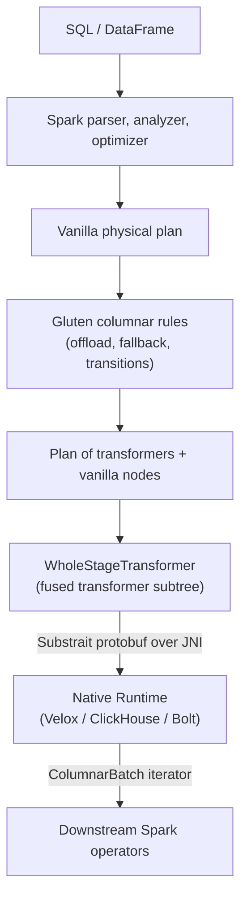

# Gluten Internals

This guide explains how Gluten works from the inside: how it hooks into Spark, how it decides which
parts of a query run natively, how the chosen parts are shipped to a native engine, and how memory
and shuffle are handled. It describes the code on `main` as of commit `1503e13b5` (2026-10-30).
Class and file names are given so you can jump straight to the source.

## 1. The mental model

Gluten is a Spark plugin. It does not replace Spark's SQL front end (parser, analyzer, Catalyst
optimizer, AQE, scheduler). It only changes the last step of planning: the **physical plan**.
Vanilla Spark operators that a native engine can run are swapped for *transformer* operators,
consecutive transformers are fused into a *whole-stage transformer*, and at execution time that
fused subtree is serialized as a **Substrait** plan and handed to a native engine (Velox,
ClickHouse, or Bolt) through JNI. Anything the engine cannot run stays as a normal Spark operator
("fallback"), and **transitions** (columnar-to-row, row-to-columnar) are inserted where the two
worlds meet.



| Term | Meaning |
|---|---|
| Component | A pluggable unit (a backend, or an add-on such as a lake-format integration) that contributes planner rules and lifecycle hooks. |
| Backend | A component that owns a native engine. Backends have no dependencies and are loaded first. |
| Offload | Replacing a vanilla `SparkPlan` node by its Gluten (transformer) counterpart. |
| Fallback | Leaving a node as the vanilla Spark operator because it failed validation or a policy forced it. |
| Convention | What a plan node emits: a *row type* and a *batch type*. Transitions convert between conventions. |
| Transformer | A `GlutenPlan` node that knows how to convert itself to Substrait. |
| Whole-stage transformer | `WholeStageTransformer`: the root of a fused transformer pipeline, executed as one native task. |
| Substrait | The cross-engine plan format used on the JVM/native boundary. |
| Runtime | The native-side object bound to one task that parses plans and creates result iterators. |

## 2. Module layout

| Module | Role |
|---|---|
| `gluten-core` | Backend-agnostic core: `GlutenPlugin`, `Component` model, rule injectors, convention/transition machinery, cost model, memory targets, shuffle manager router, config framework. |
| `gluten-substrait` | Everything Substrait-shaped: transformer operators, `*Api` backend interfaces (`SubstraitBackend`), validators, offload/rewrite rules, `ExpandFallbackPolicy`, `ColumnarShuffleManager`, UI listeners. |
| `gluten-arrow` | JVM side of the native boundary: JNI wrappers, `Runtime`/`Runtimes`, `NativePlanEvaluator`, native memory manager, columnar-batch JNI helpers. |
| `backends-velox`, `backends-clickhouse`, `backends-bolt` | One module per engine: implements the `*Api` traits, registers rules, owns engine-specific operators and config. |
| `cpp/core` | Engine-neutral native code: `Runtime`, JNI entry points (`JniWrapper.cc`), memory manager/allocation listener, shuffle writer/reader base classes. |
| `cpp/velox` | Velox implementation: `VeloxBackend`, `VeloxRuntime`, Substrait-to-Velox plan converter, `WholeStageResultIterator`, memory arbitrator, shuffle writers/readers. (`cpp-ch` is the ClickHouse equivalent.) |
| `shims` | One module per supported Spark line (`spark34`, `spark35`, `spark40`, `spark41`, `spark42`) behind `SparkShims`, selected by `SparkShimLoader`. |
| `gluten-celeborn`, `gluten-uniffle`, `gluten-delta`, `gluten-iceberg`, `gluten-hudi`, `gluten-paimon`, `gluten-kafka`, `gluten-flink`, `gluten-ui` | Optional integrations enabled by Maven profiles. |
| `ep/` | Scripts that fetch and build the native engines. The Velox build uses a pinned fork (`ep/build-velox/src/get-velox.sh`). |

Maven profiles select the Spark line (`spark-3.4` … `spark-4.2`) and the backend
(`backends-velox`, `backends-clickhouse`, `backends-bolt`). The native library must be built before
the JVM modules, because `gluten-core` changes compile without it but fail at runtime
(`AGENTS.md`).

## 3. Boot sequence

Users enable Gluten with `spark.plugins=org.apache.gluten.GlutenPlugin` (`GlutenPlugin.scala`).
`GlutenPlugin` is a Spark `SparkPlugin` with two halves.

**Driver (`GlutenDriverPlugin.init`)**

1. Appends `GlutenSessionExtensions` to `spark.sql.extensions` if missing.
2. `setPredefinedConfigs`: validates off-heap settings (off-heap must be enabled and at least 1 MB
   unless dynamic off-heap sizing or untracked-memory mode is on), then derives and stores the
   off-heap size in bytes, the per-task share (`offHeap / taskSlots`), and a conservative per-task
   share that assumes all non-borrowable storage memory (`spark.memory.storageFraction`) is used.
3. Calls `Component.sorted()` (topologically sorted component list), logs each component's
   `info()`, publishes it as `spark.gluten.component.*` configs, then calls
   `onDriverStart` on each in order. Shutdown calls `onDriverShutdown` in reverse order.

**Executor (`GlutenExecutorPlugin.init`)**

1. Raises the protobuf `CodedInputStream` recursion limit (`CodedInputStreamClassInitializer`),
   needed for deep Substrait plans.
2. Calls `onExecutorStart` on every component.
3. Registers `TaskResources` as a `TaskListener` so that per-task native resources are released
   when the Spark task ends.

For the Velox backend, `VeloxListenerApi.onDriverStart` additionally registers the driver endpoint
and SQL status listener, enforces config consistency (for example the Velox SSD cache requires the
file-handle cache, and a load quantum of at most 8 MB), sets a default executor memory overhead of
`max(0.3 × offHeap, 384 MiB)` when the user has not set one, installs the columnar table-cache
serializer when enabled, and runs the one-time native initialization and UDF signature
registration.

## 4. The component model

`Component` (`gluten-core/.../component/Component.scala`) is the single extension point. A
component supplies:

- `name()`, `info()`, and `dependencies()` (other component classes it needs);
- lifecycle hooks: `onDriverStart/Shutdown`, `onExecutorStart/Shutdown`, `registerMetrics`;
- `injectRules(injector)`: query planner rules (section 5);
- `convFuncOverride()`: a hook into convention detection (section 7);
- `costers()`: cost model contributions (section 8);
- `isRuntimeCompatible`: lets a component opt out when a class it needs is absent from the
  classpath.

Components are discovered from component files on the classpath (`Discovery.scala`) and kept in a
dependency graph. `Component.sorted()` returns a topological order; a dependency cycle throws
`UnsupportedOperationException`. `Backend` extends `Component` with `final dependencies() = Nil`,
so backends are always roots and are loaded first.

`SubstraitBackend` (in `gluten-substrait`) is the base for Substrait-speaking backends. It
implements the lifecycle once and delegates engine-specific behaviour to a bundle of APIs:
`IteratorApi`, `SparkPlanExecApi`, `TransformerApi`, `ValidatorApi`, `MetricsApi`, `ListenerApi`,
`RuleApi`, and `BackendSettingsApi`. `VeloxBackend` simply returns the Velox implementation of each.

## 5. Rule injection and the columnar pipeline

`GlutenSessionExtensions.apply` creates an `Injector` wrapping Spark's `SparkSessionExtensions`,
installs two *disablers* (the global `spark.gluten.enabled` and the thread-local
`gluten.enabledForCurrentThread` property), then calls `injectRules` on components in **reverse**
sorted order. Reverse order is deliberate: components registered later (add-ons) get their rules
injected first, so they can override a backend's rules.

The `Injector` exposes `injector.spark` (ordinary optimizer rules, planner strategies, functions)
and `injector.gluten.legacy` (Gluten's columnar rules). The columnar rules are wrapped in a single
`GlutenColumnarRule`, a Spark `ColumnarRule`, whose work is done by `HeuristicApplier`.

`HeuristicApplier` runs the following phases, each through a `ColumnarRuleExecutor`:

| Phase | Injector method | Purpose |
|---|---|---|
| pre | `injectPre` | Rewrites that must survive a whole-stage fallback. The fallback policy reverts to the *already pre-rewritten* plan, not the raw vanilla one. |
| transform | `injectPreTransform`, `injectTransform`, `injectPostTransform` | Pre-transform cleanups, the heuristic offload (`HeuristicTransform`), then post-transform optimizations and transition insertion. |
| fallback | `injectFallbackPolicy` | Policies may wrap the plan in a `FallbackNode` to demand a whole-plan fallback. |
| post | `injectPost` | Only for plans that were *not* fully fallen back. Collapses transformers into whole-stage transformers, assigns stage ids. |
| final | `injectFinal` | Always runs, fallen back or not: reporting, tag cleanup, stage resource profile adjustment. |

If the fallback phase yields a `FallbackNode`, the result is the vanilla plan and the `post` phase
is skipped; `final` still runs.

### 5.1 The Velox rule set

`VeloxRuleApi` is the canonical example (the order below is the order of registration):

- **Spark-level rules**: optimizer rewrites such as `CollectRewriteRule`, `HLLRewriteRule`,
  `RewriteCastFromArray`, `PushAggregateThroughJoinBatch`, and planner strategies such as
  `ImplementJoinAggregate`.
- **pre**: `BloomFilterMightContainJointRewriteRule`. It is registered here, not in
  pre-transform, so that a stage reverted by whole-stage fallback cannot end up producing
  Spark-format bloom-filter bytes while another stage consumes them as Velox-format.
- **pre-transform**: `RemoveTransitions`, `FallbackOnANSIMode`, `FallbackMultiCodegens`,
  `MergeTwoPhasesHashBaseAggregate`, `RewriteSubqueryBroadcast`, among others.
- **transform**: one `HeuristicTransform.WithRewrites` built from three strict offload rules
  (`OffloadOthers`, `OffloadExchange`, `OffloadJoin`) and the rewrite rules `RewriteIn`,
  `RewriteMultiChildrenCount`, `RewriteJoin`, `PullOutPreProject`, `PullOutPostProject`,
  `ProjectColumnPruning`.
- **post-transform**: batch resizing around shuffles, `PartialFallbackRules`,
  `PushDownFilterToScan`, `EliminateLocalSort`, `CollapseProjectExecTransformer`,
  `FlushableHashAggregateRule`, and finally `InsertTransitions`.
- **fallback**: `ExpandFallbackPolicy`.
- **post**: `RemoveTopmostColumnarToRow`, `ColumnarCollapseTransformStages` (builds the
  `WholeStageTransformer`s), `GenerateTransformStageId`.
- **final**: `GlutenFallbackReporter`, `RemoveFallbackTagRule`, `AdjustStageExecutionMode`, and
  table-cache related rules.

## 6. Offload: rewrite, validate, transform

`HeuristicTransform.WithRewrites` performs three stages in sequence:

1. **Rewrite** (`RewriteSparkPlanRulesManager`). `RewriteSingleNode` rules try alternative shapes
   of a node, for example pulling a non-trivial expression out of an operator into a separate
   project (`PullOutPreProject`) so the operator itself becomes offloadable. The rewrite stage may
   call the same validator early to estimate whether an alternative is better.
2. **Validate** (`AddFallbackTags`). A `Validator` pipeline is run on each node. Failures attach a
   `FallbackTag` carrying the reason.
3. **Offload** (`LegacyOffload`). `OffloadSingleNode.offload` converts each node that is still
   offloadable. The contract is that a rule touches only the current node; tree walking belongs to
   the caller. The *strict* variant of a rule replaces children with `DummyLeafExec` while the rule
   runs and restores them afterwards, which enforces that contract.

`Validators` (`gluten-substrait/.../validator/Validators.scala`) composes the checks (config
switches per operator, type support, expression support, fallback injection for tests, and a native
validation round-trip). Native validation converts the candidate node to Substrait and asks the
engine whether it can run it (`NativePlanEvaluator.doNativeValidateWithFailureReason`, backed by
`SubstraitToVeloxPlanValidator` on the Velox side).

`FallbackTag` has two forms. `Appendable` accumulates distinct reasons (joined with `; `);
`Exclusive` keeps a single reason and discards others. `FallbackTags` stores the tag on the plan
node as a `TreeNodeTag`. `GlutenFallbackReporter` turns these tags into log lines and UI events, and
`RemoveFallbackTagRule` clears them at the end.

## 7. Conventions and transitions

Every plan node has a `Convention`: a `RowType` and a `BatchType` it emits. Vanilla Spark rows,
vanilla columnar batches and the backend's native batch (for Velox, `VeloxBatchType`) are different
conventions. `ConventionFunc` computes the convention of a node and the conventions its children
must provide; a component can override this through `convFuncOverride()`. The Velox override, for
example, treats a columnar `AdaptiveSparkPlanExec` and a table scan over Gluten's cached-batch
serializer as producing `VeloxBatchType`.

`Convention.BatchType` subclasses declare how to move between types via `fromRow`, `toRow`,
`fromBatch`, `toBatch`. `VeloxBatchType` registers `RowToVeloxColumnarExec`,
`VeloxColumnarToRowExec` and `ArrowColumnarToVeloxColumnarExec`. These edges form a graph
(`TransitionGraph`, with all-pairs shortest paths from `FloydWarshallGraph`).

`InsertTransitions` first removes every existing transition (`RemoveTransitions`), then walks the
plan bottom-up, finds the cheapest transition between each child's convention and what its parent
requires, and finally enforces the requirement on the root: columnar output in the backend batch
type if the consumer wants columnar, vanilla rows otherwise. If a node declares both row and batch
type `None` it is not executable and planning fails with an explicit error.

## 8. Fallback policy and cost

Per-node fallback comes from validation. **Whole-stage / whole-query fallback** comes from
`ExpandFallbackPolicy`. It exists because many isolated native islands separated by
columnar-to-row transitions can be slower than just running vanilla Spark.

It counts transitions in the candidate plan: each `ColumnarToRow` above a Gluten node, each
`RowToColumnar` (unless `spark.gluten.sql.columnar.fallback.ignoreRowToColumnar` is set), and each
leaf that is not a Gluten operator. Inside AQE it subtracts a "stage fallback transition cost"
for neighbouring stages that are already columnar, because making the current stage vanilla would
then add transitions rather than remove them. If the net cost reaches the threshold, the policy
emits a `FallbackNode`:

| Context | Threshold config |
|---|---|
| AQE (per stage) | `spark.gluten.sql.columnar.wholeStage.fallback.threshold` |
| No AQE (whole query) | `spark.gluten.sql.columnar.query.fallback.threshold` |

A negative threshold disables the policy. Under non-AQE planning, if the plan still contains an
`AdaptiveSparkPlanExec` the policy defers to the AQE pass.

Two special cases motivate the transition accounting (from the class comment): a broadcast join
whose broadcast exchange is columnar must stay columnar, and a stage downstream of a columnar
shuffle must use the backend's own columnar-to-row, not Spark's.

Cost-based decisions elsewhere use `LongCostModel` with a chain of `LongCoster`s contributed by
components via `costers()` (Velox contributes `LegacyCoster` and `RoughCoster`).
`GlutenCostEvaluator` plugs that model into AQE's cost-based stage selection.

## 9. From transformers to a native task

### 9.1 Transformers and Substrait

A transformer (`FilterExecTransformer`, `HashAggregateExecTransformer`, `HashJoinExecTransformer`,
`FileSourceScanExecTransformer`, …) implements `doTransform(context: SubstraitContext)`, which
returns a `TransformContext` containing a Substrait `RelNode` and its output. Operators build their
rel from their children's contexts, so the tree becomes a Substrait rel tree.
`ValidatablePlan` also lets a transformer run `doNativeValidation` on its own rel.

`ColumnarCollapseTransformStages` groups a maximal connected subtree of transformers under one
`WholeStageTransformer`, which is displayed as `WholeStageCodegenTransformer (<id>)` in the plan
(`GenerateTransformStageId` assigns the id).

### 9.2 Execution

`WholeStageTransformer.doExecuteColumnar`:

1. `doWholeStageTransform()` builds the Substrait plan. This happens at execution time, after
   subqueries have been materialized.
2. It finds leaf transformers (scans). If there are any, `generateWholeStageRDD` creates an RDD
   whose partitions carry `SplitInfo` (file splits, locations); each task calls
   `IteratorApi.genFirstStageIterator`.
3. If the stage has no scan leaf (it reads only from shuffle or other columnar inputs, or a
   backend excludes scans from collapsed stages), a `WholeStageZippedPartitionsRDD` zips the input
   RDDs and each task calls `genFinalStageIterator`.

Both iterators are `Iterator[ColumnarBatch]`, backed by a native handle. They also update Spark SQL
metrics from native metrics via the backend's `MetricsApi`.

### 9.3 The JNI boundary

`NativePlanEvaluator.createKernelWithBatchIterator(plan, splitInfo, inputIterators, partitionIndex,
spillDir)` passes serialized Substrait bytes and a list of `ColumnarBatchInIterator`s (upstream
Spark RDD data, pulled by native code through JNI callbacks) to native code, which returns a
`ColumnarBatchOutIterator`. Splits can also be added after creation (`addSplits`).

On the C++ side, `JniWrapper.cc` receives the call. `Runtime` (`cpp/core/compute/Runtime.h`) is an
abstract per-task object created through a registered factory keyed by backend kind; it exposes
`parsePlan`, `parseSplitInfo`, `createResultIterator`, plus shuffle writer/reader and
columnar-to-row/row-to-columnar factories. `VeloxRuntime` implements it: it converts the Substrait
plan to a Velox plan (`VeloxPlanConverter`, `SubstraitToVeloxPlan`, `SubstraitToVeloxExpr`), and
returns a `WholeStageResultIterator`, whose `next()` drives a Velox `Task` and wraps its output as a
`VeloxColumnarBatch`. On the JVM, `Runtimes.contextInstance` ties a runtime's lifetime to the Spark
task through `TaskResources`.

Batches cross the boundary as native handles. `ColumnarBatches` (`gluten-arrow`) and
`IndicatorVector`/`PlaceholderVector` represent a native batch as a Spark `ColumnarBatch`
whose vectors are placeholders, so Spark operators can pass them along without copying.

## 10. Memory

Gluten wants native allocations to count against the executor's Spark off-heap budget, and to be
spillable under pressure.

JVM side (`gluten-core/.../memory/memtarget`): a `MemoryTarget` is something that can be asked for
memory (`borrow`) and release it (`repay`). Targets decorate each other:

- `TreeMemoryTarget` / `TreeMemoryConsumer`: a tree of named consumers under a Spark memory
  consumer root, each node with an optional `Spiller`. `Spiller.Phase` is `SHRINK` or `SPILL`.
- `ThrowOnOomMemoryTarget`: converts a failed borrow into an out-of-memory error.
- `RetryOnOomMemoryTarget`: in the shared ("legacy") mode with more than one task slot, a failed
  borrow triggers spilling across the whole tree and a retry, because Spark's per-task cap is
  dynamic.
- `OverAcquire`: optionally borrows extra up front to reduce the frequency of small requests.
- `DynamicOffHeapSizingMemoryTarget`: an experimental mode that sizes off-heap from on-heap
  (`spark.gluten.memory.dynamic.offHeap.sizing.enabled`); it forces consumers to `ON_HEAP` mode and
  zeroes Spark's off-heap settings.
- `MemoryTargets.newConsumer` assembles these based on `memoryIsolation` and task slot count.

Native side: `AllocationListener` forwards native allocation events to the JVM
`ReservationListener`, which borrows or repays through the targets above. In Velox,
`VeloxMemoryManager` registers `ListenableArbitrator`, a Velox `MemoryArbitrator` that, when a pool
needs to grow, asks the listener for more capacity and, on failure, first shrinks/reclaims
(spilling operators) before retrying. It is designed for a single root pool per manager.

Practical consequence: `spark.memory.offHeap.enabled=true` and a sufficiently large
`spark.memory.offHeap.size` are required unless dynamic sizing or untracked mode is on, and memory
overhead has to leave room for native allocations outside the tracked budget.

## 11. Shuffle

`ColumnarShuffleManager` (`gluten-substrait/.../shuffle/sort`) is a `SortShuffleManager` subclass,
on purpose: Spark only skips defensive per-row copies for instances of `SortShuffleManager`, and
the manager is process-wide, so it also serves non-offloaded row exchanges. `registerShuffle`
returns a `ColumnarShuffleHandle` when the dependency is a `ColumnarShuffleDependency` and otherwise
mirrors Spark's choice of bypass-merge, serialized or base handle. Its copied bodies must be
re-checked whenever a new Spark line is supported.

`GlutenShuffleManager` with `ShuffleManagerRouter`/`ShuffleManagerRegistry` (in `gluten-core`)
allows several shuffle managers (for example the columnar one and a remote shuffle service such as
Celeborn or Uniffle) to coexist and be selected per shuffle by a lookup. On the Velox backend,
`ColumnarShuffleWriter`/`ColumnarShuffleReader` call into native `ShuffleWriter`/`ShuffleReader`
implementations (`VeloxHashShuffleWriter`, `VeloxSortShuffleWriter`, `VeloxRssSortShuffleWriter`
for remote shuffle, and `VeloxShuffleReader`), with partitioners for hash, round-robin, single and
range partitioning, spill support (`Spill`, `LocalPartitionWriter`), and compression (`lz4` and
`zstd` are the supported codecs in `VeloxBackendSettings`).

## 12. Backends

| Backend | Module | Native side | Notes |
|---|---|---|---|
| Velox | `backends-velox` | `cpp/velox` | The reference backend. Pinned Velox fork fetched by `ep/build-velox`. |
| ClickHouse | `backends-clickhouse` | `cpp-ch` | Own operators and shuffle implementation; excludes scans from collapsed stages by default. |
| Bolt | `backends-bolt` | Bolt (ByteDance) | Selected with `-Pbackends-bolt`; docs and a migration guide are under `docs/backends/bolt`. |

All three implement the same `*Api` bundle, so the planner pipeline in sections 5 to 9 is shared.

## 13. Invariants and gotchas

- **Order of injection**: components inject in reverse topological order so add-ons override
  backends. If your rule "does nothing", check whether a later component replaced it.
- **Rules in `pre` vs `preTransform`**: only `pre` rules are baked into the plan that whole-stage
  fallback reverts to. A rewrite needed for correctness on both vanilla and native paths belongs in
  `pre` (the bloom-filter rewrite is the cautionary example).
- **`post` is skipped on whole-plan fallback**; `final` is not. Do not put logic that must always
  run in `post`.
- **Offload rules must be single-node**: they must not look at or change children. Use the strict
  wrapper and the rewrite stage instead.
- **Validation is two-layered**: a node can pass the JVM checks and still be rejected by native
  validation, and a fallback tag can appear late, so treat a node as offloadable only after all
  validators ran.
- **Plan generation is lazy**: the Substrait plan is built at execution time, after subqueries are
  materialized.
- **Build order**: build the native library before Maven; use `./build/mvn`.
- **Shim drift**: `ColumnarShuffleManager` copies Spark internals and uses positional constructor
  arguments that differ across Spark lines. Re-verify on every new Spark version.
- **Fallback visibility**: look at the Gluten SQL tab, `GlutenFallbackReporter` logs, or enable
  `spark.gluten.sql.columnar.failOnFallback` in tests to see why something did not offload.

## 14. Limitations

- Velox file scan falls back for Parquet when `mergeSchema` is true, and ORC scan has several
  nested-type and char-type restrictions (`VeloxBackendSettings.validateScanExec`).
- Only the `lz4` and `zstd` shuffle codecs are supported on the Velox backend.
- Dynamic off-heap sizing is experimental.
- `Component` is annotated `@Experimental`; its API may change.
- Spark behaviour differences (ANSI mode, some expressions) are handled by falling back, so
  functionality gaps show up as performance, not errors.

## 15. Code map

| Concern | Where to start |
|---|---|
| Plugin entry | `gluten-core/.../GlutenPlugin.scala` |
| Components | `gluten-core/.../component/Component.scala`, `Discovery.scala`; `backend/Backend.scala` |
| Rule injection | `gluten-core/.../extension/GlutenSessionExtensions.scala`, `injector/GlutenInjector.scala` |
| Columnar pipeline | `gluten-core/.../extension/columnar/heuristic/HeuristicApplier.scala`, `HeuristicTransform.scala` |
| Fallback tags | `gluten-core/.../extension/columnar/FallbackTag.scala` |
| Fallback policy | `gluten-substrait/.../columnar/heuristic/ExpandFallbackPolicy.scala` |
| Offload and validation | `gluten-substrait/.../columnar/offload/OffloadSingleNodeRules.scala`, `validator/Validators.scala` |
| Conventions | `gluten-core/.../columnar/transition/` |
| Velox rule list | `backends-velox/.../backendsapi/velox/VeloxRuleApi.scala` |
| Whole-stage execution | `gluten-substrait/.../execution/WholeStageTransformer.scala` |
| JNI evaluator | `gluten-arrow/.../vectorized/NativePlanEvaluator.java` |
| Native runtime | `cpp/core/compute/Runtime.h`, `cpp/velox/compute/VeloxRuntime.cc`, `WholeStageResultIterator.cc` |
| Plan conversion | `cpp/velox/substrait/SubstraitToVeloxPlan.cc` |
| Memory | `gluten-core/.../memory/memtarget/`, `cpp/velox/memory/VeloxMemoryManager.cc` |
| Shuffle | `gluten-substrait/.../shuffle/sort/ColumnarShuffleManager.scala`, `cpp/velox/shuffle/` |

## 16. Reference details

Key configuration entries mentioned above (all in `GlutenConfig`/`GlutenCoreConfig`):

| Key | Purpose |
|---|---|
| `spark.plugins` | Set to `org.apache.gluten.GlutenPlugin` to enable Gluten. |
| `spark.gluten.enabled` | Experimental global switch; prefer controlling via `spark.plugins`. |
| `gluten.enabledForCurrentThread` | Thread-local Spark property to disable Gluten for one thread. |
| `spark.gluten.sql.columnar.query.fallback.threshold` | Whole-query fallback threshold (no AQE). |
| `spark.gluten.sql.columnar.wholeStage.fallback.threshold` | Per-stage fallback threshold (AQE). |
| `spark.gluten.sql.columnar.fallback.ignoreRowToColumnar` | Do not count row-to-columnar in fallback cost. |
| `spark.gluten.sql.columnar.fallbackReporter` | Enable fallback reporting. |
| `spark.gluten.sql.columnar.failOnFallback` | Fail instead of falling back (debug/testing). |
| `spark.gluten.sql.ansiFallback.enabled` | Fall back when ANSI mode is on. |

Core interfaces:

```scala
trait Component {
  def name(): String
  def info(): Map[String, String]
  def dependencies(): Seq[Class[_ <: Component]]
  def onDriverStart(sc: SparkContext, pc: PluginContext): Unit
  def onExecutorStart(pc: PluginContext): Unit
  def convFuncOverride(): ConventionFunc.Override
  def costers(): Seq[LongCoster]
  def injectRules(injector: Injector): Unit
}

trait OffloadSingleNode { def offload(plan: SparkPlan): SparkPlan }

trait Validator { def validate(plan: SparkPlan): Validator.OutCome } // Passed | Failed(reason)

trait IteratorApi {
  def genFirstStageIterator(...): Iterator[ColumnarBatch]  // stage with scan leaves
  def genFinalStageIterator(...): Iterator[ColumnarBatch]  // stage fed only by input iterators
}
```

Injection points on `LegacyInjector`: `injectPre`, `injectPreTransform`, `injectTransform`,
`injectPostTransform`, `injectFallbackPolicy`, `injectPost`, `injectFinal`, `injectRuleWrapper`.
