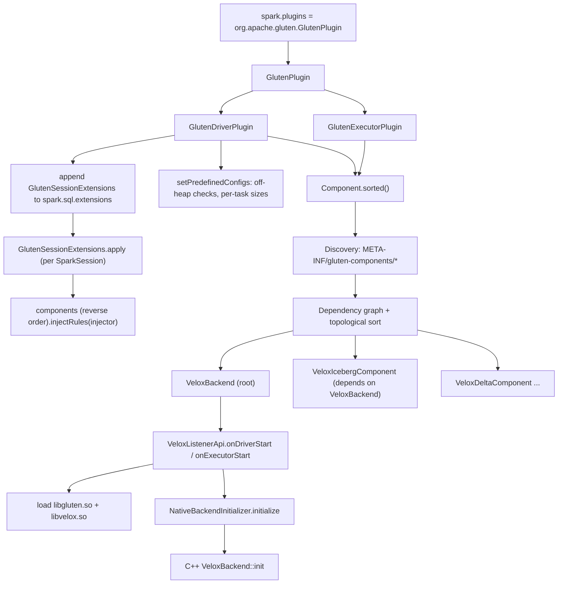
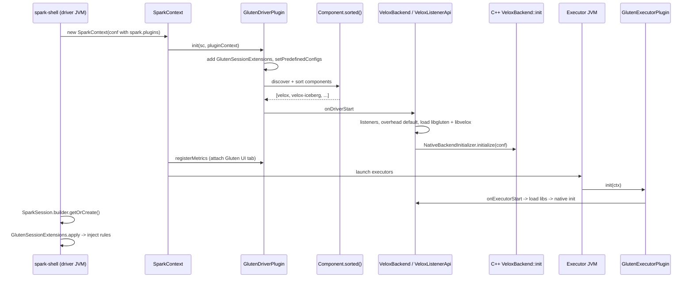

# 01 · Plugin Bootstrap, Components & Backends

> **Series:** Learning Apache Gluten (Velox backend) · **Code base:** Apache Gluten v1.7.0 · Previous: [00 · Overview](00-overview-and-query-lifecycle.md) · Next: [02 · Planning](02-planning-offload-validation-fallback.md)

---

## TL;DR

- You turn Gluten on with one setting: `spark.plugins=org.apache.gluten.GlutenPlugin`.
- At startup the plugin finds every **component** on the classpath (the Velox backend, plus optional extras such as Iceberg or Delta), orders them by dependency, and lets each one register its planner rules.
- The backend loads the native libraries **once per JVM**; each Spark task then gets its own lightweight native **runtime**, cleaned up automatically when the task ends.

**Technical summary**

- Gluten enters Spark through **one class**: `org.apache.gluten.GlutenPlugin` (a Spark `SparkPlugin`) configured with `spark.plugins`.
- The **driver plugin** appends `GlutenSessionExtensions` to `spark.sql.extensions`, validates/derives memory configs, and starts all **components**. The **executor plugin** starts components and wires per-task resource cleanup (`TaskResources`).
- Everything pluggable is a **`Component`**, discovered from `META-INF/gluten-components/<fully.qualified.ClassName>` files on the classpath and **topologically sorted** by declared dependencies.
- A **backend** (`VeloxBackend`, `CHBackend`) is a root component that implements `SubstraitBackend` and exposes **8 API facets** (`IteratorApi`, `SparkPlanExecApi`, `TransformerApi`, `ValidatorApi`, `MetricsApi`, `ListenerApi`, `RuleApi`, `BackendSettingsApi`). Common code reaches them through `BackendsApiManager`.
- Extension components (Iceberg, Delta, Hudi, Paimon) depend on the backend and contribute extra rules, injected **after** the backend's so they can override them.
- `VeloxListenerApi` loads the native libraries (`libgluten`, `libvelox`) and calls **`NativeBackendInitializer`**, which runs C++ `VeloxBackend::init` once per JVM (driver and executor).
- Per Spark task, a **`Runtime`** (native context + `NativeMemoryManager` + thread manager) is created lazily and registered in `TaskResources`, which releases it when the task finishes.
- Multiple Spark versions are supported via **shims** loaded with `ServiceLoader` (`SparkShimLoader`).

---

## 1. Why this design

| Requirement | Design choice |
|---|---|
| Must be drop-in for existing Spark deployments | Use Spark's public `SparkPlugin` + `SparkSessionExtensions` APIs; no Spark fork |
| Support more than one native engine | Backend abstraction (`SubstraitBackend` + `*Api` traits) |
| Optional integrations (Iceberg, Delta, ...) that only load if their jars exist | `Component` with `isRuntimeCompatible` + classpath discovery |
| Integrations must be able to override backend behavior | Component dependency DAG; rules injected in reverse topological order |
| Native engine needs one-time global init per JVM | `NativeBackendInitializer` guarded by an `AtomicBoolean` |
| Native state must be cleaned up even if a task fails | `TaskResources` registry tied to Spark task listeners |
| Spark 3.3–4.1 API differences | Shim layer (`shims/sparkXX`) |

---

## 2. Key concepts

| Concept | Description | Code |
|---|---|---|
| `GlutenPlugin` | `SparkPlugin` returning `GlutenDriverPlugin` and `GlutenExecutorPlugin` | [GlutenPlugin.scala](../../gluten-core/src/main/scala/org/apache/gluten/GlutenPlugin.scala) |
| `Component` | Unit of functionality with lifecycle hooks and rule injection | [Component.scala](../../gluten-core/src/main/scala/org/apache/gluten/component/Component.scala) |
| `Discovery` | Finds components via `META-INF/gluten-components` resources | [Discovery.scala](../../gluten-core/src/main/scala/org/apache/gluten/component/Discovery.scala) |
| `Backend` | A component with no dependencies (root of the DAG) | [Backend.scala](../../gluten-core/src/main/scala/org/apache/gluten/backend/Backend.scala) |
| `SubstraitBackend` | Backend that offloads via Substrait; owns the 8 API facets | [SubstraitBackend.scala](../../gluten-substrait/src/main/scala/org/apache/gluten/backendsapi/SubstraitBackend.scala) |
| `BackendsApiManager` | Static accessor for the single loaded `SubstraitBackend` | [BackendsApiManager.scala](../../gluten-substrait/src/main/scala/org/apache/gluten/backendsapi/BackendsApiManager.scala) |
| `GlutenSessionExtensions` | `SparkSessionExtensions => Unit` that asks every component to inject rules | [GlutenSessionExtensions.scala](../../gluten-core/src/main/scala/org/apache/gluten/extension/GlutenSessionExtensions.scala) |
| `Injector` | Facade with `spark` (plain Spark rules) and `gluten` (columnar rules) injectors | [Injector.scala](../../gluten-core/src/main/scala/org/apache/gluten/extension/injector/Injector.scala) |
| `NativeBackendInitializer` | One-time JNI init of the native backend | [NativeBackendInitializer.java](../../gluten-arrow/src/main/java/org/apache/gluten/init/NativeBackendInitializer.java) |
| `Runtime` / `Runtimes` | Per-task native runtime handle | [Runtime.scala](../../gluten-arrow/src/main/scala/org/apache/gluten/runtime/Runtime.scala), [Runtimes.scala](../../gluten-arrow/src/main/scala/org/apache/gluten/runtime/Runtimes.scala) |
| `TaskResources` | Per-task registry of closeable resources | [TaskResources.scala](../../gluten-core/src/main/scala/org/apache/spark/task/TaskResources.scala) |
| `SparkShimLoader` | Loads the shim matching the running Spark version | [SparkShimLoader.scala](../../shims/common/src/main/scala/org/apache/gluten/sql/shims/SparkShimLoader.scala) |

---

## 3. Architecture



---

## 4. Detailed walkthrough

### 4.1 `GlutenPlugin` — the entry point

```scala
class GlutenPlugin extends SparkPlugin {
  override def driverPlugin(): DriverPlugin = new GlutenDriverPlugin()
  override def executorPlugin(): ExecutorPlugin = new GlutenExecutorPlugin()
}
```

#### Driver: `GlutenDriverPlugin.init`

From [GlutenPlugin.scala](../../gluten-core/src/main/scala/org/apache/gluten/GlutenPlugin.scala):

1. **Register the SQL extension.** If `spark.sql.extensions` doesn't contain `org.apache.gluten.extension.GlutenSessionExtensions`, append it. This is how Gluten's planner rules reach every `SparkSession`.
2. **`setPredefinedConfigs(conf)`**
   - `checkOffHeapSettings`: requires `spark.memory.offHeap.enabled=true` and `spark.memory.offHeap.size >= 1MB`, unless `spark.gluten.memory.dynamic.offHeap.sizing.enabled` or `spark.gluten.memory.untracked` is set.
   - If dynamic off-heap sizing is on: forces Spark off-heap to `0/false` and derives Gluten's off-heap budget as `(executorMemory - 300MB) * spark.gluten.memory.dynamic.offHeap.sizing.memory.fraction` (default `0.6`).
   - Writes derived internal configs that native code and memory targets read later:

     | Derived config | Value |
     |---|---|
     | `spark.gluten.memory.offHeap.size.in.bytes` | total off-heap budget |
     | `spark.gluten.numTaskSlotsPerExecutor` | `SparkResourceUtil.getTaskSlots(conf)` (cores / task.cpus) |
     | `spark.gluten.memory.task.offHeap.size.in.bytes` | off-heap / task slots |
     | `spark.gluten.memory.conservative.task.offHeap.size.in.bytes` | off-heap × (1 − `spark.memory.storageFraction`) / slots |
3. **Start components**: `Component.sorted()` → print info → copy each component's `info()` into `spark.gluten.component.<k>` configs → `onDriverStart(sc, pluginContext)` on each, in dependency order.
4. `registerMetrics` → each component (Velox attaches the **Gluten SQL UI tab** here when `spark.gluten.ui.enabled=true`).
5. `shutdown` → `onDriverShutdown` in **reverse** order.

#### Executor: `GlutenExecutorPlugin`

```scala
override def init(ctx: PluginContext, extraConf: util.Map[String, String]): Unit = {
  CodedInputStreamClassInitializer.modifyDefaultRecursionLimitUnsafe   // deep Substrait plans
  Component.sorted().foreach(_.onExecutorStart(ctx))
}
override def onTaskStart(): Unit = taskListeners.foreach(_.onTaskStart())          // TaskResources
override def onTaskSucceeded(): Unit = taskListeners.reverse.foreach(_.onTaskSucceeded())
override def onTaskFailed(r: TaskFailedReason): Unit = taskListeners.reverse.foreach(_.onTaskFailed(r))
```

- The protobuf recursion limit is raised because a complex query can produce a deeply nested Substrait plan.
- `TaskResources` is hooked into every task start/finish so native resources (runtimes, memory managers, iterators) are released even on failure.

### 4.2 Components: discovery, DAG & ordering

#### Discovery

A component is declared by an **empty resource file whose name is the class name**:

```text
backends-velox/src/main/resources/META-INF/gluten-components/org.apache.gluten.backendsapi.velox.VeloxBackend
backends-velox/src-iceberg/main/resources/META-INF/gluten-components/org.apache.gluten.component.VeloxIcebergComponent
backends-velox/src-delta/main/resources/META-INF/gluten-components/org.apache.gluten.component.VeloxDeltaComponent
backends-velox/src-hudi/.../org.apache.gluten.component.VeloxHudiComponent
backends-velox/src-paimon/.../org.apache.gluten.component.VeloxPaimonComponent
backends-velox/src-delta33/.../org.apache.gluten.component.VeloxDelta33WriteComponent
backends-velox/src-delta40/.../org.apache.gluten.component.VeloxDelta40WriteComponent
```

`Discovery.discoverAll()` lists all `META-INF/gluten-components/*` resources, de-duplicates by class name, and instantiates each with its no-arg constructor. Which components exist therefore depends on **which Maven profiles were used to build the bundle** (e.g. `-Piceberg`).

#### Registration and ordering

`ensureAllComponentsRegistered()` ([package.scala](../../gluten-core/src/main/scala/org/apache/gluten/component/package.scala)) registers all discovered components into a graph and logs:

```text
Components registered within order: velox, velox-iceberg, velox-delta, ...
```

`Component.sorted()` returns a **topological order**: dependencies first. `Backend` overrides `dependencies()` to `Nil`, so backends are always roots.

```scala
class VeloxIcebergComponent extends Component {
  override def name(): String = "velox-iceberg"
  override def dependencies(): Seq[Class[_ <: Component]] = classOf[VeloxBackend] :: Nil
  override def isRuntimeCompatible: Boolean =
    SparkReflectionUtil.isClassPresent("org.apache.iceberg.spark.extensions.IcebergSparkSessionExtensions")
  override def injectRules(injector: Injector): Unit = {
    OffloadIcebergScan.inject(injector)
    OffloadIcebergWrite.inject(injector)
  }
}
```

#### What a component can contribute

| Hook | Called | Typical use |
|---|---|---|
| `onDriverStart / onDriverShutdown` | driver plugin | listeners, config defaults, load native libs |
| `onExecutorStart / onExecutorShutdown` | executor plugin | load native libs, init native backend |
| `registerMetrics` | driver | attach UI |
| `injectRules(injector)` | per SparkSession | optimizer rules, strategies, Gluten columnar rules |
| `convFuncOverride()` | planning | tell the transition planner the batch/row type of custom plan nodes |
| `costers()` | planning | cost functions for transition/plan cost |
| `info()` | driver | build info shown in logs and `spark.gluten.component.*` |
| `isRuntimeCompatible` | registration | skip if required third-party classes are missing |

### 4.3 Backends and the API facets

`SubstraitBackend` ([SubstraitBackend.scala](../../gluten-substrait/src/main/scala/org/apache/gluten/backendsapi/SubstraitBackend.scala)) makes its lifecycle hooks `final` and delegates to facets:

- `onDriverStart`: registers `GlutenSQLAppStatusListener`, `GlutenQueryExecutionListener`, optionally `SoftAffinityListener`; posts a build-info event; then `listenerApi().onDriverStart`.
- `injectRules`: wraps every legacy rule in `LoggedRule` (timing/logging) then calls `ruleApi().injectRules(injector)`.
- `registerMetrics`: attaches the Gluten UI tab.

The Velox implementation ([VeloxBackend.scala](../../backends-velox/src/main/scala/org/apache/gluten/backendsapi/velox/VeloxBackend.scala#L55-L74)):

| Facet | Velox class | Responsibility |
|---|---|---|
| `IteratorApi` | `VeloxIteratorApi` | Build split infos & partitions; create native iterators for a stage (`genFirstStageIterator`, `genFinalStageIterator`) |
| `SparkPlanExecApi` | `VeloxSparkPlanExecApi` | Factory for backend transformers (joins, aggregates, shuffle exchange, broadcast, C2R/R2C, expression transformers, shuffle dependency/serializer) |
| `TransformerApi` | `VeloxTransformerApi` | Misc transform helpers (partition columns, native plan string, native config post-processing) |
| `ValidatorApi` | `VeloxValidatorApi` | Schema validation & **native validation** of Substrait plans via JNI |
| `MetricsApi` | `VeloxMetricsApi` | Define `SQLMetric`s for each transformer & map native metrics back |
| `ListenerApi` | `VeloxListenerApi` | Driver/executor startup: configs, native library loading, native init |
| `RuleApi` | `VeloxRuleApi` | The ordered list of Spark and Gluten rules (see [02](02-planning-offload-validation-fallback.md)) |
| `BackendSettingsApi` | `VeloxBackendSettings` | Capability flags (e.g. `supportSortMergeJoinExec`, `supportColumnarShuffleExec`, `shuffleSupportedCodec`, scan format validation) |

Common code **never** checks "if Velox then ..."; it asks a facet via `BackendsApiManager`:

```scala
object BackendsApiManager {
  private lazy val backend: SubstraitBackend = {
    val loaded = Component.sorted().filter(_.isInstanceOf[SubstraitBackend])
    assert(loaded.size == 1, s"Zero or more than one Substrait backends are loaded: ...")
    loaded.head.asInstanceOf[SubstraitBackend]
  }
  def getSparkPlanExecApiInstance: SparkPlanExecApi = backend.sparkPlanExecApi()
  def getSettings: BackendSettingsApi = backend.settings()
  // ...
}
```

> [!IMPORTANT]
> Exactly **one** Substrait backend must be on the classpath. Don't mix the Velox and ClickHouse bundles.

### 4.4 `VeloxListenerApi` — native startup

[VeloxListenerApi.scala](../../backends-velox/src/main/scala/org/apache/gluten/backendsapi/velox/VeloxListenerApi.scala)

**`onDriverStart`** (driver only):
- Validates cache settings (`COLUMNAR_VELOX_CACHE_ENABLED` requires the file handle cache; load quantum ≤ 8MB with SSD cache).
- Generates HDFS client config into the Spark work dir.
- **Memory overhead default**: if `spark.executor.memoryOverhead` isn't set, sets it to `max(0.3 × off-heap, 384MB)`; warns if a user value is smaller. Rationale (from the log message): native engines need overhead proportional to off-heap use, not on-heap.
- If `spark.gluten.sql.columnar.tableCache` is on, sets `spark.sql.cache.serializer` to `ColumnarCachedBatchSerializer`.
- Then `initialize(conf, isDriver = true)`.

**`onExecutorStart`**: skips static init in local mode (already done by the driver in the same JVM) and calls `initialize(conf, isDriver = false)`.

**`initialize(conf, isDriver)`** — the order matters:

1. Create the **JNI workspace** dir (where native libs are extracted), or a debug dir if `DEBUG_KEEP_JNI_WORKSPACE`.
2. Resolve UDF libraries (`UDFResolver.resolveUdfConf`).
3. Register conventions: Spark row/batch, `ArrowJavaBatchType`, `ArrowNativeBatchType`, `VeloxBatchType`, `VeloxCarrierRowType` (see [05](05-columnar-batches-conventions-transitions.md)).
4. Register `ColumnarShuffleManager` in `ShuffleManagerRegistry` (used when `GlutenShuffleManager` is the configured shuffle manager).
5. `System.setProperty("arrow.struct.conflict.policy", "CONFLICT_APPEND")`.
6. Load shared libraries the backend depends on (`SharedLibraryLoaderUtils.load`), then `libgluten.so` and `libvelox.so` from the jar (or from `GLUTEN_LIB_PATH` if set).
7. **`NativeBackendInitializer.forBackend("velox").initialize(globalListener, parseConf(conf, isDriver))`** — the global off-heap listener charges native *global* allocations to `GlobalOffHeapMemory.target`.
8. Register the Velox Parquet writer injects and `VeloxRowSplitter`.

> [!NOTE]
> On the driver, `parseConf` forces `COLUMNAR_VELOX_CACHE_ENABLED=false` (issue #7837) — the driver doesn't need the data cache.

### 4.5 Native initialization (`VeloxBackend::init`)

`NativeBackendInitializer.initialize0` filters the Spark conf with `GlutenConfig.getNativeBackendConf` (only keys native cares about + defaults), lets the backend post-process them, serializes them to protobuf, and calls the native `initialize`. In C++ ([VeloxBackend.cc](../../cpp/velox/compute/VeloxBackend.cc#L123-L295)):

| Step | Detail |
|---|---|
| Logging | glog verbosity/severity from config; full verbosity in debug mode |
| Global memory manager | `VeloxMemoryManager` for process-wide allocations, wired to the global listener |
| Factories | Register `MemoryManager`, `ThreadManager`, `Runtime` factories for kind `velox` |
| Velox flags | capacity transfer across tasks, no shared leaf pools, exception stack traces, huge pages, cache prefetch |
| Filesystems | local always; HDFS/S3/GCS/ABFS when compiled in (`ENABLE_HDFS` etc.) |
| GPU | register cuDF operators/functions if `GLUTEN_ENABLE_GPU` and cuDF enabled |
| Executors | optional spill executor (`spillThreadNum`), IO executor (`kVeloxIOThreads`, default = task slots) |
| Readers/writers | Parquet reader & writer factories, ORC reader, file sinks |
| Functions | `registerAllFunctions()` (Spark SQL functions + Gluten extras), Presto vector serde (for spill) |
| UDFs | `initUdf()` loads user UDF libraries |
| Cache | `initCache()` builds the `AsyncDataCache` (memory, optionally SSD) when enabled |

This happens **once per JVM**; a second call throws `IllegalStateException("Already initialized")`. A shutdown hook releases native resources.

### 4.6 Per-SparkSession: rule injection

`GlutenSessionExtensions.apply(exts)`:

```scala
val injector = new Injector(exts)
injector.control.disableOn(session => !session.conf.get("spark.gluten.enabled", "true").toBoolean)
injector.control.disableOn(session =>
  !Option(session.sparkContext.getLocalProperty("gluten.enabledForCurrentThread")).forall(_.toBoolean))
// Components should override Backend's rules. Hence, reversed injection order is applied.
Component.sorted().reverse.foreach(_.injectRules(injector))
injector.inject()
```

- **Two kill switches**: session conf `spark.gluten.enabled` and the thread-local property `gluten.enabledForCurrentThread`. When either disables Gluten, the injected rules become no-ops for that session/thread (`InjectorControl`).
- `injector.spark` registers normal Spark extensions (optimizer rules, planner strategies, parser, functions, query-stage prep rules). They are applied immediately.
- `injector.gluten.legacy` collects **builders** for Gluten's columnar rules by phase (pre-transform, transform, post-transform, fallback policy, post, final). `injector.inject()` registers a single Spark `ColumnarRule` (`GlutenColumnarRule`) that runs them all. See [02](02-planning-offload-validation-fallback.md).

### 4.7 Per task: `Runtime` and `TaskResources`

When native code is first needed in a task (e.g. `NativePlanEvaluator.create`), Gluten calls:

```scala
Runtimes.contextInstance(backendName, name, extraConf)
// = TaskResources.addResourceIfNotRegistered(s"$backendName:$name:$extraConf", () => Runtime(...))
```

`RuntimeImpl` creates:
- a `NativeMemoryManager` (native memory pools wired to Spark's `TaskMemoryManager`, see [06](06-memory-management.md)),
- a `NativeThreadManager` (initializes native child threads with the task context),
- the native runtime via `RuntimeJniWrapper.createRuntime(backend, mmHandle, tmHandle, sessionConf)` where `sessionConf = GlutenConfig.getNativeSessionConf(...)` (session-level `spark.gluten.*`, timezone, ANSI, case sensitivity, spill buffers, …) plus `extraConf`.

`TaskResources` releases registered resources by **priority** when the task completes or fails (runtime priority is `30`). This is the main mechanism that prevents native leaks across tasks.

### 4.8 Shims

`SparkShimLoader.getSparkShims` uses `ServiceLoader` to find the `SparkShimProvider` whose `matches(SPARK_VERSION_SHORT)` is true. Providers live in `shims/spark33`, `spark34`, `spark35`, `spark40`, `spark41`. Common code calls the `SparkShims` trait for anything version-specific (e.g. `getExtendedColumnarPostRules`, `isWindowGroupLimitExec`, metadata columns).

---

## 5. End-to-end worked example: starting `spark-shell` with Gluten



What you'll see in the driver log (illustrative):

```text
INFO GlutenDriverPlugin: Gluten components:
==============================================================
Component velox
  velox_branch = ...
  velox_revision = ...
Component velox-iceberg
==============================================================
INFO component: Components registered within order: velox, velox-iceberg
INFO VeloxListenerApi: Memory overhead is not set. Setting it to 6442450944 automatically. ...
```

**Try it / verify**

```bash
spark-shell --conf spark.plugins=org.apache.gluten.GlutenPlugin \
  --conf spark.memory.offHeap.enabled=true --conf spark.memory.offHeap.size=4g \
  --conf spark.shuffle.manager=org.apache.spark.shuffle.sort.ColumnarShuffleManager \
  --jars package/target/gluten-velox-bundle-*.jar
```

- Driver log: `Components registered within order: velox, ...` (extension components such as `velox-iceberg` appear only if their jars and Spark extensions are present), followed by the `Gluten build info:` block.
- Spark UI → Environment: `spark.sql.extensions` contains `org.apache.gluten.extension.GlutenSessionExtensions`.
- If you didn't set `spark.executor.memoryOverhead`, the driver log shows `Memory overhead is not set. Setting it to ... automatically`.
- Smoke test: `spark.range(10).selectExpr("id + 1").explain()` should show `^ ProjectExecTransformer`.

---

## 6. Configuration reference

| Key | Default | Purpose |
|---|---|---|
| `spark.plugins` | — | Must include `org.apache.gluten.GlutenPlugin` |
| `spark.memory.offHeap.enabled` / `.size` | Spark defaults | Required (≥ 1MB) unless dynamic sizing/untracked |
| `spark.gluten.enabled` | `true` | Session-level switch for Gluten rules (experimental; prefer `spark.plugins`) |
| `spark.gluten.memory.dynamic.offHeap.sizing.enabled` | `false` (static) | Derive off-heap from executor memory instead of `spark.memory.offHeap.size` |
| `spark.gluten.memory.dynamic.offHeap.sizing.memory.fraction` | `0.6` (static) | Fraction used by dynamic sizing |
| `spark.gluten.memory.untracked` | `false` (static) | Don't account native memory to Spark (skips off-heap check) |
| `spark.gluten.ui.enabled` | `true` (static) | Attach the Gluten SQL UI tab |
| `spark.executor.memoryOverhead` | auto: `max(0.3 × off-heap, 384MB)` if unset | Headroom for untracked native memory |
| `spark.gluten.sql.columnar.tableCache` | see [12](12-operators-join-agg-window-sort.md) | Switches the cache serializer to the columnar one |
| `spark.gluten.soft-affinity.enabled` | see [09](09-scan-and-data-sources.md) | Registers the soft-affinity listener |

Derived/internal (written by the plugin, don't set manually): `spark.gluten.memory.offHeap.size.in.bytes`, `spark.gluten.memory.task.offHeap.size.in.bytes`, `spark.gluten.memory.conservative.task.offHeap.size.in.bytes`, `spark.gluten.numTaskSlotsPerExecutor`, `spark.gluten.memoryOverhead.size.in.bytes`, `spark.gluten.component.*`.

---

## 7. Pitfalls, debugging & FAQ

| Symptom | Likely cause | Fix |
|---|---|---|
| `GlutenException: Must set 'spark.memory.offHeap.enabled' to true ...` | Off-heap not configured | Set off-heap enabled + size, or enable dynamic sizing |
| `No component files found in container directories named with 'META-INF/gluten-components'` | Gluten jar not on driver/executor classpath | Add the bundle jar to `spark.driver/executor.extraClassPath` (or `--jars`) |
| `Zero or more than one Substrait backends are loaded` | Two backend bundles on classpath | Keep exactly one bundle |
| `UnsatisfiedLinkError` loading `libvelox.so` | Missing system libs or wrong platform | Check `ldd` on the extracted lib (keep the JNI workspace with the debug config), rebuild for your OS |
| Iceberg queries not offloaded at all | Bundle built without `-Piceberg`, or Iceberg extensions class missing (`isRuntimeCompatible` false) | Rebuild with the profile; check "Components registered" log |
| `Already initialized` | Calling `NativeBackendInitializer.initialize` twice in one JVM | Expected in custom launchers only; use the plugin |
| Gluten silently not used for one job | `spark.gluten.enabled=false` in session or thread property `gluten.enabledForCurrentThread=false` | Check session conf/local properties |

**FAQ**

- *Does the driver need native libs?* Yes — native validation runs during planning on the driver.
- *Can I disable Gluten for one query?* `spark.conf.set("spark.gluten.enabled", "false")`, or set the thread-local property `gluten.enabledForCurrentThread=false` via `sc.setLocalProperty`.
- *Where do native libraries get extracted?* Into the JNI workspace under Spark local dirs (`namespace("jni")`), random subdir per JVM.

---

## 8. Code map

| File | Role |
|---|---|
| [GlutenPlugin.scala](../../gluten-core/src/main/scala/org/apache/gluten/GlutenPlugin.scala) | Driver/executor plugins, off-heap derivation |
| [Component.scala](../../gluten-core/src/main/scala/org/apache/gluten/component/Component.scala) | Component trait, registry, dependency graph |
| [Discovery.scala](../../gluten-core/src/main/scala/org/apache/gluten/component/Discovery.scala) | Classpath discovery |
| [GlutenSessionExtensions.scala](../../gluten-core/src/main/scala/org/apache/gluten/extension/GlutenSessionExtensions.scala) | Session extension entry |
| [GlutenInjector.scala](../../gluten-core/src/main/scala/org/apache/gluten/extension/injector/GlutenInjector.scala), [SparkInjector.scala](../../gluten-core/src/main/scala/org/apache/gluten/extension/injector/SparkInjector.scala) | Rule injectors |
| [SubstraitBackend.scala](../../gluten-substrait/src/main/scala/org/apache/gluten/backendsapi/SubstraitBackend.scala) | Backend base & facets |
| [BackendsApiManager.scala](../../gluten-substrait/src/main/scala/org/apache/gluten/backendsapi/BackendsApiManager.scala) | Facet access |
| [VeloxBackend.scala](../../backends-velox/src/main/scala/org/apache/gluten/backendsapi/velox/VeloxBackend.scala) | Velox backend & settings |
| [VeloxListenerApi.scala](../../backends-velox/src/main/scala/org/apache/gluten/backendsapi/velox/VeloxListenerApi.scala) | Startup logic |
| [NativeBackendInitializer.java](../../gluten-arrow/src/main/java/org/apache/gluten/init/NativeBackendInitializer.java) | JNI init |
| [VeloxBackend.cc](../../cpp/velox/compute/VeloxBackend.cc) | Native global init |
| [Runtime.scala](../../gluten-arrow/src/main/scala/org/apache/gluten/runtime/Runtime.scala) | Per-task runtime |
| [TaskResources.scala](../../gluten-core/src/main/scala/org/apache/spark/task/TaskResources.scala) | Task-scoped cleanup |
| [VeloxIcebergComponent.scala](../../backends-velox/src-iceberg/main/scala/org/apache/gluten/component/VeloxIcebergComponent.scala) | Example extension component |

## 9. Related docs

- Next: [02 · Planning, offload, validation & fallback](02-planning-offload-validation-fallback.md)
- [04 · Native runtime & JNI](04-native-execution-runtime-jni.md) (what `Runtime` does at execution time)
- [06 · Memory management](06-memory-management.md) (memory managers created by `Runtime`)
- Repo: [docs/developers/NewToGluten.md](../../docs/developers/NewToGluten.md), [docs/get-started/GlutenUI.md](../../docs/get-started/GlutenUI.md)
