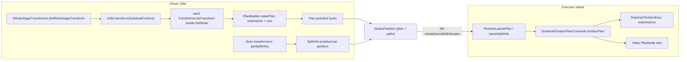

# 03 · Substrait Plan Generation & Conversion to Velox Plans

> **Series:** Learning Apache Gluten (Velox backend) · **Code base:** Apache Gluten v1.7.0 · Previous: [02 · Planning](02-planning-offload-validation-fallback.md) · Next: [04 · Native runtime](04-native-execution-runtime-jni.md)

---

## TL;DR

- **Substrait** is the plan format the JVM sends to C++: a protobuf description of "scan → filter → aggregate …".
- The driver builds one Substrait plan per native stage. On executors, C++ turns it into a **Velox plan** and runs it.
- The same converter checks plans during planning, so "Velox can't run this" is found **before** the query starts.
- When native results look wrong, dump the Substrait plan and the Velox plan. That shows exactly what Velox was asked to do.

**Technical summary**

- **Substrait** is the contract between the JVM planner and the native engine: a protobuf relational-algebra IR. Gluten vendors a **modified** copy (base v0.23.0) under `gluten-substrait/src/main/resources/substrait/proto`.
- On the driver, each `WholeStageTransformer` calls `transform(context)` on its child tree; every transformer's `doTransform` returns a `TransformContext(outputAttributes, RelNode)`, building a Rel tree bottom-up. `PlanBuilder.makePlan` wraps it into a `Plan` with function extensions and output names.
- Functions are referenced by **id** with a **typed signature name** like `gt:i32_i32`; the mapping lives in the plan's `extensions`. Columns are referenced by **ordinal** (field references), named `name#exprId`.
- Scans produce a `ReadRel` with `LocalFiles` whose per-task content (files, offsets, partition values) is shipped separately as **SplitInfo**; stage inputs (shuffle, broadcast, fallback operators) are `ReadRel`s whose `LocalFiles` path is `iterator:<idx>`.
- On the executor, `VeloxRuntime::createResultIterator` uses `SubstraitToVeloxPlanConverter` to turn each `Rel` into a Velox `PlanNode` (`FilterNode`, `ProjectNode`, `AggregationNode`, `HashJoinNode`, `TableScanNode`, ...), and `SubstraitToVeloxExpr` to turn expressions into Velox typed expressions.
- The same converter (in **validation mode**) powers native validation during planning via `SubstraitToVeloxPlanValidator`.
- Debug: `WholeStageTransformer.substraitPlanJson`, `nativePlanString()`, `spark.gluten.sql.injectNativePlanStringToExplain=true`, and dumping plans/splits/data for a task with `spark.gluten.sql.benchmark_task.*` + `spark.gluten.saveDir`.

---

## 1. Why Substrait

| Alternative | Problem |
|---|---|
| Call the native engine per operator via JNI | JNI crossing per operator/batch; no fusion; complex lifetime management |
| Serialize Spark's own physical plan | Spark-internal, unstable, JVM-specific, impossible to consume from C++ |
| Invent a private IR | Each backend would need its own; no ecosystem |
| **Substrait** | Open, protobuf-based, language-neutral; a whole stage = one message → one JNI call to build a native pipeline |

Gluten modifies Substrait where it lacks Spark features (window functions, expand, generate, write, partition columns, kafka read, TopN...). All changes are listed in [docs/developers/SubstraitModifications.md](../../docs/developers/SubstraitModifications.md).

---

## 2. Key concepts

| Concept | Description | Code |
|---|---|---|
| `SubstraitContext` | Per-stage builder state: function name→id map, operator id→rel ids map, iterator indexes, join/agg params (used by metrics) | [SubstraitContext.scala](../../gluten-substrait/src/main/scala/org/apache/gluten/substrait/SubstraitContext.scala) |
| `TransformContext` | `(outputAttributes, root: RelNode)` returned by `doTransform` | `execution/TransformContext` |
| `RelNode` / `RelBuilder` | Java wrappers that build Substrait `Rel` protos (`makeFilterRel`, `makeProjectRel`, `makeJoinRel`, `makeReadRelForInputIterator`, ...) | [RelBuilder.java](../../gluten-substrait/src/main/java/org/apache/gluten/substrait/rel/RelBuilder.java) |
| `ExpressionNode` / `ExpressionBuilder` | Wrappers for Substrait expressions (field refs, literals, scalar/aggregate/window functions, casts, if-then, ...) | `gluten-substrait/src/main/java/org/apache/gluten/substrait/expression` |
| `TypeNode` / `TypeBuilder` | Substrait types with nullability | `substrait/type` |
| `PlanNode` / `PlanBuilder` | Whole plan with extensions + root names | `substrait/plan` |
| `LocalFilesNode` / `SplitInfo` | File list for a scan task | [LocalFilesNode.java](../../gluten-substrait/src/main/java/org/apache/gluten/substrait/rel/LocalFilesNode.java) |
| `InputIteratorRelNode` | `ReadRel` whose source is an input iterator (`iterator:<idx>`) | [InputIteratorRelNode.java](../../gluten-substrait/src/main/java/org/apache/gluten/substrait/rel/InputIteratorRelNode.java) |
| `ConverterUtils` | Type conversion, function signature names, column naming | [ConverterUtils.scala](../../gluten-substrait/src/main/scala/org/apache/gluten/expression/ConverterUtils.scala) |
| `SubstraitToVeloxPlanConverter` | Native Rel → Velox `PlanNode` | [SubstraitToVeloxPlan.cc](../../cpp/velox/substrait/SubstraitToVeloxPlan.cc) |
| `SubstraitToVeloxExpr` | Native expression conversion | [SubstraitToVeloxExpr.cc](../../cpp/velox/substrait/SubstraitToVeloxExpr.cc) |
| `SubstraitParser` | Type parsing, function-name mapping | [SubstraitParser.cc](../../cpp/velox/substrait/SubstraitParser.cc) |
| `SubstraitToVeloxPlanValidator` | Validation using the converter | [SubstraitToVeloxPlanValidator.cc](../../cpp/velox/substrait/SubstraitToVeloxPlanValidator.cc) |
| `VeloxPlanConverter` | Wrapper used by the runtime (splits, input iterators, write paths) | `cpp/velox/compute/VeloxPlanConverter.cc` |

---

## 3. Architecture



---

## 4. JVM side: building the plan

### 4.1 Recursive `transform`

`TransformSupport.transform(context)` ([WholeStageTransformer.scala](../../gluten-substrait/src/main/scala/org/apache/gluten/execution/WholeStageTransformer.scala#L101-L119)):

```scala
final def transform(context: SubstraitContext): TransformContext = {
  if (TransformerState.underValidationState) doTransform(context)
  else executeQuery { doTransform(context) }   // materialize subqueries first
}
```

A unary transformer transforms its child first, then wraps the child's `RelNode`:

```scala
// FilterExecTransformerBase.doTransform (simplified)
val childCtx = child.asInstanceOf[TransformSupport].transform(context)
val operatorId = context.nextOperatorId(this.nodeName)
val currRel = getRelNode(context, remainingCondition, child.output, operatorId, childCtx.root, validation = false)
TransformContext(output, currRel)
```

`getRelNode` converts the Catalyst condition into a Substrait expression with `ExpressionConverter.replaceWithExpressionTransformer(cond, child.output).doTransform(context)` and calls `RelBuilder.makeFilterRel(input, condExpr, context, operatorId)`.

### 4.2 Column references & naming

- Inside a plan, columns are referenced by **position** in the input schema (Substrait `FieldReference` with struct field index). Converters compute the index by binding attributes to `child.output`.
- Output names use `ConverterUtils.genColumnNameWithExprId(attr)` → `l_quantity#16`. These names appear in `RelRoot.names` and in scan schemas.

### 4.3 Functions & signatures

Each function call is registered in the context and referenced by id:

```scala
val funcName = ConverterUtils.makeFuncName("gt", Seq(IntegerType, IntegerType))   // "gt:i32_i32"
val funcId = context.registerFunction(funcName)
ExpressionBuilder.makeScalarFunction(funcId, args, outputTypeNode)
```

Type signature codes (`ConverterUtils.getTypeSigName`): `bool, i8, i16, i32, i64, fp32, fp64, date, ts, ts_ntz, str, vbin, dec<p,s>, list<...>, struct<...>, map<...>`. Prefixes `:req_` / `:opt_` mark required/optional configs on some functions.

`PlanBuilder.makePlan` writes every registered function into the plan's `extensions` as `extension_function { function_anchor: id, name: "gt:i32_i32" }`.

### 4.4 Stage inputs: input iterators

`InputIteratorTransformer.doTransform` → `RelBuilder.makeReadRelForInputIterator(output, context, operatorId)` → `InputIteratorRelNode` which encodes:

```text
ReadRel {
  base_schema { names: ["k#5", "sum#20"], struct { types: [...] } }
  local_files { items { uri_file: "iterator:0" } }
}
```

At runtime, the corresponding Spark RDD's iterator (shuffle reader, broadcast relation, upstream fallback operator...) is passed to native code in the same order (`ColumnarBatchInIterator[]`).

### 4.5 Scans and splits

`FileSourceScanExecTransformer` (a `LeafTransformSupport`) builds a `ReadRel` with the read schema, filter, and file format, but **not** the files. File lists differ per task, so they're built separately:

- `getSplitInfos` → `VeloxIteratorApi.genSplitInfo(partitionIndex, partitions, partitionSchema, dataSchema, fileFormat, ...)` → `LocalFilesBuilder.makeLocalFiles(paths, starts, lengths, fileSizes, modificationTimes, partitionColumns, metadataColumns, format, preferredLocations, properties, ...)`.
- `VeloxIteratorApi.genPartitions` serializes the plan **once** (`wsCtx.root.toProtobuf.toByteArray`) and creates one `GlutenPartition(index, planBytes, splitInfos)` per task.

More in [09 · Scan](09-scan-and-data-sources.md).

### 4.6 Bookkeeping for metrics

`SubstraitContext.registerRelToOperator(operatorId)` records which Rel ids belong to which Spark operator (one Spark operator can produce several Rels, e.g. a join with pre/post projections). `JoinParams` and `AggregationParams` remember shape details. After execution, Velox operator metrics are mapped back using these maps (`metricsUpdatingFunction(child, registeredRelMap, registeredJoinParams, registeredAggregationParams)`). See [13](13-metrics-ui-config-troubleshooting.md).

---

## 5. Native side: Substrait → Velox

### 5.1 Entry

```cpp
// VeloxRuntime::createResultIterator (simplified)
VeloxPlanConverter veloxPlanConverter(leafPool, veloxCfg, inputs, connectorIds, writeTempPath, writeFileName);
veloxPlan_ = veloxPlanConverter.toVeloxPlan(substraitPlan_, std::move(localFiles_));
// separate leaf nodes into scans (with SplitInfo) and streams (iterators), then build WholeStageResultIterator
```

### 5.2 Dispatch

`SubstraitToVeloxPlanConverter::toVeloxPlan(const ::substrait::Plan&)`:
1. `constructFunctionMap(plan)` — reads extensions into `functionMap_` (anchor → signature name).
2. Converts the single `RelRoot`/`Rel` recursively by type:

| Substrait Rel | Velox node(s) |
|---|---|
| `ReadRel` (files) | `TableScanNode` with Hive (or Delta/Iceberg) connector table handle, subfield filters, assignments |
| `ReadRel` (`iterator:N`) | `TableScanNode` with the **iterator (ValueStream) connector**; splits are fed from Java iterators |
| `ReadRel` (virtual table) | `ValuesNode` |
| `FilterRel` | `FilterNode` |
| `ProjectRel` | `ProjectNode` |
| `AggregateRel` | `AggregationNode` (step from Substrait phase: partial/intermediate/final/single) |
| `JoinRel` | `HashJoinNode` / `MergeJoinNode` (by join options) |
| `CrossRel` | `NestedLoopJoinNode` |
| `SortRel` | `OrderByNode` |
| `FetchRel` | `LimitNode` |
| `TopNRel` | `TopNNode` |
| `WindowRel` | `WindowNode` |
| `WindowGroupLimitRel` | `TopNRowNumberNode` / `RowNumberNode` |
| `ExpandRel` | `ExpandNode` |
| `GenerateRel` | `UnnestNode` (explode/posexplode/inline...) |
| `SetRel` | union (`LocalPartitionNode` gather) |
| `WriteRel` | `TableWriteNode` |

Example (`FilterRel`):

```cpp
core::PlanNodePtr SubstraitToVeloxPlanConverter::toVeloxPlan(const ::substrait::FilterRel& filterRel) {
  auto childNode = convertSingleInput<::substrait::FilterRel>(filterRel);
  auto filterNode = std::make_shared<core::FilterNode>(
      nextPlanNodeId(), exprConverter_->toVeloxExpr(filterRel.condition(), childNode->outputType()), childNode);
  return filterRel.has_common() ? processEmit(filterRel.common(), std::move(filterNode)) : filterNode;
}
```

Plan node ids are sequential strings (`"0"`, `"1"`, ...); Gluten keeps the ordered list to map metrics back.

### 5.3 Input iterators → ValueStream connector

```cpp
// constructValueStreamNode (simplified)
auto nodeId = ValueStreamConnectorFactory::nodeIdOf(streamIdx);
auto tableHandle = std::make_shared<ValueStreamTableHandle>(connectorIds_.iterator, dynamicFilterEnabled);
// columns named node_<id>_<i>, assignments of ValueStreamColumnHandle
auto tableScanNode = std::make_shared<core::TableScanNode>(nodeId, outputType, tableHandle, assignments);
splitInfo->leafType = SplitInfo::LeafType::SPLIT_AWARE_STREAM;
```

So **upstream batches enter Velox as splits of a special connector**. `WholeStageResultIterator::addIteratorSplits` adds one split per Java input iterator. A config (`kValueStreamDynamicFilterEnabled`) allows Velox dynamic filters (e.g. from a hash join build) to be pushed onto the stream; it's disabled automatically when the probe side has non-deterministic expressions (see `hasNonDeterministicExprInJoinProbe`).

### 5.4 Expressions & function names

`SubstraitToVeloxExpr::toVeloxExpr` converts:
- field references → `FieldAccessTypedExpr`,
- literals → `ConstantTypedExpr`,
- scalar functions → `CallTypedExpr(name, args, type)` where `name = SubstraitParser::findVeloxFunction(functionMap_, anchor)`,
- casts, if-then, singular-or-list (IN), etc.

`findVeloxFunction` strips the signature (`gt:i32_i32` → `gt`) and maps Substrait names to Velox's Spark-SQL function names when they differ:

```cpp
{"is_not_null", "isnotnull"}, {"equal", "equalto"}, {"lt", "lessthan"}, {"gte", "greaterthanorequal"},
{"strpos", "instr"}, {"named_struct", "row_constructor"}, {"murmur3hash", "hash_with_seed"},
{"xxhash64", "xxhash64_with_seed"}, {"modulus", "remainder"}, {"negative", "unaryminus"}, ...
```

Velox resolves the final name against its function registry (Spark SQL functions registered in `registerAllFunctions()` at backend init). More in [11](11-expressions-functions-udf.md).

### 5.5 Types

`SubstraitParser::parseType` maps Substrait types to Velox types (`i32→INTEGER`, `string→VARCHAR`, `decimal(p,s)→DECIMAL`, `date→DATE`, `timestamp→TIMESTAMP`, lists/maps/structs recursively). Field names are lower-cased unless `spark.sql.caseSensitive=true`.

### 5.6 Validation mode

`SubstraitToVeloxPlanValidator` reuses the converter with `validationMode_ = true` (no split infos needed) and adds rule checks per Rel. For expressions it actually **compiles** them:

```cpp
std::vector<core::TypedExprPtr> expressions{exprConverter_->toVeloxExpr(expression, inputType)};
exec::ExprSet exprSet(std::move(expressions), execCtx_.get());   // throws on unknown function/signature
```

Any `VeloxException` is caught, its message recorded, and validation fails → the node falls back ([02](02-planning-offload-validation-fallback.md)).

---

## 6. End-to-end worked example

Query:

```sql
SELECT k, sum(v * 2) AS s
FROM parquet.`/tmp/t`
WHERE v > 10
GROUP BY k
```

### 6.1 Gluten physical plan (first stage, illustrative)

```text
WholeStageCodegenTransformer (1)
+- ^ ProjectExecTransformer [k, sum, count...]
   +- ^ FlushableHashAggregateExecTransformer(keys=[k], functions=[partial_sum(_pre_0)])
      +- ^ ProjectExecTransformer [k, (v * 2) AS _pre_0]        <- PullOutPreProject
         +- ^ FilterExecTransformer (isnotnull(v) AND (v > 10))
            +- ^ FileSourceScanExecTransformer parquet [k, v]
```

### 6.2 Substrait (abridged, illustrative JSON from `substraitPlanJson`)

```json
{
  "extensions": [
    {"extensionFunction": {"functionAnchor": 0, "name": "is_not_null:i64"}},
    {"extensionFunction": {"functionAnchor": 1, "name": "gt:i64_i64"}},
    {"extensionFunction": {"functionAnchor": 2, "name": "and:bool_bool"}},
    {"extensionFunction": {"functionAnchor": 3, "name": "multiply:i64_i64"}},
    {"extensionFunction": {"functionAnchor": 4, "name": "sum:i64"}}
  ],
  "relations": [{"root": {"input": {
    "aggregate": {
      "input": {"project": {
        "input": {"filter": {
          "input": {"read": {"baseSchema": {"names": ["k", "v"]}, "localFiles": {}}},
          "condition": {"scalarFunction": {"functionReference": 2, "...": "..."}}
        }},
        "expressions": [{"scalarFunction": {"functionReference": 3, "...": "..."}}]
      }},
      "groupings": [{"groupingExpressions": [{"selection": {"directReference": {"structField": {}}}}]}],
      "measures": [{"measure": {"functionReference": 4, "phase": "AGGREGATION_PHASE_INITIAL_TO_INTERMEDIATE"}}]
    }},
    "names": ["k#0", "sum#12"]
  }}]
}
```

Note the empty `localFiles` in the plan: the files come per task from `SplitInfo`:

```text
LocalFiles { items: [ {uri_file: "file:/tmp/t/part-00000.parquet", start: 0, length: 1048576,
                        parquet: {}, partition_columns: []} ] }
```

### 6.3 Velox plan (illustrative output of `injectNativePlanStringToExplain`)

```text
-- Project[4][expressions: (n4_0:BIGINT, "n3_0"), (n4_1:BIGINT, "n3_1")]
  -- Aggregation[3][PARTIAL [n2_0] n3_1 := sum("n2_1")]
    -- Project[2][expressions: (n2_0:BIGINT, "n0_0"), (n2_1:BIGINT, multiply("n0_1", 2))]
      -- Filter[1][expression: and(isnotnull("n0_1"), greaterthan("n0_1", 10))]
        -- TableScan[0][table: hive_table, remaining filter: ...]
```

Notice the name mapping in action: `is_not_null` → `isnotnull`, `gt` → `greaterthan`. In practice the filter is often pushed into the scan (`PushDownFilterToScan` + subfield filters), so the `Filter` node may disappear.

**Try it / verify**

- `spark.conf.set("spark.gluten.sql.injectNativePlanStringToExplain", "true")`, then `df.explain("formatted")`: each native stage prints its Velox plan. Look for the same operators (`TableScan`, `Filter`/remaining filter, `Aggregation`) as in §6.3.
- Print the Substrait JSON of each stage with the snippet in §7 and check function names such as `gt:i64_i64` in `extensions`.

---

## 7. Debugging the plan contract

| Goal | How |
|---|---|
| See the Velox plan in EXPLAIN | `spark.conf.set("spark.gluten.sql.injectNativePlanStringToExplain", "true")`; `df.explain("formatted")` |
| Get Substrait JSON for a stage | In a Scala shell: find `WholeStageTransformer` nodes in `df.queryExecution.executedPlan` and call `.substraitPlanJson` |
| Log plan generation time / plans | `spark.gluten.sql.substrait.plan.logLevel` (default `DEBUG`) controls the "generating the substrait plan took" log |
| Print Velox plan per task | `spark.gluten.sql.debug=true` → `VeloxRuntime` logs the session config and the Velox plan (`veloxPlan_->toString(true, true)`) |
| Dump a task's plan, splits & input data for offline replay | `spark.gluten.sql.benchmark_task.stageId` / `.partitionId` / `.taskId` + `spark.gluten.saveDir=/path`; replay with the C++ `GenericBenchmark` ([docs/developers/MicroBenchmarks.md](../../docs/developers/MicroBenchmarks.md)) |
| Query trace (Velox) | [docs/developers/QueryTrace.md](../../docs/developers/QueryTrace.md) |

```scala
import org.apache.gluten.execution.WholeStageTransformer
df.queryExecution.executedPlan.collect { case w: WholeStageTransformer => w }
  .foreach(w => println(s"== stage ${w.stageId}\n${w.substraitPlanJson}"))
```

> [!NOTE]
> With AQE, call this after the query ran (or on `df.queryExecution.executedPlan` after an action), since the final plan with transformers only exists after adaptive planning.

---

## 8. Configuration reference

| Key | Default | Effect |
|---|---|---|
| `spark.gluten.sql.injectNativePlanStringToExplain` | `false` | Append Velox plan to EXPLAIN per stage |
| `spark.gluten.sql.substrait.plan.logLevel` | `DEBUG` | Log level for Substrait plan generation messages |
| `spark.gluten.sql.debug` | `false` | Native debug mode (logs config and Velox plans, verbose glog) |
| `spark.gluten.sql.cacheWholeStageTransformerContext` | `false` | Cache generated Substrait context per stage |
| `spark.gluten.sql.enable.native.validation` | `true` (internal) | Use native validator during planning |
| `spark.gluten.sql.benchmark_task.stageId` / `.partitionId` / `.taskId` | `-1` / `""` / `""` (internal) | Select task(s) to dump |
| `spark.gluten.saveDir` | `""` (internal) | Where dumps are written (required when dumping) |
| `spark.sql.caseSensitive` | `false` | Native lowercases field names when false |

---

## 9. Pitfalls & FAQ

- **"Plan must have readRel and related split info"** — a scan in the plan with no split info supplied. Usually a planning bug (e.g. a leaf transformer not collected by `findAllLeafTransformers`).
- **Name mismatch problems with case-sensitive schemas** — check `spark.sql.caseSensitive`; native lower-cases names otherwise.
- **Deep plans hitting protobuf recursion limits** — Gluten raises the limit at executor init (`CodedInputStreamClassInitializer`).
- **Function exists in Velox but validation fails** — usually a **signature** mismatch (argument types after Spark coercion, e.g. decimal precision) rather than a missing function. Enable `printStackOnFailure` and read the native message.
- **Why are there extra projects?** Native operators only evaluate expressions in projects; `PullOutPreProject/PostProject` creates them, and `CollapseProjectExecTransformer` merges adjacent ones.

---

## 10. Code map

| File | Role |
|---|---|
| [algebra.proto](../../gluten-substrait/src/main/resources/substrait/proto/substrait/algebra.proto) | Modified Substrait relations/expressions |
| [SubstraitContext.scala](../../gluten-substrait/src/main/scala/org/apache/gluten/substrait/SubstraitContext.scala) | Builder state |
| [RelBuilder.java](../../gluten-substrait/src/main/java/org/apache/gluten/substrait/rel/RelBuilder.java) | Rel construction |
| [InputIteratorRelNode.java](../../gluten-substrait/src/main/java/org/apache/gluten/substrait/rel/InputIteratorRelNode.java) | Iterator inputs |
| [LocalFilesNode.java](../../gluten-substrait/src/main/java/org/apache/gluten/substrait/rel/LocalFilesNode.java) | Split description |
| [ConverterUtils.scala](../../gluten-substrait/src/main/scala/org/apache/gluten/expression/ConverterUtils.scala) | Types, names, signatures |
| [WholeStageTransformer.scala](../../gluten-substrait/src/main/scala/org/apache/gluten/execution/WholeStageTransformer.scala) | Plan generation entry, debug helpers |
| [VeloxIteratorApi.scala](../../backends-velox/src/main/scala/org/apache/gluten/backendsapi/velox/VeloxIteratorApi.scala) | SplitInfo & partitions |
| [VeloxRuntime.cc](../../cpp/velox/compute/VeloxRuntime.cc) | Plan parsing, conversion entry |
| [SubstraitToVeloxPlan.cc](../../cpp/velox/substrait/SubstraitToVeloxPlan.cc) | Rel conversion |
| [SubstraitToVeloxExpr.cc](../../cpp/velox/substrait/SubstraitToVeloxExpr.cc) | Expression conversion |
| [SubstraitParser.cc](../../cpp/velox/substrait/SubstraitParser.cc) | Types & function mapping |
| [SubstraitToVeloxPlanValidator.cc](../../cpp/velox/substrait/SubstraitToVeloxPlanValidator.cc) | Validation |

## 11. Related docs

- [02 · Planning](02-planning-offload-validation-fallback.md) · [04 · Native runtime](04-native-execution-runtime-jni.md) · [09 · Scan](09-scan-and-data-sources.md) · [11 · Expressions](11-expressions-functions-udf.md)
- Repo: [SubstraitModifications.md](../../docs/developers/SubstraitModifications.md), [MicroBenchmarks.md](../../docs/developers/MicroBenchmarks.md), [QueryTrace.md](../../docs/developers/QueryTrace.md)
