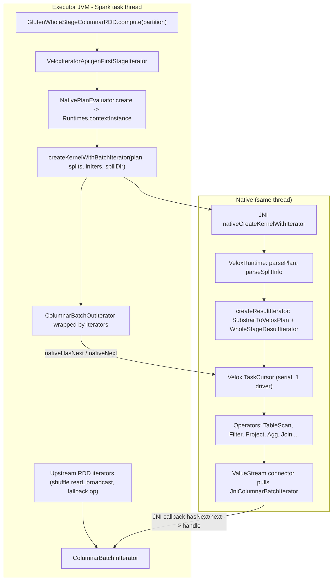
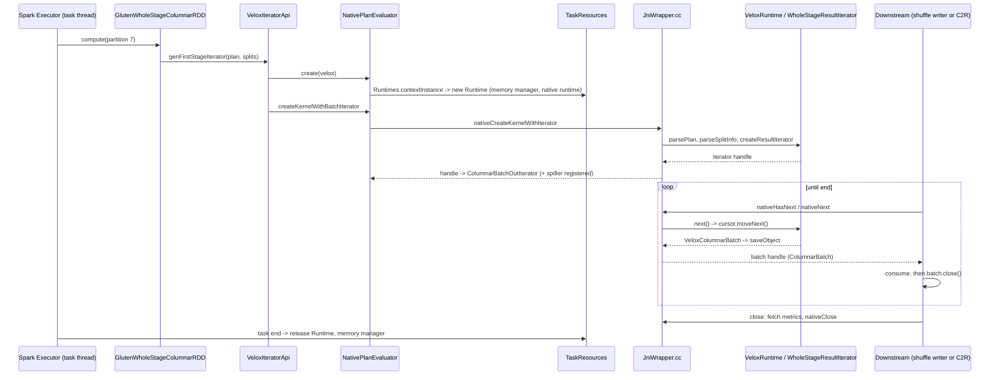

# 04 · Native Execution Runtime & JNI

> **Series:** Learning Apache Gluten (Velox backend) · **Code base:** Apache Gluten v1.7.0 · Previous: [03 · Substrait](03-substrait-and-native-plan-conversion.md) · Next: [05 · Batches & transitions](05-columnar-batches-conventions-transitions.md)

---

## TL;DR

- A native stage runs **inside an ordinary Spark task**, on the task's own thread. Spark still gives you the parallelism (one task per core).
- The JVM hands the plan to C++ over **JNI** and then just pulls batches. Data stays in C++; the JVM only holds numeric handles to it.
- C++ errors come back as Java exceptions, and every native resource is freed automatically when the task ends.

**Technical summary**

- A native stage executes inside a **normal Spark task**. Spark calls `RDD.compute`; Gluten's RDD (`GlutenWholeStageColumnarRDD` or `WholeStageZippedPartitionsRDD`) asks `VeloxIteratorApi` to build a **native iterator**.
- `NativePlanEvaluator` gets the task's **`Runtime`** and calls JNI `nativeCreateKernelWithIterator(plan, splits, inputIterators, ...)`. C++ parses the Substrait plan, converts it to a Velox plan, and creates a **`WholeStageResultIterator`** wrapping a **Velox `TaskCursor`**.
- Velox runs **serially on the Spark task thread** (`serialExecution = true`, `maxDrivers = 1`): each `next()` pulls one `RowVector` through the pipeline. Spark tasks provide the parallelism.
- Batches cross JNI as **opaque `long` handles** into a per-runtime **`ObjectStore`**; data is never copied into the JVM. Upstream JVM iterators are pulled from C++ by calling back into Java (`ColumnarBatchInIterator.next()` returns a handle).
- Every JNI entry point is wrapped in `JNI_METHOD_START/END`, converting C++ exceptions into Java `GlutenException`.
- Task-scoped native resources (runtime, memory manager, iterators) are owned by **`TaskResources`** and released on task completion/failure. Metrics are fetched once when the iterator finishes and mapped to SQL metrics.

---

## 1. Why this design

| Question | Answer |
|---|---|
| Why not run Velox with its own thread pool? | Spark already schedules tasks across cores; running Velox serially per task avoids oversubscription and keeps Spark's task-level memory accounting, cancellation and fault tolerance semantics. |
| Why handles instead of copying batches? | Copying columnar data JVM↔native per batch would erase most of the speedup. Handles keep data native; the JVM only orchestrates. |
| Why a pull model with callbacks into Java? | Fits Spark's iterator model and lets native pipelines consume any Spark RDD (shuffle readers, broadcast, fallback operators) without materializing it. |
| Why `TaskResources`? | JVM GC can't free native memory; resources must be closed deterministically, including on failures and cancellations. |

---

## 2. Key concepts

| Concept | Side | Description | Code |
|---|---|---|---|
| `GlutenWholeStageColumnarRDD` | JVM | RDD for stages **with** leaf scans (partitions carry plan + splits) | [GlutenWholeStageColumnarRDD.scala](../../gluten-substrait/src/main/scala/org/apache/gluten/execution/GlutenWholeStageColumnarRDD.scala) |
| `WholeStageZippedPartitionsRDD` | JVM | RDD for stages **without** leaf scans; zips input RDD partitions | [WholeStageZippedPartitionsRDD.scala](../../gluten-substrait/src/main/scala/org/apache/gluten/execution/WholeStageZippedPartitionsRDD.scala) |
| `VeloxIteratorApi` | JVM | `genFirstStageIterator` / `genFinalStageIterator` | [VeloxIteratorApi.scala](../../backends-velox/src/main/scala/org/apache/gluten/backendsapi/velox/VeloxIteratorApi.scala) |
| `NativePlanEvaluator` | JVM | Creates native kernels; registers the plan **spiller** | [NativePlanEvaluator.java](../../gluten-arrow/src/main/java/org/apache/gluten/vectorized/NativePlanEvaluator.java) |
| `ColumnarBatchOutIterator` | JVM | Java iterator over native output (`nativeHasNext`, `nativeNext`, `nativeSpill`, `nativeClose`) | [ColumnarBatchOutIterator.java](../../gluten-arrow/src/main/java/org/apache/gluten/vectorized/ColumnarBatchOutIterator.java) |
| `ColumnarBatchInIterator` | JVM | Adapter that native code calls to pull upstream batches | [ColumnarBatchInIterator.java](../../gluten-arrow/src/main/java/org/apache/gluten/vectorized/ColumnarBatchInIterator.java) |
| `Runtime` / `VeloxRuntime` | both | Per-task native context: plan, splits, memory manager, Velox config, object store | [Runtime.scala](../../gluten-arrow/src/main/scala/org/apache/gluten/runtime/Runtime.scala), [VeloxRuntime.cc](../../cpp/velox/compute/VeloxRuntime.cc) |
| `ResultIterator` | C++ | Generic iterator wrapper used by JNI | `cpp/core/compute/ResultIterator.h` |
| `WholeStageResultIterator` | C++ | Owns the Velox `TaskCursor`, adds splits, collects metrics, spills | [WholeStageResultIterator.cc](../../cpp/velox/compute/WholeStageResultIterator.cc) |
| `JniColumnarBatchIterator` | C++ | Calls back into `ColumnarBatchInIterator` | [JniCommon.h](../../cpp/core/jni/JniCommon.h), [JniCommon.cc](../../cpp/core/jni/JniCommon.cc) |
| `ObjectStore` | C++ | Handle → `shared_ptr` registry per runtime | [ObjectStore.h](../../cpp/core/utils/ObjectStore.h) |
| `JniWrapper.cc` | C++ | Most JNI entry points | [JniWrapper.cc](../../cpp/core/jni/JniWrapper.cc) |
| `TaskResources` | JVM | Task-scoped resource registry | [TaskResources.scala](../../gluten-core/src/main/scala/org/apache/spark/task/TaskResources.scala) |
| `Iterators` | JVM | Wrapper builder: cleanup, timing, interruption, invocation protection | [Iterators.scala](../../gluten-core/src/main/scala/org/apache/gluten/iterator/Iterators.scala) |

---

## 3. Architecture



---

## 4. Detailed walkthrough

### 4.1 From `executeColumnar` to an RDD

`WholeStageTransformer.doExecuteColumnar` (driver):
1. Generates the Substrait plan (`doWholeStageTransform`), logging the time.
2. Collects `columnarInputRDDs` from non-leaf inputs (anything below `InputIteratorTransformer`).
3. If the stage has leaf scans → `GlutenWholeStageColumnarRDD(partitions with plan + splits, inputRDDs, ...)`; else → `WholeStageZippedPartitionsRDD(inputRDDs, plan, ...)`.
4. Passes `metricsUpdatingFunction(...)` built from the Substrait context maps, so native metrics can be attributed to operators later.

`GlutenWholeStageColumnarRDD.compute(split, context)`:

```scala
val (inputPartition, inputColumnarRDDPartitions) = castNativePartition(split)
val inputIterators = rdds.getIterators(inputColumnarRDDPartitions, context)   // upstream iterators
BackendsApiManager.getIteratorApiInstance.genFirstStageIterator(
  inputPartition, context, pipelineTime, updateInputMetrics, updateNativeMetrics, split.index, inputIterators, enableCudf)
```

Preferred locations come from split infos (enables locality / soft affinity).

### 4.2 Creating the native kernel

`VeloxIteratorApi.genFirstStageIterator` ([source](../../backends-velox/src/main/scala/org/apache/gluten/backendsapi/velox/VeloxIteratorApi.scala#L185-L240)):

```scala
val columnarNativeIterators = inputIterators.map(iter => new ColumnarBatchInIterator(backendName, iter.asJava))
val transKernel = NativePlanEvaluator.create(backendName, extraConf)      // gets/creates the task Runtime
val splitInfoByteArray = inputPartition.splitInfos.map(_.toProtobuf.toByteArray)
val spillDirPath = SparkDirectoryUtil.get().namespace("gluten-spill").mkChildDirRoundRobin(UUID...).getAbsolutePath
val resIter = transKernel.createKernelWithBatchIterator(plan, splitInfoByteArray, columnarNativeIterators, partitionIndex, spillDirPath)
resIter.noMoreSplits()
Iterators.wrap(resIter.asScala)
  .protectInvocationFlow()                                  // safe repeated hasNext after close
  .recycleIterator { updateNativeMetrics(itrMetrics.fetch(resIter)); updateInputMetrics(...); resIter.close() }
  .recyclePayload(batch => batch.close())                  // close each batch after consumer is done
  .collectLifeMillis(millis => pipelineTime += millis)
  .asInterruptible(context)                                 // honor task kill
  .create()
```

`NativePlanEvaluator.createKernelWithBatchIterator` calls `PlanEvaluatorJniWrapper.nativeCreateKernelWithIterator(plan, splits, iters, stageId, partitionIndex, taskAttemptId, dumpingEnabled, spillDir)` and registers a **spiller** on the runtime's memory manager that calls `out.spill(size)` in the SPILL phase ([07 · Spill](07-spill.md)).

### 4.3 JNI: `nativeCreateKernelWithIterator`

From [JniWrapper.cc](../../cpp/core/jni/JniWrapper.cc#L515-L569):

```cpp
auto ctx = getRuntime(env, wrapper);                     // VeloxRuntime for this task
ctx->setSparkTaskInfo({stageId, partitionId, taskId});
if (enableDumping) ctx->enableDumping();
ctx->parsePlan(planBytes, planSize);
for (i in splitInfos) ctx->parseSplitInfo(splitBytes, size, i);
for (idx in batchItrArray)                                // wrap each Java ColumnarBatchInIterator
  inputIters.push_back(std::make_shared<ResultIterator>(std::make_unique<JniColumnarBatchIterator>(env, iter, ctx, idx)));
return ctx->saveObject(ctx->createResultIterator(spillDir, inputIters));   // handle
```

`VeloxRuntime::createResultIterator` ([source](../../cpp/velox/compute/VeloxRuntime.cc#L428-L473)) converts Substrait → Velox plan, separates scan leaves (with `SplitInfo`) from stream leaves (input iterators), constructs `WholeStageResultIterator`, and adds remaining input iterators as **iterator splits**.

### 4.4 `WholeStageResultIterator`: running Velox

Constructor ([source](../../cpp/velox/compute/WholeStageResultIterator.cc#L111-L200)):

```cpp
facebook::velox::exec::CursorParameters params;
params.planNode = planNode;
params.maxDrivers = 1;
params.queryCtx = createNewVeloxQueryCtx();      // QueryConfig from session conf, connector configs,
                                                 // AsyncDataCache, task aggregate memory pool, spill executor
params.executionStrategy = velox::core::ExecutionStrategy::kUngrouped;
params.spillDirectory = spillDir;
params.serialExecution = true;                   // run on the caller thread
params.copyResult = false;                       // hand out vectors without copying
params.outputPool = memoryManager_->getLeafMemoryPool();
cursor_ = velox::exec::TaskCursor::create(params);
task_ = cursor_->task().get();
// then build ConnectorSplits for every scan from SplitInfo (Hive/Iceberg/Delta splits, partition keys, metadata cols)
```

- The Velox `QueryCtx` is named `Gluten_Stage_<stage>_TID_<task>_VTID_<n>` — useful when reading Velox logs.
- `noMoreSplits()` adds all file splits to the scan nodes and calls `task_->noMoreSplits(...)` for scans and streams.

`next()`:

```cpp
std::shared_ptr<ColumnarBatch> WholeStageResultIterator::next() {
  while (true) {
    if (!cursor_->moveNext()) return nullptr;            // end of stream
    RowVectorPtr vector = cursor_->current();
    if (vector->size() == 0) continue;                   // skip empty batches
    for (auto& child : vector->children()) child->loadedVector();   // materialize lazy vectors (timed)
    return std::make_shared<VeloxColumnarBatch>(vector);
  }
}
```

Each `moveNext()` drives the single driver until the pipeline produces an output vector (or finishes). Operators like hash join build or aggregation accumulate internally before emitting.

### 4.5 Pulling upstream batches

When a ValueStream (iterator) table scan needs input, Velox asks the iterator split's source, which ends in `JniColumnarBatchIterator::nextInternal`:

```cpp
attachCurrentThreadAsDaemonOrThrow(vm_, &env);
if (!env->CallBooleanMethod(jColumnarBatchItr_, hasNext)) return nullptr;   // calls ColumnarBatchInIterator.hasNext()
jlong handle = env->CallLongMethod(jColumnarBatchItr_, next);               // returns native handle of the batch
return ObjectStore::retrieve<ColumnarBatch>(handle);
```

On the Java side, `ColumnarBatchInIterator.next()` checks the batch is **offloaded** (native-backed) and returns its handle. If the upstream produced an Arrow/Java batch, it must be offloaded first (see [05](05-columnar-batches-conventions-transitions.md)).

### 4.6 Returning output batches

`ColumnarBatchOutIterator.next0()` → JNI `nativeNext`:

```cpp
auto iter = ObjectStore::retrieve<ResultIterator>(iterHandle);
if (!iter->hasNext()) return kInvalidObjectHandle;      // -1 => Java returns null
auto batch = iter->next();
return ctx->saveObject(batch);                           // new handle
```

Java wraps the handle with `ColumnarBatches.create(handle)` into a Spark `ColumnarBatch` whose columns are placeholder vectors pointing to native memory. Downstream Gluten operators pass the handle on; a `VeloxColumnarToRow` converts it to rows when needed.

### 4.7 Handles and lifetime (`ObjectStore`)

- Each runtime owns an `ObjectStore`. `save(shared_ptr<T>)` returns a 64-bit handle encoding store id + resource id; `retrieve<T>(handle)` looks it up; `release(handle)` drops the reference.
- Java `ColumnarBatch.close()` → releases the batch handle (`recyclePayload` in the iterator wrapper ensures this happens).
- `ColumnarBatchOutIterator.close()` → `nativeClose` → releases the result iterator (and with it the Velox task).
- When the task ends, `TaskResources` releases the `Runtime` (priority `30`) and memory managers; the object store reports leaked objects if any remain.

### 4.8 Errors

```cpp
#define JNI_METHOD_START try {
#define JNI_METHOD_END(fallback_expr) \
  } catch (std::exception& e) { env->ThrowNew(gluten::getJniErrorState()->glutenExceptionClass(), e.what()); return fallback_expr; }
```

So a `VeloxUserError`/`VeloxRuntimeError` surfaces in Spark as `org.apache.gluten.exception.GlutenException: <velox message>` in the task failure. Velox stack traces in messages are controlled by `kEnableUserExceptionStacktrace` / `kEnableSystemExceptionStacktrace` backend configs.

Java exceptions thrown while native code calls back into Java (e.g. a shuffle fetch failure inside `ColumnarBatchInIterator.next()`) are checked with `checkException(env)` and rethrown as C++ exceptions, then converted back at the outer JNI boundary — preserving Spark semantics like `FetchFailedException` handling as far as possible.

### 4.9 Threads

- **Task thread**: all Velox driver work (`serialExecution`).
- **IO executor** (`ioExecutor_`, size `kVeloxIOThreads`, default = task slots): split preloading / async reads for table scans.
- **Spill executor** (`spillExecutor_`, `spillThreadNum`, default `0` = no dedicated threads).
- **Native threads calling Java** must be attached to the JVM (`attachCurrentThreadAsDaemonOrThrow`); `NativeThreadManager` + `TaskChildThreadInitializer` propagate the Spark `TaskContext` to child threads so memory accounting and task-local state work.

### 4.10 Metrics

On iterator completion (`recycleIterator`), `IteratorMetricsJniWrapper.fetch(resIter)` calls `nativeFetchMetrics`, which returns per-Velox-operator arrays (input/output rows & bytes, CPU and wall time, peak memory, spill bytes/rows/files, dynamic filter stats, scan IO stats, write stats, lazy-load time, ...). The `metricsUpdatingFunction` maps them onto each transformer's `SQLMetric`s using the operator→rel id maps. Details: [13](13-metrics-ui-config-troubleshooting.md).

---

## 5. End-to-end worked example: one task of a scan + aggregate stage



What you can observe:
- Spark UI → SQL tab: per-operator native metrics on the transformer nodes (e.g. `time of scan`, `peak memory bytes`, `number of output rows`).
- With `spark.gluten.sql.debug=true`: executor logs print the Velox plan per task (illustrative):

```text
############### Velox plan for task Stage 3 TID 57 ... ###############
-- Aggregation[3][PARTIAL ...] -> ...
```

**Try it / verify**

- Set `spark.gluten.sql.debug=true` and run a scan + aggregate. Each task's executor log prints its Velox plan (the `Velox plan for task ...` block above).
- In the SQL UI, the transformer nodes show native metrics such as `time of scan` and `peak memory bytes`.
- Take a thread dump (Executors tab) while the query runs. The task thread's stack shows a native frame under `ColumnarBatchOutIterator.nativeHasNext`/`nativeNext`: Velox runs on the Spark task thread.

---

## 6. Configuration reference

| Key | Default | Effect |
|---|---|---|
| `spark.gluten.sql.debug` | `false` | Native debug mode: log session config, Velox plans; verbose glog |
| `spark.gluten.sql.columnar.maxBatchSize` | `4096` | Target rows per batch for native operators |
| `spark.gluten.sql.columnar.backend.velox.IOThreads` | task slots | Native IO thread pool size |
| `spark.gluten.sql.columnar.backend.velox.spillThreadNum` | `0` | Dedicated spill threads |
| `spark.gluten.sql.columnar.backend.velox.glogVerboseLevel` | see `VeloxConfig.h` | glog `-v` level (when not in debug mode) |
| `spark.gluten.sql.benchmark_task.*`, `spark.gluten.saveDir` | off | Dump plan/splits/input of selected tasks (see [03](03-substrait-and-native-plan-conversion.md)) |
| `spark.gluten.sql.columnar.backend.velox.enableUserExceptionStacktrace` / `enableSystemExceptionStacktrace` | `true` / `true` | Include stack traces in Velox exceptions |

> [!TIP]
> Velox-related keys are prefixed `spark.gluten.sql.columnar.backend.velox.` (see [docs/velox-configuration.md](../../docs/velox-configuration.md) and `cpp/velox/config/VeloxConfig.h`). Verify exact names there before use.

---

## 7. Pitfalls, debugging & FAQ

| Symptom | Meaning / action |
|---|---|
| `When hasNext() is called on a closed iterator, an exception is thrown...` | Iterator used after close; ensure `protectInvocationFlow()` wrapping (Gluten code) |
| `Task doesn't support single threaded execution: <plan>` | A Velox plan node doesn't support serial mode; report with the plan string |
| `GlutenException: ... VeloxUserError ...` | Native runtime error; read the Velox message (often a semantic/unsupported case) |
| Executor crash (SIGSEGV) | Native bug; collect `hs_err_pid*.log` + core dump; reproduce with dumped task (`benchmark_task`) in `GenericBenchmark` |
| Leaked objects warning at task end | Some batch/iterator wasn't closed; check custom operators |
| Tasks hang on cancellation | Native loops not interruptible between batches; `asInterruptible(context)` checks between `next()` calls |

Breakpoints/logs:
- JVM: `GlutenWholeStageColumnarRDD.compute`, `VeloxIteratorApi.genFirstStageIterator`, `ColumnarBatchOutIterator.next0`.
- C++: `Java_org_apache_gluten_vectorized_PlanEvaluatorJniWrapper_nativeCreateKernelWithIterator`, `VeloxRuntime::createResultIterator`, `WholeStageResultIterator::next`.
- Attaching gdb to an executor: see [docs/developers/NewToGluten.md](../../docs/developers/NewToGluten.md).

---

## 8. Code map

| File | Role |
|---|---|
| [WholeStageTransformer.scala](../../gluten-substrait/src/main/scala/org/apache/gluten/execution/WholeStageTransformer.scala) | `doExecuteColumnar` → RDD |
| [GlutenWholeStageColumnarRDD.scala](../../gluten-substrait/src/main/scala/org/apache/gluten/execution/GlutenWholeStageColumnarRDD.scala) | First-stage RDD |
| [VeloxIteratorApi.scala](../../backends-velox/src/main/scala/org/apache/gluten/backendsapi/velox/VeloxIteratorApi.scala) | Iterator creation |
| [NativePlanEvaluator.java](../../gluten-arrow/src/main/java/org/apache/gluten/vectorized/NativePlanEvaluator.java) | Kernel creation + spiller |
| [ColumnarBatchOutIterator.java](../../gluten-arrow/src/main/java/org/apache/gluten/vectorized/ColumnarBatchOutIterator.java) | Output iterator |
| [ColumnarBatchInIterator.java](../../gluten-arrow/src/main/java/org/apache/gluten/vectorized/ColumnarBatchInIterator.java) | Input adapter |
| [Iterators.scala](../../gluten-core/src/main/scala/org/apache/gluten/iterator/Iterators.scala) | Iterator wrappers |
| [JniWrapper.cc](../../cpp/core/jni/JniWrapper.cc) | JNI entry points |
| [JniError.h](../../cpp/core/jni/JniError.h) | Exception bridging |
| [JniCommon.cc](../../cpp/core/jni/JniCommon.cc) | `JniColumnarBatchIterator` |
| [ObjectStore.h](../../cpp/core/utils/ObjectStore.h) | Handles |
| [VeloxRuntime.cc](../../cpp/velox/compute/VeloxRuntime.cc) | Runtime |
| [WholeStageResultIterator.cc](../../cpp/velox/compute/WholeStageResultIterator.cc) | Velox task driving |

## 9. Related docs

- [03 · Substrait](03-substrait-and-native-plan-conversion.md) — what gets parsed
- [05 · Batches & transitions](05-columnar-batches-conventions-transitions.md) — what flows through handles
- [06 · Memory](06-memory-management.md), [07 · Spill](07-spill.md) — memory managers & spillers created per runtime
- [13 · Metrics & troubleshooting](13-metrics-ui-config-troubleshooting.md)
