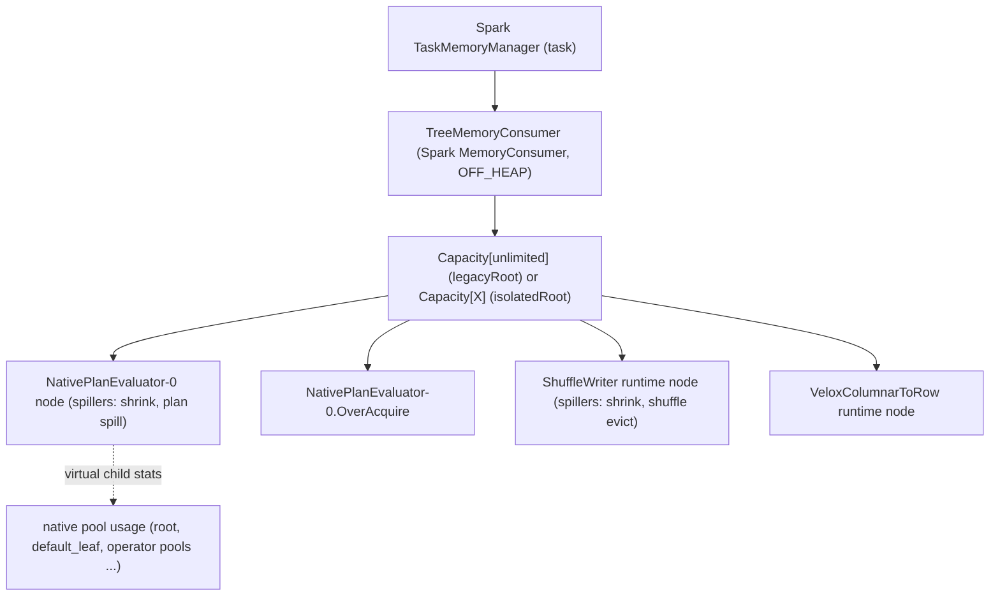
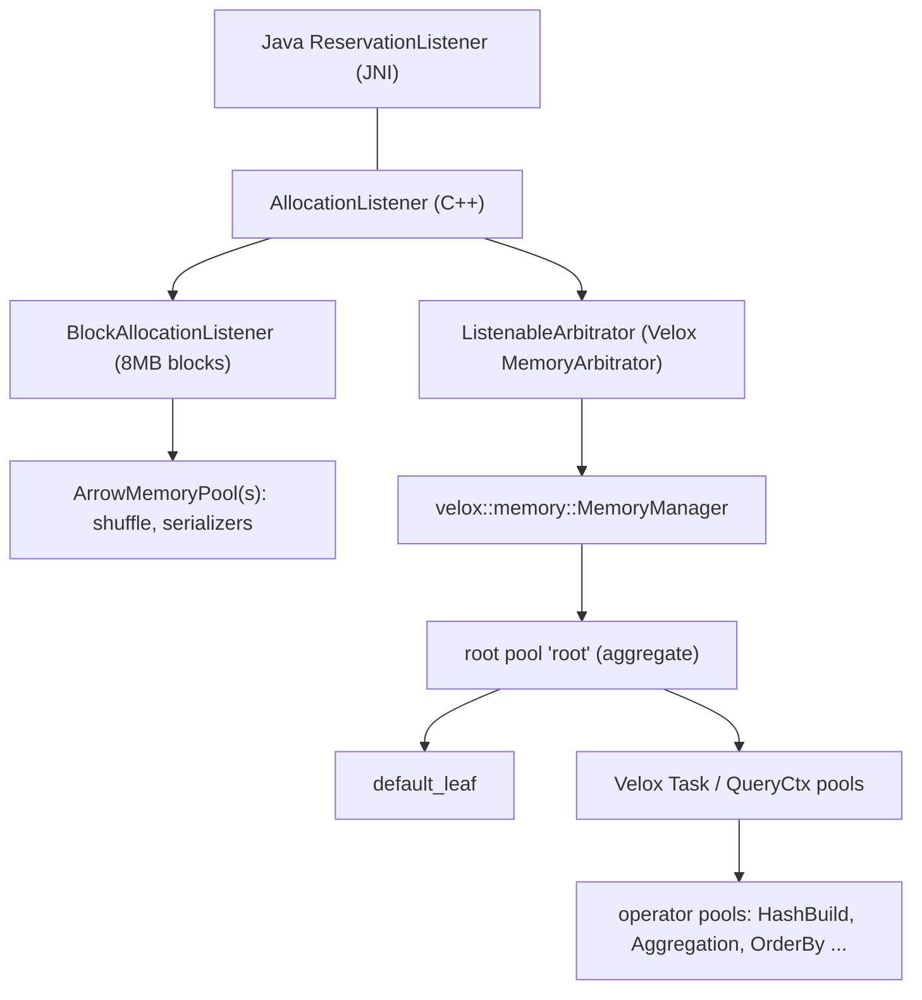

# 06 · Memory Management

> **Series:** Learning Apache Gluten (Velox backend) · **Code base:** Apache Gluten v1.7.0 · Previous: [05 · Batches & transitions](05-columnar-batches-conventions-transitions.md) · Next: [07 · Spill](07-spill.md)

---

## TL;DR

- Native memory is invisible to the JVM, so Gluten **reserves every native allocation from Spark's off-heap memory**. Spark then knows the real usage and won't overschedule.
- When Spark has no memory left, it asks Gluten to give some back: first unused reserved memory, then by spilling native operators to disk.
- Some native memory can't be tracked. It must fit in `spark.executor.memoryOverhead`; if the container gets killed, raise that first.

**Technical summary**

- Native (C++) memory is invisible to the JVM.
  - If Gluten didn't account for it, Spark would happily schedule more work than the machine can hold and executors would get OOM-killed.
  - So **every native allocation is reserved against Spark's off-heap execution memory** (`spark.memory.offHeap.size`) through Spark's `TaskMemoryManager`.
- On the JVM side, Gluten builds a **tree of memory targets** under one Spark `MemoryConsumer` (`TreeMemoryConsumer`) per task. Each native memory manager (one per `Runtime`) gets its own node with **spillers** attached.
- On the native side, each runtime has a **`VeloxMemoryManager`** whose Velox memory pools are governed by Gluten's **`ListenableArbitrator`**. When a pool needs to grow, the arbitrator calls an `AllocationListener` → JNI `ReservationListener.reserve(bytes)` → memory target tree → Spark.
- Reservations are made in **blocks** (`spark.gluten.memory.reservationBlockSize`, default 8MB) to avoid JNI calls on every small allocation.
- If Spark can't grant the memory: Spark asks consumers to spill (Gluten **shrinks** then **spills** native operators — see [07](07-spill.md)):
  - `RetryOnOomMemoryTarget` retries after spilling the whole task tree;
  - `ThrowOnOomMemoryTarget` GCs, retries with backoff, and finally throws `OutOfMemoryException: Not enough spark off-heap execution memory...` with a detailed memory dump.
- Process-global native allocations (e.g. broadcast build relations) go through **`GlobalOffHeapMemory`**, which borrows Spark **storage** memory.
- Some native memory is **not tracked** (third-party libs, allocator fragmentation, untracked buffers): it must fit in `spark.executor.memoryOverhead`, which Gluten defaults to `max(0.3 × off-heap, 384MB)` if you don't set it.
- Alternative modes: **dynamic off-heap sizing** (share the JVM heap budget; experimental), **memory isolation** (cap per-task native memory), **untracked** (testing only).

---

## 1. Why memory management matters

### The three budgets of an executor

| Budget | Enforced by | Consequence when exceeded |
|---|---|---|
| JVM heap (`spark.executor.memory`) | JVM | `java.lang.OutOfMemoryError` → executor exit |
| Spark memory pools (on-heap/off-heap execution & storage) | Spark `MemoryManager` (bookkeeping) | Consumers asked to spill; `SparkOutOfMemoryError`-style task failure |
| Container/process resident memory (RSS: heap + off-heap + overhead) | YARN/K8s/cgroup | Executor killed (exit 137 / "container killed by YARN for exceeding memory limits") |

Gluten's goal: make native memory **participate in the second budget** so Spark can arbitrate and trigger spills, and keep untracked usage small enough to fit in overhead so the third budget isn't blown.

### Why "off-heap"?

Velox allocates with its own allocator outside the JVM heap. Spark's **off-heap** execution pool is the natural budget for it. That's why `spark.memory.offHeap.enabled=true` with a size is required by default ([01](01-plugin-bootstrap-components-backends.md)).

---

## 2. Key concepts

| Concept | Side | Description | Code |
|---|---|---|---|
| `MemoryTarget` | JVM | `borrow(size)`, `repay(size)`, `usedBytes()` | [MemoryTarget.java](../../gluten-core/src/main/java/org/apache/gluten/memory/memtarget/MemoryTarget.java) |
| `TreeMemoryTarget` | JVM | Target with children, capacity, and a `Spiller` | [TreeMemoryTarget.java](../../gluten-core/src/main/java/org/apache/gluten/memory/memtarget/TreeMemoryTarget.java) |
| `TreeMemoryConsumer` | JVM | The Spark `MemoryConsumer` at the root of the tree; implements `spill()` by spilling the tree | [TreeMemoryConsumer.java](../../gluten-core/src/main/java/org/apache/gluten/memory/memtarget/spark/TreeMemoryConsumer.java) |
| `TreeMemoryConsumers.Factory` | JVM | Per-task factory; `legacyRoot()` (unlimited) or `isolatedRoot()` (capped) | [TreeMemoryConsumers.java](../../gluten-core/src/main/java/org/apache/gluten/memory/memtarget/spark/TreeMemoryConsumers.java) |
| `MemoryTargets` | JVM | Factory composing decorators | [MemoryTargets.java](../../gluten-core/src/main/java/org/apache/gluten/memory/memtarget/MemoryTargets.java) |
| `RetryOnOomMemoryTarget` | JVM | On short grant, spill the whole task tree and retry once | [RetryOnOomMemoryTarget.java](../../gluten-core/src/main/java/org/apache/gluten/memory/memtarget/RetryOnOomMemoryTarget.java) |
| `ThrowOnOomMemoryTarget` | JVM | GC + retry with backoff; then throw with a memory report | [ThrowOnOomMemoryTarget.java](../../gluten-core/src/main/java/org/apache/gluten/memory/memtarget/ThrowOnOomMemoryTarget.java) |
| `OverAcquire` | JVM | Probe-acquire extra `ratio × used` memory to make sure headroom exists | [OverAcquire.java](../../gluten-core/src/main/java/org/apache/gluten/memory/memtarget/OverAcquire.java) |
| `DynamicOffHeapSizingMemoryTarget` | JVM | Quota check against JVM heap when dynamic sizing is on | [DynamicOffHeapSizingMemoryTarget.java](../../gluten-core/src/main/java/org/apache/gluten/memory/memtarget/DynamicOffHeapSizingMemoryTarget.java) |
| `NativeMemoryManager` | JVM | Per-runtime handle to native memory manager; owns the reservation listener & spillers | [NativeMemoryManager.scala](../../gluten-arrow/src/main/scala/org/apache/gluten/memory/NativeMemoryManager.scala) |
| `ReservationListeners` / `ManagedReservationListener` | JVM | Bridge called from native to borrow/repay | [ReservationListeners.java](../../gluten-arrow/src/main/java/org/apache/gluten/memory/listener/ReservationListeners.java), [ManagedReservationListener.java](../../gluten-arrow/src/main/java/org/apache/gluten/memory/listener/ManagedReservationListener.java) |
| `GlobalOffHeapMemory` | JVM | Process-wide target using Spark storage memory | [GlobalOffHeapMemory.scala](../../gluten-core/src/main/scala/org/apache/spark/memory/GlobalOffHeapMemory.scala), [GlobalOffHeapMemoryTarget.scala](../../gluten-core/src/main/scala/org/apache/spark/memory/GlobalOffHeapMemoryTarget.scala) |
| `AllocationListener` / `BlockAllocationListener` | C++ | Listener interface; block-granular reservation | [AllocationListener.h](../../cpp/core/memory/AllocationListener.h) |
| `VeloxMemoryManager` | C++ | Velox `MemoryManager` + root/leaf pools + Arrow pools | [VeloxMemoryManager.cc](../../cpp/velox/memory/VeloxMemoryManager.cc) |
| `ListenableArbitrator` | C++ | Velox `MemoryArbitrator` that asks the listener for capacity | same file |
| `ArrowMemoryPool` | C++ | Arrow pool (used by shuffle, etc.) charging the same listener | [ArrowMemoryPool.cc](../../cpp/core/memory/ArrowMemoryPool.cc) |

---

## 3. Architecture

### 3.1 JVM memory-target tree for one task



Each `Runtime` → one `NativeMemoryManager` → one `ReservationListener` → one consumer node (plus an `.OverAcquire` sibling). The decorator chain around a node:

```text
ThrowOnOom( OverAcquire( [DynamicOffHeapSizing]( RetryOnOom( TreeNode ) ), [DynamicOffHeapSizing]( OverAcquireNode ), ratio ) )
```

(`RetryOnOom` is added by `MemoryTargets.newConsumer` only in legacy mode with more than one task slot; `DynamicOffHeapSizing` only if enabled.)

### 3.2 Native side for one runtime



- `VeloxMemoryManager` creates a Velox `MemoryManager` with `arbitratorKind` = a freshly registered `ListenableArbitrator` factory, a root aggregate pool `"root"` (capacity `kMaxMemory`, with a `MemoryReclaimer`) and a leaf `"default_leaf"`.
- The Velox task's `QueryCtx` uses `getAggregateMemoryPool()` as its pool, so all operator pools are children of `"root"`.
- Arrow pools (used by shuffle writers, serializers) charge the same listener through `BlockAllocationListener`.

---

## 4. Detailed walkthrough: one allocation end to end

Scenario: a Velox hash aggregation inserts rows and its pool needs 20MB more.

1. **Velox pool growth.** The operator's leaf pool can't reserve more from the root's capacity → Velox calls `ListenableArbitrator::growCapacity(pool, targetBytes)`.
2. **Arbitrator** ([source](../../cpp/velox/memory/VeloxMemoryManager.cc#L117-L185)):

   ```cpp
   void growCapacityInternal(velox::memory::MemoryPool* pool, uint64_t bytes) {
     if (pool->freeBytes() > bytes && growPool(pool, 0, bytes)) return;        // enough free capacity
     auto reclaimedFreeBytes = shrinkPool(pool, 0);                              // release unused capacity first
     auto neededBytes = velox::bits::roundUp(bytes - reclaimedFreeBytes, memoryPoolTransferCapacity_);
     try {
       listener_->allocationChanged(neededBytes);                                // ask Spark (may throw)
     } catch (const std::exception&) {
       listener_->allocationChanged(-reclaimedFreeBytes);
       std::rethrow_exception(std::current_exception());
     }
     VELOX_CHECK(growPool(pool, reclaimedFreeBytes + neededBytes, bytes), ...);
   }
   ```

   `memoryPoolTransferCapacity_` = reservation block size (8MB), so growth happens in 8MB multiples.
3. **JNI listener** → Java `ManagedReservationListener.reserve(size)` (synchronized on a task-shared lock to avoid ABBA deadlocks between listeners) → `target.borrow(size)`.
4. **Decorators**: `ThrowOnOom` → `OverAcquire` (borrow, then briefly borrow & return `0.3 × used` on the `.OverAcquire` node to verify headroom) → `RetryOnOom` → tree node.
5. **Tree node** borrows from its parent up to `TreeMemoryConsumer`, which calls Spark `acquireExecutionMemory(size, OFF_HEAP)`.
6. **Spark** grants from the off-heap execution pool. If not enough is free, it calls `spill()` on other consumers of the task (and possibly this one) → Gluten spills ([07](07-spill.md)).
7. **Outcome**:
   - Granted → returns up the stack; Velox pool grows; aggregation continues.
   - Short → `RetryOnOom` spills from the root of the task's tree (`spillTree(root, Long.MAX_VALUE)`) and retries.
   - Still short → `ThrowOnOom`: `System.gc()`, retries up to 9 times with exponential sleep (≤1s total), then throws `OutOfMemoryException` with a dump of all targets and the relevant configs.
     - The exception propagates through JNI into Velox, failing the operator, and back to Spark as a task failure.
8. **Release**: when pools shrink (operator finished, spilled, or task ends), `allocationChanged(-bytes)` → `repay` → Spark `releaseExecutionMemory`.

Typical failure message (abbreviated, illustrative):

```text
org.apache.gluten.memory.memtarget.ThrowOnOomMemoryTarget$OutOfMemoryException:
Not enough spark off-heap execution memory. Acquired: 8.0 MiB, granted: 0.0 B. Try tweaking config option
spark.memory.offHeap.size to get larger space to run this application ...
Current config settings:
  spark.gluten.memory.offHeap.size.in.bytes=...
  spark.gluten.memory.task.offHeap.size.in.bytes=...
  spark.gluten.memory.conservative.task.offHeap.size.in.bytes=...
  spark.memory.offHeap.enabled=true
Memory consumer stats:
  Task.123:  Current used bytes: 3.9 GiB, peak bytes: N/A
  \- Gluten.Tree.0: ...
     \- NativePlanEvaluator-0: ...
        \- single: ...
           \- root: ...
              \- task.Gluten_Stage_4_TID_123_VTID_0: ...
                 \- node.3 (HashAggregation): ...
```

This dump is the best place to see **which operator** held memory.

---

## 5. Modes and variants

### 5.1 Legacy (default) vs. isolated

| Mode | Root | Behavior | When to use |
|---|---|---|---|
| Legacy (`spark.gluten.memory.isolation=false`) | `Capacity[unlimited]` | A task can grab as much off-heap as Spark gives it (Spark's own per-task fairness `1/2N..1/N` applies). Adds `RetryOnOom` when task slots > 1. | Default |
| Isolated (`spark.gluten.memory.isolation=true`) | `Capacity[conservative per-task size]` | Caps each task's native memory at `off-heap × (1 − storageFraction) / slots` | Concurrent queries in one session; protects against non-spillable large allocations (config doc) |

### 5.2 Over-acquire

`spark.gluten.memory.overAcquiredMemoryRatio` (default `0.3`): after each successful borrow, Gluten tries to borrow an extra `0.3 × used` on a sibling node and immediately returns it. If that probe fails, Spark will have been asked to spill others **now**, while operators are still spillable — a workaround for two-phase operators where phase B can't spill (see `OverAcquire` comments).

### 5.3 Dynamic off-heap sizing (experimental)

`spark.gluten.memory.dynamic.offHeap.sizing.enabled=true`:
- Spark off-heap is disabled; Gluten derives a budget from executor memory × `...memory.fraction` (default 0.6).
- Consumers use `MemoryMode.ON_HEAP`, and `DynamicOffHeapSizingMemoryTarget` checks a total quota (JVM committed heap + tracked native) — may trigger GC to shrink the heap.
- See [docs/developers/VeloxDynamicSizingOffheap.md](../../docs/developers/VeloxDynamicSizingOffheap.md) (JDK 11+ heap free ratio flags).

### 5.4 Untracked

`spark.gluten.memory.untracked=true`: listeners become no-ops. Spark never sees native memory → no spills, no Spark OOMs, but high risk of container kills. Testing only.

### 5.5 Global (process-wide) memory

Some allocations outlive tasks, e.g. **broadcast hash table build relations** kept off-heap (`spark.gluten.velox.offHeapBroadcastBuildRelation.enabled`) or the native backend's global memory manager. `VeloxListenerApi` passes a listener tied to `GlobalOffHeapMemory.target`, which calls Spark `MemoryManager.acquireStorageMemory(...)` with a synthetic block id. Using **storage** memory means Spark can evict cached blocks to make room, and execution memory isn't permanently reduced.

---

## 6. End-to-end worked example: sizing an executor

Cluster: 16 cores, 64GB container, Velox backend.

```text
spark.executor.cores=8
spark.executor.memory=12g                 # JVM heap (Spark row ops, driver-side stuff, Arrow Java)
spark.memory.offHeap.enabled=true
spark.memory.offHeap.size=36g             # native execution + broadcast (storage) budget
spark.executor.memoryOverhead=10g         # untracked native + JVM overhead (>= 0.3 × off-heap recommended)
```

Derived by Gluten (driver log / Spark UI environment):

| Derived | Value |
|---|---|
| `spark.gluten.numTaskSlotsPerExecutor` | 8 |
| `spark.gluten.memory.task.offHeap.size.in.bytes` | 36g / 8 = 4.5g |
| `spark.gluten.memory.conservative.task.offHeap.size.in.bytes` | 36g × 0.5 / 8 = 2.25g |

Reasoning:
- Native operators do almost all heavy lifting → give most memory to off-heap.
- Overhead must absorb untracked allocations (allocator caches, IO buffers, libraries). If the container is killed while Spark shows no memory pressure, **increase overhead** first.
- If tasks fail with "Not enough spark off-heap execution memory", either increase off-heap, reduce concurrency (`executor.cores`), or make sure spilling is enabled for the operators involved.

**Try it / verify**

- Spark UI → Environment: the derived keys `spark.gluten.memory.task.offHeap.size.in.bytes` and `spark.gluten.memory.conservative.task.offHeap.size.in.bytes` should match the table above.
- If `spark.executor.memoryOverhead` isn't set, the driver log shows `Memory overhead is not set. Setting it to ... automatically`.
- In the SQL UI, compare `peak memory bytes` on the heaviest operators with the per-task budget (4.5g here). If the peak is close to the budget, expect spilling.

---

## 7. Observing memory

| Where | What you see |
|---|---|
| OOM exception text | Full target tree with current/peak bytes per node and operator pool |
| Spark UI SQL metrics | `peak memory bytes` / `number of memory allocations` per transformer (from Velox operator stats) |
| Spark UI executors tab | Off-heap storage/execution usage |
| Executor log (debug) | Memory usage stats from `collectMemoryUsageStats` when releasing managers |
| Profiling | [docs/developers/ProfileMemoryOfGlutenWithVelox.md](../../docs/developers/ProfileMemoryOfGlutenWithVelox.md) (jemalloc/heap profiling) |
| Leak check | `spark.gluten.sql.columnar.backend.velox.checkUsageLeak` (default `true`) checks pools at destruction; `TreeMemoryConsumers.Factory.release` warns `... still used N bytes when task is ending, this may cause memory leak` |

---

## 8. Configuration reference

| Key | Default | Effect / when to change |
|---|---|---|
| `spark.memory.offHeap.enabled`, `spark.memory.offHeap.size` | Spark defaults | Required native budget |
| `spark.executor.memoryOverhead` | auto `max(0.3 × off-heap, 384MB)` if unset | Raise on container kills |
| `spark.gluten.memory.reservationBlockSize` | `8MB` | Reservation granularity (fewer JNI calls vs. coarser accounting) |
| `spark.gluten.memory.overAcquiredMemoryRatio` | `0.3` | Headroom probe ratio; `0` disables |
| `spark.gluten.memory.isolation` | `false` | Cap per-task native memory |
| `spark.gluten.memory.dynamic.offHeap.sizing.enabled` | `false` (static) | Use heap-derived budget (experimental) |
| `spark.gluten.memory.dynamic.offHeap.sizing.memory.fraction` | `0.6` (static) | Fraction of executor memory for native |
| `spark.gluten.memory.untracked` | `false` (static) | Disable accounting (testing only) |
| `spark.gluten.sql.columnar.backend.velox.memInitCapacity` | `8MB` | Velox pool initial capacity (passed to arbitrator config) |
| `spark.gluten.sql.columnar.backend.velox.reclaimMaxWaitMs` | `3600000` (60 min) | Max wait for memory reclaim in arbitration |
| `spark.gluten.sql.columnar.backend.velox.memoryPoolCapacityTransferAcrossTasks` | `true` | Velox flag allowing capacity transfer |
| `spark.gluten.sql.columnar.backend.velox.memoryUseHugePages` | `false` | Use huge pages in Velox allocator |
| `spark.gluten.sql.columnar.backend.velox.checkUsageLeak` | `true` | Velox pool leak check |
| `spark.memory.storageFraction` | `0.5` | Affects conservative per-task size |

---

## 9. Pitfalls, debugging & FAQ

| Symptom | Likely cause | Action |
|---|---|---|
| `Not enough spark off-heap execution memory` | Budget too small or non-spillable operator (e.g. large hash build) | Increase off-heap; enable/verify operator spill configs; reduce cores; consider isolation |
| Container killed, no Spark OOM | Untracked native memory beyond overhead | Increase `memoryOverhead`; profile with jemalloc; check large IO buffers/caches |
| Frequent tiny spills | Off-heap too small relative to cores; block size too large | Increase off-heap or reduce cores |
| `... still used N bytes when task is ending` | A resource didn't release reservations | Usually a bug; report with plan |
| Driver OOM during planning of huge queries | JVM heap on driver | Not native memory; raise driver memory |

**FAQ**

- *Does Gluten use on-heap memory?* Yes, for JVM-side work (planning, Arrow Java batches, row operators). Native execution uses off-heap.
- *Why does Spark UI show off-heap storage used with no cache?* Global allocations (e.g. off-heap broadcast relations) borrow storage memory.
- *Is accounting exact?* No. Reservations are block-granular and some allocations are untracked; plan overhead accordingly.

---

## 10. Code map

| File | Role |
|---|---|
| [MemoryTargets.java](../../gluten-core/src/main/java/org/apache/gluten/memory/memtarget/MemoryTargets.java) | Target composition |
| [TreeMemoryConsumer.java](../../gluten-core/src/main/java/org/apache/gluten/memory/memtarget/spark/TreeMemoryConsumer.java) | Spark consumer + tree |
| [TreeMemoryConsumers.java](../../gluten-core/src/main/java/org/apache/gluten/memory/memtarget/spark/TreeMemoryConsumers.java) | Roots |
| [TreeMemoryTargets.java](../../gluten-core/src/main/java/org/apache/gluten/memory/memtarget/TreeMemoryTargets.java) | spillTree |
| [ThrowOnOomMemoryTarget.java](../../gluten-core/src/main/java/org/apache/gluten/memory/memtarget/ThrowOnOomMemoryTarget.java) | OOM handling |
| [RetryOnOomMemoryTarget.java](../../gluten-core/src/main/java/org/apache/gluten/memory/memtarget/RetryOnOomMemoryTarget.java) | Retry |
| [OverAcquire.java](../../gluten-core/src/main/java/org/apache/gluten/memory/memtarget/OverAcquire.java) | Headroom probe |
| [NativeMemoryManager.scala](../../gluten-arrow/src/main/scala/org/apache/gluten/memory/NativeMemoryManager.scala) | Native MM handle |
| [ReservationListeners.java](../../gluten-arrow/src/main/java/org/apache/gluten/memory/listener/ReservationListeners.java) | Listener creation |
| [GlobalOffHeapMemoryTarget.scala](../../gluten-core/src/main/scala/org/apache/spark/memory/GlobalOffHeapMemoryTarget.scala) | Global memory |
| [AllocationListener.h](../../cpp/core/memory/AllocationListener.h) | Block listener |
| [VeloxMemoryManager.cc](../../cpp/velox/memory/VeloxMemoryManager.cc) | Arbitrator & pools |
| [GlutenPlugin.scala](../../gluten-core/src/main/scala/org/apache/gluten/GlutenPlugin.scala) | Derived sizes |
| [VeloxListenerApi.scala](../../backends-velox/src/main/scala/org/apache/gluten/backendsapi/velox/VeloxListenerApi.scala) | Overhead defaults, global listener |

## 11. Related docs

- [07 · Spill](07-spill.md) — what happens when Spark asks for memory back
- [08 · Shuffle](08-shuffle.md) — shuffle writer memory behavior
- [13 · Troubleshooting](13-metrics-ui-config-troubleshooting.md)
- Repo: [VeloxDynamicSizingOffheap.md](../../docs/developers/VeloxDynamicSizingOffheap.md), [ProfileMemoryOfGlutenWithVelox.md](../../docs/developers/ProfileMemoryOfGlutenWithVelox.md)
