# 08 · Columnar Shuffle

> **Series:** Learning Apache Gluten (Velox backend) · **Code base:** Apache Gluten v1.7.0 · Previous: [07 · Spill](07-spill.md) · Next: [09 · Scan](09-scan-and-data-sources.md)

---

## TL;DR

- Gluten replaces Spark's shuffle with a **columnar, native shuffle**: batches are split by partition, compressed and written by C++, and read back as native batches.
- It still uses Spark's shuffle files, index files, AQE and the external shuffle service, so operations work the same as before.
- There are two main writers: **hash** (fast; memory grows with partitions × columns) and **sort** (memory grows with data size). Gluten switches to sort automatically at ≥ 4000 partitions.

**Technical summary**

- Gluten replaces Spark's `ShuffleExchangeExec` with **`ColumnarShuffleExchangeExec`** (`ColumnarExchange` in EXPLAIN). Data stays columnar end to end: native batches are partitioned, serialized, compressed and written by **native shuffle writers**, and read back into native batches by a **native reader**.
- It plugs into Spark's shuffle framework through **`ColumnarShuffleManager`** (`spark.shuffle.manager=org.apache.spark.shuffle.sort.ColumnarShuffleManager`) and a **`ColumnarShuffleDependency`**, so map outputs, index files, the external shuffle service, AQE and fetch-failure handling keep working.
- For hash partitioning the partition key is computed **natively** by a `ProjectExecTransformer` that prepends `hash_partition_key = murmur3(keys)`; the native `HashPartitioner` turns it into a partition id (`pmod`).
- Writer types:
  - **Hash** (`VeloxHashShuffleWriter`) — default; splits each batch into **per-partition, per-column buffers**, evicts them as compressed payloads. Very fast for moderate partition counts, but memory grows with *partitions × columns*.
  - **Sort** (`VeloxSortShuffleWriter`) — converts rows to compact row format in pages, sorts 64-bit row ids by partition (radix sort), writes partition runs.
    - Memory grows with *data size*, not partitions.
    - Chosen when `numPartitions ≥ spark.gluten.sql.columnar.shuffle.sort.partitions.threshold` (default **4000**) or `#columns ≥ ...sort.columns.threshold` (default **100000**, i.e. effectively off).
  - **RSS sort** (`VeloxRssSortShuffleWriter`, RSS = *remote shuffle service*) — buffers whole `RowVector`s and serializes per-partition row ranges with Velox's Presto serde; used with **Celeborn** (`useRssSort`, default `true`).
  - **GPU hash** (`VeloxGpuShuffleWriter`) — cuDF builds.
- `LocalPartitionWriter` manages caching/merging payloads, spilling to disk under memory pressure, and producing the final **data + index** files. `RssPartitionWriter` pushes to remote shuffle services.
- Before shuffle, `VeloxResizeBatches` coalesces small batches (hash writer). Codecs: `lz4` (default via Spark), `zstd`, optional QAT/IAA hardware codec backends.

---

## 1. Why a columnar shuffle

Vanilla Spark shuffle serializes rows (`UnsafeRow`) — a native pipeline would need C2R before every exchange and R2C after it. Columnar shuffle:

- avoids two full data conversions per exchange,
- compresses better (column-wise buffers),
- partitions with vectorized loops in C++,
- keeps memory accounting & spilling inside Gluten's framework ([06](06-memory-management.md), [07](07-spill.md)).

It reuses Spark's shuffle *infrastructure* (map status, block resolver, fetch) instead of re-implementing it, which keeps compatibility with ESS, AQE, speculation and retries.

---

## 2. Key concepts

| Concept | Side | Description | Code |
|---|---|---|---|
| `ColumnarShuffleExchangeExec` | JVM | Columnar exchange node; builds dependency, metrics, serializer | [ColumnarShuffleExchangeExec.scala](../../gluten-substrait/src/main/scala/org/apache/spark/sql/execution/ColumnarShuffleExchangeExec.scala) |
| `ColumnarShuffleDependency` | JVM | `ShuffleDependency` carrying native partitioning, writer type, metrics | [ColumnarShuffleDependency.scala](../../gluten-substrait/src/main/scala/org/apache/spark/shuffle/ColumnarShuffleDependency.scala) |
| `ColumnarShuffleManager` | JVM | Spark `ShuffleManager` that creates Gluten writers/readers for columnar deps | [ColumnarShuffleManager.scala](../../gluten-substrait/src/main/scala/org/apache/spark/shuffle/sort/ColumnarShuffleManager.scala) |
| `GlutenShuffleManager` | JVM | Registry-based manager delegating per dependency (columnar → `ColumnarShuffleManager`) | [GlutenShuffleManager.scala](../../gluten-core/src/main/scala/org/apache/spark/shuffle/GlutenShuffleManager.scala) |
| `ShuffleWriterType` | JVM | `HashShuffleWriterType`, `SortShuffleWriterType`, `RssSortShuffleWriterType`, `GpuHashShuffleWriterType` | [GlutenConfig.scala](../../gluten-substrait/src/main/scala/org/apache/gluten/config/GlutenConfig.scala#L32-L60) |
| `ColumnarShuffleWriter` | JVM | Spark `ShuffleWriter`; creates native writer, feeds batches, registers spiller, commits map output | [ColumnarShuffleWriter.scala](../../backends-velox/src/main/scala/org/apache/spark/shuffle/ColumnarShuffleWriter.scala) |
| `ColumnarBatchSerializer` | JVM | Spark `Serializer` used on the read side; wraps native reader | [ColumnarBatchSerializer.scala](../../backends-velox/src/main/scala/org/apache/gluten/vectorized/ColumnarBatchSerializer.scala) |
| `Partitioner` (C++) | native | `HashPartitioner`, `RoundRobinPartitioner`, `SinglePartitioner`, `FallbackRangePartitioner`, `RandomPartitioner` | `cpp/core/shuffle/*Partitioner*` |
| `VeloxHashShuffleWriter` | native | Split-to-buffers writer | [VeloxHashShuffleWriter.cc](../../cpp/velox/shuffle/VeloxHashShuffleWriter.cc) |
| `VeloxSortShuffleWriter` | native | Row-pages + radix sort writer | [VeloxSortShuffleWriter.cc](../../cpp/velox/shuffle/VeloxSortShuffleWriter.cc) |
| `VeloxRssSortShuffleWriter` | native | Buffered vectors + Presto serde writer (RSS) | [VeloxRssSortShuffleWriter.cc](../../cpp/velox/shuffle/VeloxRssSortShuffleWriter.cc) |
| `PartitionWriter` | native | Destination abstraction: `hashEvict`, `sortEvict`, `evict`, `stop`, `reclaimFixedSize` | [PartitionWriter.h](../../cpp/core/shuffle/PartitionWriter.h) |
| `LocalPartitionWriter` | native | Local files: payload cache/merge, spills, final data file | [LocalPartitionWriter.cc](../../cpp/core/shuffle/LocalPartitionWriter.cc) |
| `Payload` | native | `InMemoryPayload` (raw buffers), `BlockPayload` (serialized/compressed) | [Payload.cc](../../cpp/core/shuffle/Payload.cc) |
| `VeloxShuffleReader` + deserializers | native | Hash / Sort / RssSort deserializers → Velox batches | [VeloxShuffleReader.cc](../../cpp/velox/shuffle/VeloxShuffleReader.cc) |
| `Options.h` | native | Defaults for writer/reader options | [Options.h](../../cpp/core/shuffle/Options.h) |

---

## 3. Architecture

```mermaid
flowchart LR
  subgraph Map["Map task (executor)"]
    NS["Native stage output (Velox batches)"] --> PJ["ProjectExecTransformer: hash_partition_key = murmur3(keys)"]
    PJ --> RZ["VeloxResizeBatches (coalesce)"]
    RZ --> CSW["ColumnarShuffleWriter (JVM)"]
    CSW -->|"JNI write(batch handle)"| W["Native writer: Hash / Sort / RssSort"]
    W --> PW["LocalPartitionWriter: cache, merge, compress, spill"]
    PW --> F["data file + index (IndexShuffleBlockResolver)"]
  end
  subgraph Reduce["Reduce task"]
    FETCH["Spark ShuffleBlockFetcherIterator"] --> SER["ColumnarBatchSerializer.deserializeStream"]
    SER -->|"JNI"| RD["VeloxShuffleReader: decompress + deserialize + merge"]
    RD --> OUT["Velox batches -> InputIteratorTransformer of next native stage"]
  end
  F --> FETCH
```



---

## 4. Planning side

### 4.1 Offload and partition key projection

`OffloadExchange` → `VeloxSparkPlanExecApi.genColumnarShuffleExchange(shuffle)` ([source](../../backends-velox/src/main/scala/org/apache/gluten/backendsapi/velox/VeloxSparkPlanExecApi.scala#L395-L478)):

| Partitioning | What Gluten builds |
|---|---|
| `HashPartitioning(exprs, n)` | `ProjectExecTransformer(Alias(Murmur3Hash(exprs), "hash_partition_key") +: child.output)` under the exchange. If this project fails validation, the **exchange falls back**. |
| `RoundRobinPartitioning(n)` with `spark.sql.execution.sortBeforeRepartition` | hash all columns → local `SortExecTransformer` on the hash → drop it (deterministic round-robin like Spark) |
| `RangePartitioning` | Range bounds are computed on the JVM (Spark's sampling) and a pid column is prepended; native `FallbackRangePartitioner` reads it |
| `SinglePartition` | No pid; single partitioner |

Because the hash is computed in a native project, the partitioning logic matches Spark's `Murmur3Hash` semantics (Velox implements Spark's hash), so co-partitioning with vanilla Spark shuffles stays correct.

### 4.2 Choosing the writer type

`VeloxSparkPlanExecApi.getShuffleWriterType(partitioning, output)` ([source](../../backends-velox/src/main/scala/org/apache/gluten/backendsapi/velox/VeloxSparkPlanExecApi.scala#L601-L630)):

```scala
if (conf.isUseCelebornShuffleManager) {
  if (conf.celebornShuffleWriterType == "sort") {
    if (conf.useCelebornRssSort) RssSortShuffleWriterType
    else if (partitioning != SinglePartition) SortShuffleWriterType
    else HashShuffleWriterType
  } else HashShuffleWriterType
} else {
  if (partitioning != SinglePartition &&
      (partitioning.numPartitions >= columnarShuffleSortPartitionsThreshold ||   // default 4000
       output.size >= columnarShuffleSortColumnsThreshold))                     // default 100000
    SortShuffleWriterType
  else HashShuffleWriterType
}
```

In v1.7.0 the EXPLAIN node name is just `ColumnarExchange`; tell the writer apart by its metrics in the SQL UI (`time to split` → hash writer, `time to shuffle sort` → sort writer).

### 4.3 Read side in the plan

The next stage sees `ShuffleQueryStage → (optional VeloxResizeBatches) → InputIteratorTransformer`. With AQE, `AQEShuffleReadExec` (coalesced/skew partitions) works unchanged because Gluten reuses Spark's map statuses.

---

## 5. Map side in depth

### 5.1 `ColumnarShuffleWriter` (JVM)

For each input `ColumnarBatch`:
1. On first batch, create the native partition writer (local dirs from `SparkDirectoryUtil.namespace("shuffle-write")`, codec, buffer sizes) and the native shuffle writer for the dependency's writer type (hash: `nativeBufferSize`, `reallocThreshold`, `partitionBufferEvictThreshold`; sort: sort buffer sizes, radix sort...).
2. Register a **spiller** on the runtime's memory manager that calls `shuffleWriterJniWrapper.reclaim(writer, size)` in the SPILL phase ([07](07-spill.md)).
3. `shuffleWriterJniWrapper.write(writer, numRows, batchHandle, availableMemoryPerTask)` — the last argument (`memLimit`) lets the hash writer size buffers relative to available memory.
4. On `stop(success)`: native `stop` → partition lengths & metrics → commit via Spark's `IndexShuffleBlockResolver` (`writeMetadataFileAndCommit`) → `MapStatus`.

### 5.2 Hash writer (`VeloxHashShuffleWriter`)

**Data structures** (per writer):
- `partitionBuffers_[column][partition]` — Arrow buffers (validity, offsets/lengths, values) for each *simple* column and partition.
- Complex types (array/map/struct) are serialized per partition with Velox's Presto serde (`complexTypeFlushBuffer_`).
- `row2Partition_`, `partition2RowCount_`, `partition2RowOffsetBase_`, `partitionBufferBase_` — split bookkeeping.

**Per batch** (`write` → `partitioningAndDoSplit` → `doSplit`):

```text
1. compute pid per row (HashPartitioner: pmod(hash_partition_key, n)); count rows per partition
2. strip the pid column
3. calculatePartitionBufferSize(rv, memLimit):
      bytesPerRow = fixed-width bytes + avg binary bytes (running) + avg complex bytes
      memLimit   += cachedPayloadSize(); memLimit = max(memLimit, 128MB)
      preAllocRowCnt = min(memLimit / bytesPerRow / numPartitions >> 2, splitBufferSize)
4. preAllocPartitionBuffers: allocate/resize/evict buffers for partitions that receive rows
   (realloc when size differs by more than spark.gluten.sql.columnar.shuffle.realloc.threshold)
5. splitRowVector: column-by-column scatter into partition buffers
   (fixed-width, validity, booleans, binary/strings, complex)
6. if partitionBufferEvictThreshold > 0: evict partitions whose buffers exceed it
```

**Eviction**: when a partition's buffer is full (or at stop / under memory pressure), `evictPartitionBuffers` → `assembleBuffers` → `InMemoryPayload` → `partitionWriter->hashEvict(pid, payload, Evict::kCache|kSpill, reuseBuffers, ...)`.

**Memory reclaim** (`reclaimFixedSize`): (1) evict cached payloads to disk (`partitionWriter->reclaimFixedSize`), (2) shrink partition buffers, (3) evict partition buffers.

**Why it's fast**: no sorting, no row conversion, tight per-column loops, output already columnar.
**Why it can use lots of memory**: buffers exist per (partition × column). With `P` partitions, `C` columns and `R` rows per buffer, memory ≈ `P × C × R × width` plus allocator overhead — e.g. 3000 partitions × 50 columns × 4096 rows × 8 bytes ≈ 4.9GB worst case. The `memLimit` heuristic shrinks `R`, but very large `P` means tiny buffers, many small payloads and poor compression. That's why the sort writer exists.

### 5.3 Sort writer (`VeloxSortShuffleWriter`)

**Data structures**: pages of serialized **compact rows** (`velox::row::CompactRow`), and an array of 64-bit **compact row ids**:

```text
row id = [ partitionId : 24 bits | pageNumber : 13 bits | offsetInPage : 27 bits ]
```

**Per batch** (`insert`): compute pid (same partitioner), serialize rows into the current page (allocate new pages as needed), append row ids; `maybeSpill` triggers `evictAllPartitions` when the array would overflow `uint32` rows or pages exceed `kMaxPageNumber` (8191).

**Evict** (`evictAllPartitions`): sort row ids by partition id — **radix sort** on the partition-id bytes (`spark.shuffle.sort.useRadixSort`, default true; uses half of the array as scratch) or `std::sort` — then walk runs of equal pid and `evictPartition(pid, begin, end)`: copy row bytes into a disk-write buffer (`spark.shuffle.spill.diskWriteBufferSize`, default 1MB), compress, `partitionWriter->sortEvict(...)`.

**Trade-offs**: memory ≈ data size + 8 bytes/row, independent of partition count; extra CPU for row conversion + sort; the reader must convert rows back to columns (`VeloxSortShuffleReaderDeserializer`).

### 5.4 RSS sort writer (`VeloxRssSortShuffleWriter`)

Used with Celeborn when `spark.gluten.sql.columnar.shuffle.celeborn.useRssSort=true` (default):
- keeps input `RowVector`s, records `(batchIdx, rowIdx)` per partition,
- when buffered bytes exceed `sortBufferMaxSize` (64MB default) or on reclaim/stop, serializes each partition's rows directly from the vectors with `VectorStreamGroup::append(rowVector, IndexRanges)` (Presto serde, no row conversion) and pushes compressed blocks through `RssPartitionWriter`.
- Read side: `VeloxRssSortShuffleReaderDeserializer` (Presto deserialize).

### 5.5 `LocalPartitionWriter`

- **Hash path (`hashEvict`)**: payloads go to a `PayloadMerger` (small payloads for the same partition are merged up to `mergeBufferSize` while below `spark.gluten.sql.columnar.shuffle.merge.threshold` × buffer size), then into a `PayloadCache` (compressed in memory) — or straight to a spill file when `Evict::kSpill`.
- **Sort path (`sortEvict`)**: partitions arrive in ascending order per eviction round, so each round streams into a spill file; a lower pid than the last one starts a new spill.
- **Compression**: payloads with fewer rows than `spark.gluten.sql.columnar.shuffle.compression.threshold` (default 100) are written uncompressed (compression overhead isn't worth it).
- **`reclaimFixedSize`**: writes cached payloads to a spill file and frees memory.
- **`stop`**: opens the final data file and, partition by partition, concatenates spilled ranges + cached payloads + remaining buffers, recording partition lengths for the index file.

### 5.6 Optional encodings

- `spark.gluten.sql.columnar.shuffle.dictionary.enabled` (default `false`): dictionary-encode string columns in payloads (`ArrowShuffleDictionaryWriter`).
- `spark.gluten.sql.columnar.shuffle.typeAwareCompress.enabled` (default `false`): type-aware compression for numeric buffers (`VeloxTypeAwareCompress.h`).
- `spark.gluten.sql.columnar.shuffle.codecBackend`: hardware codec backends (QAT/IAA) when built with support (see [docs/get-started/VeloxQAT.md](../../docs/get-started/VeloxQAT.md)).

---

## 6. Reduce side

`ColumnarBatchSerializer.deserializeStream(in)` creates a native reader stream via `ShuffleReaderJniWrapper` with reader options: writer type, codec, `batchSize = spark.gluten.sql.columnar.maxBatchSize`, `readerBufferSize` (1MB), `deserializerBufferSize` (1MB, sort only).

| Deserializer | Input format | Output |
|---|---|---|
| `VeloxHashShuffleReaderDeserializer` | Block payloads of Arrow-style buffers (+ Presto-serialized complex columns) | Velox `RowVector`s; small payloads are **merged** (`merged_`) up to batch size before conversion |
| `VeloxSortShuffleReaderDeserializer` | Compact rows | Rows deserialized into Velox vectors (`CompactRow::deserialize`) in batches |
| `VeloxRssSortShuffleReaderDeserializer` | Presto serde blocks | Velox vectors |

Batches flow into the next native stage through `InputIteratorTransformer` (iterator connector). `spark.gluten.sql.columnar.backend.velox.hashShuffle.reader.streamMerge.enabled` (default `false`) enables a raw payload merge fast path within one stream.

---

## 7. End-to-end worked example

```sql
SELECT k, count(*) FROM t GROUP BY k   -- spark.sql.shuffle.partitions=200
```

Map task (illustrative):

```text
^ FlushableHashAggregateExecTransformer (partial)  -> batch [k, count]
^ ProjectExecTransformer [murmur3hash(k) AS hash_partition_key, k, count]
VeloxResizeBatches                                   -> coalesce tiny batches
ColumnarExchange hashpartitioning(k, 200)            -> writer type chosen at planning (hash here)
```

1. 200 partitions < 4000 → **hash writer**.
2. Per batch: pid = `pmod(hash_partition_key, 200)`; buffers for `k` (and validity) and `count` per partition; scatter.
3. Buffers fill → `InMemoryPayload` → merged & cached compressed in `LocalPartitionWriter`.
4. Memory pressure (e.g. partial agg grows) → Spark spill → shuffle spiller → cached payloads written to a spill file.
5. `stop` → final data file (200 contiguous partition ranges) + index → `MapStatus`.

Reduce task for partition 17:
1. Spark fetches block 17 from each map output.
2. `VeloxHashShuffleReaderDeserializer` decompresses payloads, merges small ones to ~4096 rows, builds `RowVector`s.
3. Final `RegularHashAggregateExecTransformer` consumes them.

SQL UI metrics on `ColumnarExchange` (names from `VeloxMetricsApi`): `shuffle bytes spilled`, `time to spill`, `time to compress`, `time to decompress`, `time to deserialize`, `shuffle wall time`, `peak bytes allocated`, `time to split` (hash) / `time to shuffle sort` (sort), `data size`, `number of partitions`, `dictionary size`.

Now with `spark.sql.shuffle.partitions=8000` the same query uses the **sort writer** (≥ 4000) and you'll see `time to shuffle sort` instead of `time to split`.

**Try it / verify**

```scala
spark.conf.set("spark.sql.shuffle.partitions", "200")
spark.range(0, 10000000).selectExpr("id % 1000 AS k").groupBy("k").count().collect()   // hash writer: "time to split"
spark.conf.set("spark.sql.shuffle.partitions", "8000")
spark.range(0, 10000000).selectExpr("id % 1000 AS k").groupBy("k").count().collect()   // sort writer: "time to shuffle sort"
```

In the SQL UI, open `ColumnarExchange`. The first run reports `time to split`, the second `time to shuffle sort`. That confirms the writer switch at 4000 partitions.

---

## 8. Configuration reference

| Key | Default | Effect |
|---|---|---|
| `spark.shuffle.manager` | — | `org.apache.spark.shuffle.sort.ColumnarShuffleManager` (or Celeborn/Uniffle Gluten managers) |
| `spark.gluten.sql.columnar.shuffle` | `true` | Enable columnar shuffle offload |
| `spark.gluten.sql.columnar.shuffle.sort.partitions.threshold` | `4000` | Use sort writer when partitions ≥ value |
| `spark.gluten.sql.columnar.shuffle.sort.columns.threshold` | `100000` | Use sort writer when columns ≥ value |
| `spark.gluten.sql.columnar.shuffle.celeborn.useRssSort` | `true` | Use RSS sort writer with Celeborn sort mode |
| `spark.gluten.sql.columnar.shuffle.codec` | unset (→ Spark `spark.io.compression.codec`) | Shuffle codec (lz4/zstd/...) |
| `spark.gluten.sql.columnar.shuffle.codecBackend` | unset | Hardware codec backend (QAT/IAA) |
| `spark.gluten.sql.columnar.shuffle.compression.threshold` | `100` | Min rows to compress a payload |
| `spark.gluten.sql.columnar.shuffle.merge.threshold` | `0.25` | Merge small payloads below this fraction of buffer size |
| `spark.gluten.sql.columnar.shuffle.realloc.threshold` | `0.25` | Hash writer buffer realloc threshold |
| `spark.gluten.sql.columnar.shuffle.partitionBufferEvictThreshold` | `-1` | Evict partition buffers larger than N bytes after each split (`-1` off) |
| `spark.gluten.shuffleWriter.bufferSize` | unset → `maxBatchSize` (4096) | Max rows per partition buffer (hash) |
| `spark.gluten.sql.columnar.shuffle.readerBufferSize` | `1MB` | Reader input buffer |
| `spark.gluten.sql.columnar.shuffle.sort.deserializerBufferSize` | `1MB` | Sort reader deserialization buffer |
| `spark.gluten.sql.columnar.shuffle.dictionary.enabled` | `false` | Dictionary encoding of strings |
| `spark.gluten.sql.columnar.shuffle.typeAwareCompress.enabled` | `false` | Type-aware compression |
| `spark.gluten.sql.columnar.backend.velox.resizeBatches.shuffleInput` / `.shuffleOutput` | `true` / `false` | Batch coalescing around shuffle |
| `spark.shuffle.sort.useRadixSort` | `true` | Radix sort in sort writer |
| `spark.shuffle.spill.diskWriteBufferSize` | `1MB` | Sort writer disk write buffer |
| `spark.shuffle.file.buffer` | `32k` | Output stream buffer |

---

## 9. Pitfalls, debugging & FAQ

| Symptom | Cause | Action |
|---|---|---|
| Exchange falls back to vanilla `Exchange` | Hash key projection failed validation (e.g. unsupported key type) | Check fallback reason; cast key types |
| Map tasks OOM / heavy spill with many partitions | Hash writer buffers ∝ partitions × columns | Lower `sort.partitions.threshold` to switch to sort writer; reduce partitions; enable AQE coalescing |
| Many tiny shuffle blocks, poor compression | Small batches or huge partition count | Keep `resizeBatches.shuffleInput=true`; review `bufferSize` |
| High `time to deserialize` with sort writer | Row→column on read | Expected trade-off; prefer hash writer when partitions are moderate |
| Mixed vanilla/columnar join partitioning mismatch | Should not happen (Spark-compatible murmur3) | If seen, report with plan |
| `ColumnarShuffleManager` not used | `spark.shuffle.manager` not set | Set it (or use `GlutenShuffleManager`) |

**FAQ**
- *Is the external shuffle service supported?* Yes: files and index use Spark's formats/resolver.
- *Can I mix vanilla and columnar shuffles in one app?* Yes; `ColumnarShuffleManager` delegates non-columnar dependencies to Spark's sort shuffle manager.
- *Celeborn/Uniffle?* Build with `-Pceleborn` / `-Puniffle` and use their Gluten shuffle managers (see [docs/get-started/Velox.md](../../docs/get-started/Velox.md#L270-L350)).

---

## 10. Code map

| File | Role |
|---|---|
| [VeloxSparkPlanExecApi.scala](../../backends-velox/src/main/scala/org/apache/gluten/backendsapi/velox/VeloxSparkPlanExecApi.scala) | Exchange offload, writer type, dependency, serializer |
| [ColumnarShuffleExchangeExec.scala](../../gluten-substrait/src/main/scala/org/apache/spark/sql/execution/ColumnarShuffleExchangeExec.scala) | Exchange node |
| [ColumnarShuffleManager.scala](../../gluten-substrait/src/main/scala/org/apache/spark/shuffle/sort/ColumnarShuffleManager.scala) | Shuffle manager |
| [ColumnarShuffleWriter.scala](../../backends-velox/src/main/scala/org/apache/spark/shuffle/ColumnarShuffleWriter.scala) | Writer glue |
| [ShuffleWriterJniWrapper.java](../../gluten-arrow/src/main/java/org/apache/gluten/vectorized/ShuffleWriterJniWrapper.java) | JNI |
| [ColumnarBatchSerializer.scala](../../backends-velox/src/main/scala/org/apache/gluten/vectorized/ColumnarBatchSerializer.scala) | Read side |
| [VeloxHashShuffleWriter.cc](../../cpp/velox/shuffle/VeloxHashShuffleWriter.cc) | Hash writer |
| [VeloxSortShuffleWriter.cc](../../cpp/velox/shuffle/VeloxSortShuffleWriter.cc), [RadixSort.h](../../cpp/velox/shuffle/RadixSort.h) | Sort writer |
| [VeloxRssSortShuffleWriter.cc](../../cpp/velox/shuffle/VeloxRssSortShuffleWriter.cc) | RSS sort writer |
| [LocalPartitionWriter.cc](../../cpp/core/shuffle/LocalPartitionWriter.cc) | Local output |
| [Payload.cc](../../cpp/core/shuffle/Payload.cc) | Payload format |
| [VeloxShuffleReader.cc](../../cpp/velox/shuffle/VeloxShuffleReader.cc) | Reader |
| [Options.h](../../cpp/core/shuffle/Options.h) | Defaults |
| `cpp/velox/tests/VeloxShuffleWriterTest.cc`, `cpp/velox/benchmarks/` | Tests & micro benchmarks |

## 11. Related docs

- [05 · Transitions](05-columnar-batches-conventions-transitions.md) (VeloxResizeBatches) · [06 · Memory](06-memory-management.md) · [07 · Spill](07-spill.md) · [12 · Operators](12-operators-join-agg-window-sort.md) (broadcast exchange)
- Repo: [docs/get-started/Velox.md](../../docs/get-started/Velox.md) (Celeborn/Uniffle), [docs/velox-configuration.md](../../docs/velox-configuration.md)
