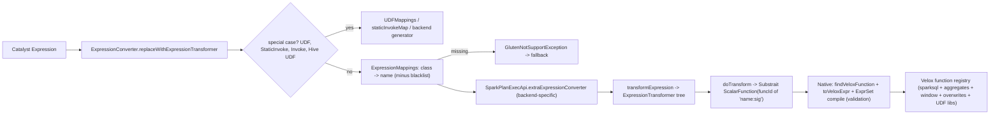

# 11 · Expressions, Functions & UDFs

> **Series:** Learning Apache Gluten (Velox backend) · **Code base:** Apache Gluten v1.7.0 · Previous: [10 · Native write](10-native-write.md) · Next: [12 · Operators](12-operators-join-agg-window-sort.md)

---

## TL;DR

- Every expression in a native operator (e.g. `upper(name)`) must map to a function that Velox implements **with Spark semantics**. If one doesn't, that operator falls back.
- Mapping is a name lookup plus a native check of the exact argument types, so a function can be supported for some types and not others.
- UDFs run natively only if you ship a native UDF library. Otherwise **partial project** evaluates just the UDF in the JVM and keeps the rest native.

**Technical summary**

- Every Catalyst expression inside an offloaded operator must be converted to an **`ExpressionTransformer`** that can emit a Substrait expression. This is done by **`ExpressionConverter.replaceWithExpressionTransformer`**.
- The core lookup is **`ExpressionMappings`**: a table `Sig[SparkExpressionClass](substraitName)` (e.g.
  - `Sig[Upper]("upper")`, `Sig[Substring]("substring")`) for scalar, aggregate and window functions, plus backend extras.
  - If an expression class isn't in the map → `GlutenNotSupportException("Not supported to map spark function name to substrait function name ...")` → the operator **falls back**.
- Functions are emitted with typed signature names (`substring:str_i32_i32`) and resolved natively by stripping the signature and (if needed) remapping the name to Velox's registry; Velox registers **Spark-semantics** functions (`velox/functions/sparksql`), Presto+Spark aggregates, window functions, and Gluten overwrites at startup.
- Native validation compiles expressions with Velox (`exec::ExprSet`), so a **missing signature/type combination** also causes fallback, even when the name exists.
- **ANSI mode**: with `spark.sql.ansi.enabled=true`, Gluten falls back everything by default (`spark.gluten.sql.ansiFallback.enabled=true`); the ANSI flag is otherwise passed to Velox's Spark query config.
- **UDFs**: Scala/Python/Hive UDFs run natively only if a **native Velox UDF library** registers an implementation under the same name (`spark.gluten.sql.columnar.backend.velox.udfLibraryPaths`); otherwise the projection uses **partial project** (JVM evaluates only the UDF) or falls back.
- To disable a function natively: `spark.gluten.expression.blacklist`.

---

## 1. Why expressions need special care

- Spark has hundreds of expressions with subtle semantics (null handling, overflow, timezones, collation, legacy flags). A native engine must match them **exactly** or results differ.
- Velox implements many Spark functions in its `sparksql` function library. Gluten's job is to: (1) know which Spark expression maps to which native function, (2) send correct types/arguments, (3) refuse anything uncertain so it falls back.

---

## 2. Key concepts

| Concept | Description | Code |
|---|---|---|
| `ExpressionTransformer` | Base trait: `doTransform(SubstraitContext): ExpressionNode`, children, original expression | [ExpressionTransformer.scala](../../gluten-substrait/src/main/scala/org/apache/gluten/expression/ExpressionTransformer.scala) |
| `GenericExpressionTransformer` | Default: scalar function call with converted children | same |
| `ExpressionConverter` | Catalyst → transformer conversion, special cases (UDFs, StaticInvoke, Invoke, casts, literals, attribute binding) | [ExpressionConverter.scala](../../gluten-substrait/src/main/scala/org/apache/gluten/expression/ExpressionConverter.scala) |
| `ExpressionMappings` | Class → Substrait name tables (`SCALAR_SIGS`, `AGGREGATE_SIGS`, `WINDOW_SIGS`), blacklist | [ExpressionMappings.scala](../../gluten-substrait/src/main/scala/org/apache/gluten/expression/ExpressionMappings.scala) |
| `ExpressionNames` | String constants for names | [ExpressionNames.scala](../../shims/common/src/main/scala/org/apache/gluten/expression/ExpressionNames.scala) |
| `SparkPlanExecApi` expression hooks | Backend overrides: `extraExpressionMappings`, `extraExpressionConverter`, `gen*Transformer` (e.g. casts, JSON, hash, regex, decimal arithmetic) | [VeloxSparkPlanExecApi.scala](../../backends-velox/src/main/scala/org/apache/gluten/backendsapi/velox/VeloxSparkPlanExecApi.scala) |
| `ValidatorApi.doExprValidate` | Backend veto per expression (Velox returns `true`; native validation decides) | [VeloxValidatorApi.scala](../../backends-velox/src/main/scala/org/apache/gluten/backendsapi/velox/VeloxValidatorApi.scala) |
| `registerAllFunctions` | Native function registration at backend init | [RegistrationAllFunctions.cc](../../cpp/velox/operators/functions/RegistrationAllFunctions.cc) |
| `SubstraitToVeloxExpr` / `SubstraitParser` | Native conversion & name mapping | [SubstraitToVeloxExpr.cc](../../cpp/velox/substrait/SubstraitToVeloxExpr.cc), [SubstraitParser.cc](../../cpp/velox/substrait/SubstraitParser.cc) |
| `UDFMappings`, `UDFResolver` | Map Spark UDF names to native UDFs; load UDF libraries | [UDFResolver.scala](../../backends-velox/src/main/scala/org/apache/spark/sql/expression/UDFResolver.scala), [UdfLoader.cc](../../cpp/velox/udf/UdfLoader.cc), [Udf.h](../../cpp/velox/udf/Udf.h) |
| Partial project | Evaluate only unsupported expressions in JVM | [docs/developers/PartialProject.md](../../docs/developers/PartialProject.md) |

---

## 3. Architecture



---

## 4. Detailed walkthrough

### 4.1 Conversion algorithm

```scala
private def replaceWithExpressionTransformer0(expr, attributeSeq, expressionsMap): ExpressionTransformer =
  tryTransformWithoutExpressionMapping(expr, attributeSeq, expressionsMap).getOrElse {   // UDFs, StaticInvoke, Invoke
    val substraitExprName = getAndCheckSubstraitName(expr, expressionsMap)                // class lookup (+ doExprValidate)
    BackendsApiManager.getSparkPlanExecApiInstance
      .extraExpressionConverter(substraitExprName, expr, attributeSeq)                    // backend override
      .getOrElse(transformExpression(expr, attributeSeq, expressionsMap, substraitExprName))  // big match on expression kinds
  }
```

`transformExpression` handles attribute binding (`BoundReference` by ordinal), literals, casts (with backend-specific cast transformers), `If`/`CaseWhen`, `In`/`InSet`, struct/array/map accessors, decimal arithmetic (with result-type rescaling, `rescaleDecimalArithmetic = true` for Velox), date/time functions with timezone, regex functions, JSON, hashes, etc., falling back to `GenericExpressionTransformer(name, children, expr)`.

Failure points (all lead to operator fallback with a message):

| Message | Meaning |
|---|---|
| `Not supported to map spark function name to substrait function name: <expr>, class name: X` | Class not in `ExpressionMappings` (or blacklisted) |
| `Not supported scala udf: ...` / `Not supported python udf: ...` | No native UDF registered under that name |
| `Not supported to transform StaticInvoke with object: ..., function: ...` | Unhandled `StaticInvoke` |
| Native validation messages (e.g. scalar function not registered / signature mismatch) | Velox compile failed |

### 4.2 `ExpressionMappings`

```scala
val SCALAR_SIGS: Seq[Sig] = Seq(
  Sig[Add](ADD), Sig[Subtract](SUBTRACT), Sig[Multiply](MULTIPLY), Sig[Divide](DIVIDE),
  Sig[And](AND), Sig[Or](OR), ...
  Sig[Upper](UPPER), Sig[Substring](SUBSTRING), ...
  Sig[MapContainsKey](MAP_CONTAINS_KEY)
) ++ SparkShimLoader.getSparkShims.runtimeReplaceableExpressionMappings
```

- `expressionsMap = (SCALAR_SIGS ++ AGGREGATE_SIGS ++ WINDOW_SIGS ++ backend.extraExpressionMappings) − blacklist`.
- `spark.gluten.expression.blacklist` (comma-separated **Substrait names**, e.g. `regexp_extract,from_json`) removes entries → those expressions fall back (or go through partial project).
- `listExpressionMappings()` powers [tools/scripts/gen-function-support-docs.py](../../tools/scripts/gen-function-support-docs.py), which generates [docs/velox-backend-scalar-function-support.md](../../docs/velox-backend-scalar-function-support.md) and the aggregate/window/generator pages.

### 4.3 Substrait emission

`GenericExpressionTransformer.doTransform` converts children, computes the typed name via `ConverterUtils.makeFuncName(name, childTypes)` (e.g. `substring:str_i32_i32`), registers it in the `SubstraitContext` and builds `ScalarFunction(funcId, args, outputType)`. See [03](03-substrait-and-native-plan-conversion.md).

### 4.4 Native resolution

- `SubstraitParser::findVeloxFunction` strips `:...` and maps names that differ between Substrait-ish names and Velox (e.g. `equal→equalto`, `lt→lessthan`, `is_not_null→isnotnull`, `strpos→instr`, `murmur3hash→hash_with_seed`, `modulus→remainder`, `negative→unaryminus`).
- `registerAllFunctions()` (at `VeloxBackend::init`):

```cpp
velox::functions::sparksql::registerFunctions("");                               // Spark-semantics scalar functions
velox::aggregate::prestosql::registerAllAggregateFunctions("", true, false, true);  // + companion functions
velox::functions::aggregate::sparksql::registerAggregateFunctions("", true, true);  // Spark aggs overwrite
velox::window::prestosql::registerAllWindowFunctions();
velox::functions::window::sparksql::registerWindowFunctions("");
registerFunctionOverwrite();                                                      // name mismatch fixes
velox::functions::iceberg::registerFunctions();
registerDeltaBitmapAggregator();
```

- Validation compiles expressions with `exec::ExprSet`; at runtime Velox evaluates them vectorized.

### 4.5 Aggregates and windows

- Aggregate functions map through `AGGREGATE_SIGS` (sum, count, avg, min/max, stddev/variance, collect_list/set, approx functions, first/last, bit ops, ...). Partial/final phases use **companion functions** (`*_partial`, `*_merge`, `*_extract`) registered by Velox; intermediate types are handled by `HashAggregateExecTransformer` ([12](12-operators-join-agg-window-sort.md)).
- Window functions map through `WINDOW_SIGS` (rank, dense_rank, row_number, ntile, lag/lead, nth_value, percent_rank, cume_dist...).

### 4.6 ANSI mode

- `FallbackOnANSIMode`: if `spark.sql.ansi.enabled=true` and `spark.gluten.sql.ansiFallback.enabled=true` (default) → every node tagged `does not support ansi mode`.
- If you set `ansiFallback.enabled=false`, the ANSI flag reaches Velox (`SparkQueryConfig::kAnsiEnabled`) and functions with ANSI-specific behavior use it where implemented. Treat as experimental; check [docs/velox-backend-limitations.md](../../docs/velox-backend-limitations.md).

### 4.7 UDFs

**Native Velox UDFs/UDAFs** ([VeloxUDF.md](../../docs/developers/VeloxUDF.md)):
1. Implement functions in C++ against Velox APIs; expose `getNumUdf()`, `getUdfEntries()`, `registerUdf()` via macros in `cpp/velox/udf/Udf.h` (`Udaf.h` for aggregates).
2. Build a shared library linked against `libvelox.so`.
3. Configure `spark.gluten.sql.columnar.backend.velox.udfLibraryPaths` (and `...driver.udfLibraryPaths` when driver paths differ, e.g. YARN client mode).
4. Register the Java/Hive UDF as usual (`CREATE TEMPORARY FUNCTION myudf AS 'org.apache.gluten.sql.hive.MyUDF'`). At startup `UDFResolver` loads the libraries' signatures; `UDFMappings` maps the Spark UDF name to the native name; `ExpressionConverter` emits it; `UdfLoader` registers it in Velox.
5. If types don't match a registered signature → fallback to the Java UDF.

**JVM UDFs without native implementation**: partial project (default on) evaluates only the UDF expressions in the JVM:

```text
expr: hash(udf(col0)), col1, col2
-> native project computes everything except udf(col0)
-> only col0 is converted to the JVM; udf(col0) computed as partialProject1_
-> result merged back into the native batch
```

**Python UDFs**: `ArrowEvalPythonExec` → `ColumnarArrowEvalPythonExec` exchanges Arrow batches with the Python worker without row conversion (`spark.gluten.sql.columnar.arrowUdf`).

---

## 5. End-to-end worked examples

### 5.1 Trace `upper(substr(name, 1, 3))`

```scala
spark.read.parquet("/tmp/people").select(upper(substring($"name", 1, 3)).as("p"))
```

1. **Catalyst**: `Alias(Upper(Substring(name#0, Literal(1), Literal(3))), "p")` inside `ProjectExec`.
2. **Offload**: `ProjectExecTransformer`; validation calls `ExpressionConverter.replaceWithExpressionTransformer(projectList, child.output)`.
3. **Mapping**: `Upper → "upper"`, `Substring → "substring"`; `name#0` → `BoundReference(0)`; literals → Substrait literals.
4. **Substrait**:
   - extensions: `0 → "substring:str_i32_i32"`, `1 → "upper:str"`
   - expression: `ScalarFunction(1, [ScalarFunction(0, [field(0), lit(1), lit(3)])])`
5. **Native**: names resolve to Velox Spark functions `substring` and `upper`; `ExprSet` compiles (validation OK); runtime evaluates vectorized over each batch.
6. **EXPLAIN** (illustrative): `^ ProjectExecTransformer [upper(substring(name#0, 1, 3)) AS p#5]`.

### 5.2 Add a new function mapping (walkthrough)

Goal: offload Spark expression `Foo` (class `org.apache.spark.sql.catalyst.expressions.Foo`, SQL `foo(str)`), assuming Velox's `sparksql` library has `foo(varchar) -> varchar`.

1. **Check Velox**: search Velox `functions/sparksql` for `foo`; if missing, implement it in Velox first (see [velox-function-development-guide.md](../../docs/developers/velox-function-development-guide.md)) and bump the Velox version used by Gluten.
2. **Name constant**: add `final val FOO = "foo"` to `ExpressionNames`.
3. **Mapping**: add `Sig[Foo](FOO)` to `SCALAR_SIGS` in `ExpressionMappings` (or to `VeloxSparkPlanExecApi.extraExpressionMappings` if Velox-only).
4. **Special handling (only if needed)**:
   - if arguments need reordering/casting or a different native name, add a case in `VeloxSparkPlanExecApi.extraExpressionConverter` / a custom transformer;
   - if Velox needs extra validation (e.g. unsupported pattern arguments), add a check in `SubstraitToVeloxPlanValidator::validateScalarFunction`;
   - if the native name differs and can't be overwritten, add to `substraitVeloxFunctionMap_`.
5. **Test** in `backends-velox`:

```scala
// backends-velox/src/test/scala/org/apache/gluten/functions/ScalarFunctionsValidateSuite.scala
test("foo") {
  runQueryAndCompare("SELECT foo(l_comment) FROM lineitem LIMIT 10") {
    checkGlutenPlan[ProjectExecTransformer]   // asserts the plan offloaded
  }
}
```

6. **Spark UTs**: enable relevant Spark function tests in `gluten-ut` (`VeloxTestSettings`).
7. **Docs**: regenerate function support docs with `tools/scripts/gen-function-support-docs.py`.

**Try it / verify**

- Example 5.1: `df.explain()` should show `^ ProjectExecTransformer` containing `upper(substring(...))`, and `df.fallbackSummary().numFallbackNodes == 0`.
- To see the failure path, add the function to `spark.gluten.expression.blacklist` and repeat. The project falls back with "Not supported to map spark function name ..." (walkthrough in [13 §6.1](13-metrics-ui-config-troubleshooting.md)).
- After adding a mapping (5.2), the new test with `checkGlutenPlan[ProjectExecTransformer]` is the proof.

---

## 6. Configuration reference

| Key | Default | Effect |
|---|---|---|
| `spark.gluten.expression.blacklist` | empty | Comma-separated Substrait names forced to fall back |
| `spark.gluten.sql.columnar.fallback.expressions.threshold` | `50` | Max expression depth to offload |
| `spark.gluten.sql.columnar.partial.project` | `true` | Partial project for unsupported expressions |
| `spark.gluten.sql.columnar.partial.generate` | see `GlutenConfig` | Partial generate |
| `spark.gluten.sql.ansiFallback.enabled` | `true` | Fall back all operators in ANSI mode |
| `spark.gluten.sql.columnar.arrowUdf` | see `GlutenConfig` | Columnar Arrow Python UDF |
| `spark.gluten.sql.columnar.backend.velox.udfLibraryPaths` | — | Native UDF libraries (executors) |
| `spark.gluten.sql.columnar.backend.velox.driver.udfLibraryPaths` | — | Native UDF libraries for driver |
| `spark.gluten.sql.columnar.backend.velox.maxCompiledRegexes` | see `VeloxConfig` | Regex compile cache per expression |
| `spark.gluten.sql.columnar.backend.velox.floatingPointMode` | see `VeloxConfig` | Floating-point semantics mode |

---

## 7. Pitfalls & FAQ

- **Same function name, different result?** Check [velox-backend-limitations.md](../../docs/velox-backend-limitations.md) (e.g. regex dialect differences, floating point, timezone edge cases). Blacklist the function as a workaround and file an issue.
- **Decimal precision mismatches** cause signature failures → fallback. Look for `dec<p,s>` signatures in native messages.
- **Regex**: Velox uses RE2; patterns with unsupported features (lookarounds, backreferences) are rejected in validation → fallback.
- **Map-typed expressions**: `alwaysFailOnMapExpression = true` for Velox in some contexts (e.g. hash on map types requires `spark.sql.legacy.allowHashOnMapType`).
- **Where's the list of supported functions?** `docs/velox-backend-scalar-function-support.md`, `...aggregate-function-support.md`, `...window-function-support.md`, `...generator-function-support.md`.

---

## 8. Code map

| File | Role |
|---|---|
| [ExpressionConverter.scala](../../gluten-substrait/src/main/scala/org/apache/gluten/expression/ExpressionConverter.scala) | Conversion |
| [ExpressionMappings.scala](../../gluten-substrait/src/main/scala/org/apache/gluten/expression/ExpressionMappings.scala) | Mapping tables |
| [ExpressionNames.scala](../../shims/common/src/main/scala/org/apache/gluten/expression/ExpressionNames.scala) | Names |
| [ExpressionTransformer.scala](../../gluten-substrait/src/main/scala/org/apache/gluten/expression/ExpressionTransformer.scala) | Base transformers |
| [backends-velox ExpressionTransformer.scala](../../backends-velox/src/main/scala/org/apache/gluten/expression/ExpressionTransformer.scala) | Velox-specific transformers |
| [VeloxSparkPlanExecApi.scala](../../backends-velox/src/main/scala/org/apache/gluten/backendsapi/velox/VeloxSparkPlanExecApi.scala) | Backend expression hooks |
| [RegistrationAllFunctions.cc](../../cpp/velox/operators/functions/RegistrationAllFunctions.cc) | Native registry |
| [SubstraitToVeloxPlanValidator.cc](../../cpp/velox/substrait/SubstraitToVeloxPlanValidator.cc) | Expression validation |
| [UDFResolver.scala](../../backends-velox/src/main/scala/org/apache/spark/sql/expression/UDFResolver.scala), [UdfLoader.cc](../../cpp/velox/udf/UdfLoader.cc) | UDFs |
| [ScalarFunctionsValidateSuite.scala](../../backends-velox/src/test/scala/org/apache/gluten/functions/ScalarFunctionsValidateSuite.scala) | Function tests |

## 9. Related docs

- [02 · Planning](02-planning-offload-validation-fallback.md) (partial fallback rules) · [03 · Substrait](03-substrait-and-native-plan-conversion.md) · [12 · Operators](12-operators-join-agg-window-sort.md) · [14 · Build & test](14-build-test-dev-workflow.md)
- Repo: [VeloxUDF.md](../../docs/developers/VeloxUDF.md), [velox-function-development-guide.md](../../docs/developers/velox-function-development-guide.md), [PartialProject.md](../../docs/developers/PartialProject.md)
