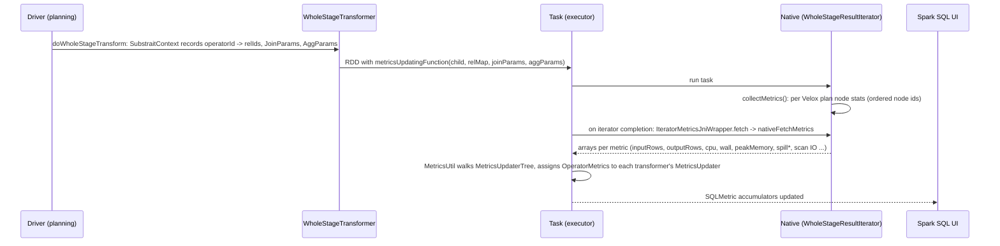
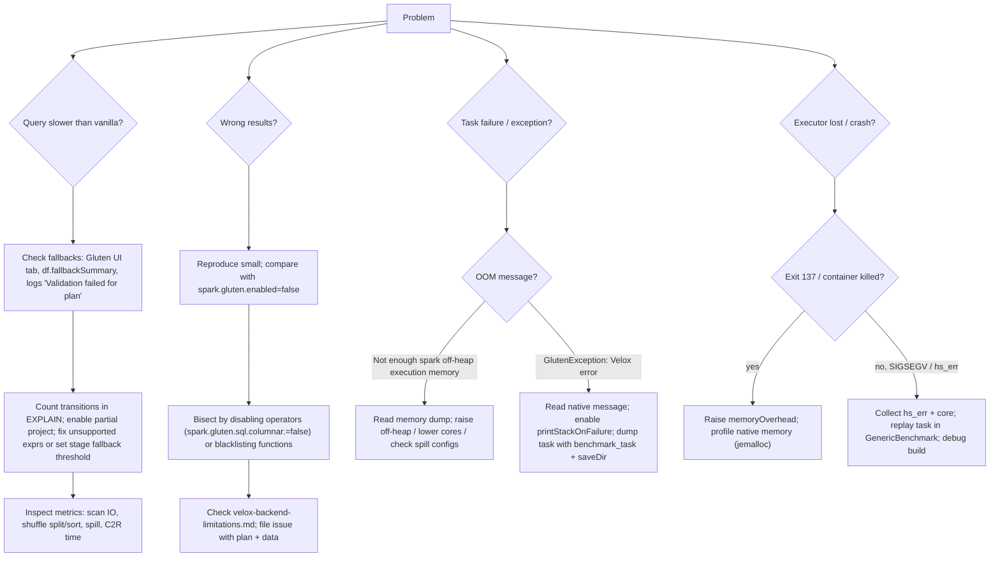

# 13 · Metrics, UI, Configuration & Troubleshooting

> **Series:** Learning Apache Gluten (Velox backend) · **Code base:** Apache Gluten v1.7.0 · Previous: [12 · Operators](12-operators-join-agg-window-sort.md) · Next: [14 · Build & test](14-build-test-dev-workflow.md)

---

## TL;DR

- Native operator stats (rows, time, memory, spill, IO) show up as **normal Spark SQL UI metrics** on the Gluten nodes.
- The **Gluten UI tab** lists, for each query, which operators fell back and why.
- Configs live in three Scala classes; only selected ones are forwarded to C++. `spark.gluten.sql.debug=true` prints what native code actually received.
- Troubleshooting: first classify the problem (slow / wrong result / OOM / crash), then follow the playbook in §5 and the worked cases in §6.

**Technical summary**

- **Metrics**: Velox collects per-operator stats for each task; when the native iterator finishes, Gluten fetches them through JNI and maps them onto the **`SQLMetric`s of the matching transformers** using the operator↔Rel id maps recorded during Substrait generation.
  - So the Spark SQL UI shows native time, rows, bytes, memory, spill and IO stats on Gluten nodes.
- **Gluten UI**: a "Gluten SQL / DataFrame" tab shows build info and per-query **fallback reasons** (from `GlutenBuildInfoEvent` / `GlutenPlanFallbackEvent`), also in the history server.
- **Configuration**: all keys are `ConfigEntry`s in `GlutenCoreConfig`, `GlutenConfig` (common), `VeloxConfig` (backend). Native code receives (a) **backend config** once at init and (b) **session config** per runtime (task) — only selected keys are forwarded.
- **Troubleshooting** in practice: classify the problem (fallback / wrong result / OOM / crash / slow), then pick the tool:
  - fallback → fallback summary & logs;
  - wrong plan or result → debug mode & native plan strings;
  - OOM → the memory dump in the error message;
  - native bugs → task dumps + `GenericBenchmark` + query trace;
  - crashes → core dumps.

---

## 1. Metrics

### 1.1 How native metrics reach the UI



- `MetricsUtil.genMetricsUpdatingFunction` ([source](../../backends-velox/src/main/scala/org/apache/gluten/metrics/MetricsUtil.scala#L30-L80)) builds a `MetricsUpdaterTree` mirroring the transformer tree (joins visit build + streamed sides; transformers with `MetricsUpdater.None` are skipped) and consumes native metrics in Rel-id order.
  - One Spark operator may correspond to several Velox nodes (e.g. join + pre/post projections); metrics are **merged** (`mergeMetrics`: input from the last, output from the first, times summed).
- Each transformer defines its metrics via `MetricsApi` (`VeloxMetricsApi.gen*Metrics`) and a `*MetricsUpdater` class in `backends-velox/.../metrics`.
- A "velox task stats" accumulator (`TaskStatsAccumulator`) aggregates Velox task-level stats.

### 1.2 Native metric types (from `nativeFetchMetrics`)

Every native operator reports the same set of counters. Not every operator fills in every group.

| Group | Metrics | Look here when… |
|---|---|---|
| Rows / data volume | `inputRows`, `inputVectors`, `inputBytes`, `rawInputRows`, `rawInputBytes`, `outputRows`, `outputVectors`, `outputBytes` | You want to check that filters and joins shrink the data as expected |
| Time | `cpuCount`, `wallNanos`, `loadLazyVectorTime`, `veloxToArrow` | Finding the slowest operator in a stage |
| Memory | `peakMemoryBytes`, `numMemoryAllocations` | Sizing off-heap memory; spotting memory-hungry operators |
| Spill | `spilledInputBytes`, `spilledBytes`, `spilledRows`, `spilledPartitions`, `spilledFiles` | A stage is slow and disks are busy (see [07](07-spill.md)) |
| Aggregation | `flushRowCount`, `abandonedPartialAggregationRows` | Checking whether partial aggregation helps (see [12](12-operators-join-agg-window-sort.md)) |
| Dynamic / bloom filters | `numDynamicFiltersProduced`, `numDynamicFiltersAccepted`, `numReplacedWithDynamicFilterRows`, `bloomFilterBlocksByteSize` | Checking whether join filters reach the probe-side scan |
| Scan & IO | `scanTime`, `skippedSplits`, `processedSplits`, `skippedStrides`, `processedStrides`, `remainingFilterTime`, `ioWaitTime`, `storageReadBytes`, `storageReads`, `localReadBytes`, `ramReadBytes`, `preloadSplits`, `pageLoadTime`, `dataSourceAddSplitWallNanos`, `dataSourceReadWallNanos`, `loadedToValueHook` | Scans are slow: IO-bound (`ioWaitTime`) or filter-bound (`remainingFilterTime`)? Is pruning working (`skipped*`)? |
| Write | `physicalWrittenBytes`, `writeIOTime`, `numWrittenFiles` | Native write cost and file counts (see [10](10-native-write.md)) |

### 1.3 Reading metrics in the UI (what to look for)

| Node | Key metrics | Interpretation |
|---|---|---|
| `WholeStageCodegenTransformer` | pipeline time | Wall time of the native stage iterator |
| Scan transformer | time of scan, io wait time, storage read bytes, number of skipped row groups / splits | IO-bound? Filters effective? |
| Aggregate | peak memory bytes, bytes written for spilling, number of flushed rows, number of rows after partial aggregation abandonment | Memory pressure, partial agg effectiveness |
| Join | build/probe times, peak memory, spill, dynamic filter stats | Build-side size, skew |
| `ColumnarExchange` | time to split / shuffle sort, compress, spill, shuffle bytes spilled, peak bytes | Shuffle cost & memory |
| `VeloxColumnarToRow` | time to convert | Transition cost |

Extra: `spark.gluten.sql.columnar.backend.velox.showTaskMetricsWhenFinished=true` logs full Velox task stats per task; `spark.gluten.sql.columnar.backend.velox.taskMetricsToEventLog.threshold` (seconds) writes stats of slow tasks to the event log.

---

## 2. Gluten UI

- Tab **"Gluten SQL / DataFrame"** ([docs/get-started/GlutenUI.md](../../docs/get-started/GlutenUI.md)):
  1. **Build info** — Gluten/Velox revisions, Java/Scala/Spark/GCC versions, backend (from `GlutenBuildInfoEvent`, posted by `SubstraitBackend.onDriverStart`).
  2. **Fallback info per execution** — number of Gluten vs fallback nodes and reasons (from `GlutenPlanFallbackEvent`, posted by `GlutenFallbackReporter`; with AQE, per stage).
- Implementation: [GlutenSQLAppStatusListener.scala](../../gluten-ui/src/main/scala/org/apache/spark/sql/execution/ui/GlutenSQLAppStatusListener.scala), [GlutenSQLTab.scala](../../gluten-ui/src/main/scala/org/apache/spark/sql/execution/ui/GlutenSQLTab.scala), [GlutenAllExecutionsPage.scala](../../gluten-ui/src/main/scala/org/apache/spark/sql/execution/ui/GlutenAllExecutionsPage.scala).
- History server: put the gluten-ui jar on the history server classpath (`GlutenSQLHistoryServerPlugin`).
- Disable: `spark.gluten.ui.enabled=false`.
- You can register your own `SparkListener` for these events (e.g. to export fallback stats to a metrics system).

---

## 3. Configuration system

### 3.1 Where configs are defined

| Class | Scope | Examples |
|---|---|---|
| [GlutenCoreConfig.scala](../../gluten-core/src/main/scala/org/apache/gluten/config/GlutenCoreConfig.scala) | Core/memory | `spark.gluten.enabled`, `spark.gluten.memory.*` |
| [GlutenConfig.scala](../../gluten-substrait/src/main/scala/org/apache/gluten/config/GlutenConfig.scala) | Common planning/runtime | `spark.gluten.sql.columnar.*`, `spark.gluten.sql.debug`, shuffle, fallback |
| [VeloxConfig.scala](../../backends-velox/src/main/scala/org/apache/gluten/config/VeloxConfig.scala) | Velox backend | `spark.gluten.sql.columnar.backend.velox.*`, `spark.gluten.velox.*` |
| [cpp/core/config/GlutenConfig.h](../../cpp/core/config/GlutenConfig.h), [cpp/velox/config/VeloxConfig.h](../../cpp/velox/config/VeloxConfig.h) | Native key constants & native defaults | `kSpillStrategy`, `kMemoryReservationBlockSize`, ... |

Configs are built with `buildConf` (dynamic, session-settable) or `buildStaticConf` (must be set at startup). Some are `.internal()` (not shown in generated docs). Reference docs: [Configuration.md](../../docs/Configuration.md), [velox-configuration.md](../../docs/velox-configuration.md), [velox-spark-configuration.md](../../docs/velox-spark-configuration.md).

### 3.2 How configs reach native code

| Path | When | What is forwarded | Code |
|---|---|---|---|
| **Backend config** | Once per JVM at `NativeBackendInitializer.initialize` | `GlutenConfig.getNativeBackendConf`: backend-prefixed keys (`spark.gluten.sql.columnar.backend.velox.*`), Hadoop/S3/GCS/ABFS settings, task slots, shuffle codec, selected Spark SQL keys | [NativeBackendInitializer.java](../../gluten-arrow/src/main/java/org/apache/gluten/init/NativeBackendInitializer.java) |
| **Session config** | Per `Runtime` (task) | `GlutenConfig.getNativeSessionConf`: a fixed set of `nativeKeys` (debug, save dir, task off-heap size, ...) + defaults for case sensitivity, ignore missing files, timezone, ANSI, map key dedup, legacy time parser + byte-size Spark configs (spill buffers, shuffle file buffer) + **all dynamic `spark.gluten.sql.columnar.backend.velox.*`** + all `spark.gluten.velox.*` + UGI tokens | [GlutenConfig.scala](../../gluten-substrait/src/main/scala/org/apache/gluten/config/GlutenConfig.scala#L535-L612) |

Native code turns session config into Velox `QueryConfig` and Hive connector session config in `WholeStageResultIterator::getQueryContextConf` / `createNewVeloxQueryCtx`.

> [!TIP]
> To verify what native code actually received, enable `spark.gluten.sql.debug=true`: `VeloxBackend` logs its config at init and `VeloxRuntime` logs the session config when creating result iterators.

### 3.3 Most important configs (with v1.7.0 defaults)

| Area | Key | Default |
|---|---|---|
| Enable | `spark.plugins` | must contain `org.apache.gluten.GlutenPlugin` |
| Enable | `spark.gluten.enabled` | `true` |
| Memory | `spark.memory.offHeap.enabled` / `.size` | required |
| Memory | `spark.executor.memoryOverhead` | auto `max(0.3 × off-heap, 384MB)` |
| Memory | `spark.gluten.memory.reservationBlockSize` | `8MB` |
| Memory | `spark.gluten.memory.overAcquiredMemoryRatio` | `0.3` |
| Memory | `spark.gluten.memory.isolation` | `false` |
| Shuffle | `spark.shuffle.manager` | `org.apache.spark.shuffle.sort.ColumnarShuffleManager` |
| Shuffle | `spark.gluten.sql.columnar.shuffle.sort.partitions.threshold` | `4000` |
| Batch | `spark.gluten.sql.columnar.maxBatchSize` | `4096` |
| Join | `spark.gluten.sql.columnar.forceShuffledHashJoin` | `true` |
| Fallback | `spark.gluten.sql.columnar.wholeStage.fallback.threshold` / `query.fallback.threshold` | `-1` / `-1` |
| Fallback | `spark.gluten.sql.ansiFallback.enabled` | `true` |
| Fallback | `spark.gluten.sql.columnar.partial.project` | `true` |
| Fallback | `spark.gluten.expression.blacklist` | empty |
| Spill | `spark.gluten.sql.columnar.backend.velox.spillStrategy` | `auto` |
| Scan | `spark.gluten.sql.columnar.backend.velox.cacheEnabled` | `false` |
| Write | `spark.gluten.sql.native.writer.enabled` | unset (on for Spark 3.4+) |
| Cache | `spark.gluten.sql.columnar.tableCache` | `true` |
| Debug | `spark.gluten.sql.debug` | `false` |
| Debug | `spark.gluten.sql.injectNativePlanStringToExplain` | `false` |
| Debug | `spark.gluten.sql.validation.logLevel` | `WARN` |
| Logging | `spark.gluten.sql.columnar.backend.velox.glogVerboseLevel` / `glogSeverityLevel` | `0` / `1` |
| UI | `spark.gluten.ui.enabled` | `true` |

---

## 4. Logging

- **JVM**: standard Spark log4j; useful loggers: `org.apache.gluten` (planning, memory, fallback reporter), `org.apache.spark.sql.execution.GlutenFallbackReporter`.
- **Native**: glog to stderr (`FLAGS_logtostderr = true`) — appears in executor stderr logs.
  - `glogSeverityLevel` (default `1` = WARNING minimum), `glogVerboseLevel` (`-v`, default `0`).
  - `spark.gluten.sql.debug=true` sets maximum verbosity (unless `glogVerboseLevel` is set), prints configs and Velox plans.
- Useful native log lines: `Spill[...]` (spill), `Shrink[...]` (VLOG 2), `ListenableArbitrator growCapacityInternal failed` (VLOG 2), Velox task termination lines with task id `Gluten_Stage_<s>_TID_<t>_VTID_<n>`.

---

## 5. Troubleshooting playbook



### 5.1 Fallback investigation

```scala
import org.apache.spark.sql.execution.GlutenImplicits._
val s = df.fallbackSummary()
s.numGlutenNodes; s.numFallbackNodes; s.fallbackNodeToReason.foreach(println)
```

- For CI: `spark.gluten.sql.columnar.failOnFallback=true` throws on any fallback.
- For more detail: `spark.gluten.sql.validation.printStackOnFailure=true`, lower `spark.gluten.sql.validation.logLevel`.

### 5.2 Plan inspection

- `spark.gluten.sql.injectNativePlanStringToExplain=true` + `df.explain("formatted")` → Velox plan per stage.
- Substrait JSON: `WholeStageTransformer.substraitPlanJson` ([03](03-substrait-and-native-plan-conversion.md#7-debugging-the-plan-contract)).

### 5.3 Reproducing a native problem offline

1. Dump a task: `spark.gluten.sql.benchmark_task.stageId=<s>` (+ `.partitionId` or `.taskId`) and `spark.gluten.saveDir=/tmp/saveDir` → files like `conf_<s>_<p>.ini`, `plan_<s>_<p>.json`, `split_<s>_<p>_<i>.json`, `data_<s>_<p>_<i>.parquet`.
2. Replay with the C++ `GenericBenchmark` ([MicroBenchmarks.md](../../docs/developers/MicroBenchmarks.md)) — debug under gdb, profile with perf.
3. For operator-level replay use Velox **query trace** ([QueryTrace.md](../../docs/developers/QueryTrace.md); `...velox.queryTraceEnabled`, `queryTraceDir`, `queryTraceNodeIds`, `queryTraceTaskRegExp`).

### 5.4 Memory issues

- Spark-level OOM: the exception includes current config and the **full memory target tree** with per-operator pools ([06](06-memory-management.md#4-detailed-walkthrough-one-allocation-end-to-end)).
- Container kills: increase overhead; profile native heap ([ProfileMemoryOfGlutenWithVelox.md](../../docs/developers/ProfileMemoryOfGlutenWithVelox.md)).

### 5.5 Known environment issues ([velox-backend-troubleshooting.md](../../docs/velox-backend-troubleshooting.md))

| Symptom | Fix |
|---|---|
| Fatal error after a native exception (validation crashes the JVM) | `libunwind-dev` installed (seen on Ubuntu 20.04) → purge it and rebuild |
| Jar conflicts (protobuf, flatbuffers, arrow) | Remove conflicting jars from `$SPARK_HOME/jars` or ensure Gluten jar loads first |
| Incompatible class error with native writer | Put the Gluten jar first on the classpath (see doc for YARN client/cluster/local configs) |
| `free(): invalid pointer` at startup | Rebuild with `--compile_arrow_java=ON` |

---

## 6. End-to-end worked examples

### 6.1 Case A — "Why is this query not fully native?"

This case reproduces a check in `GlutenFallbackSuite` (the test that blacklists `add` and expects "Not supported to map spark function name") ([GlutenFallbackSuite.scala](../../gluten-ut/spark34/src/test/scala/org/apache/spark/sql/gluten/GlutenFallbackSuite.scala)). We force a fallback by blacklisting the `add` function:

```scala
spark.conf.set("spark.gluten.expression.blacklist", "add")
val df = spark.sql("SELECT sum(id + 1) FROM range(10)")
df.collect()

import org.apache.spark.sql.execution.GlutenImplicits._
val s = df.fallbackSummary()
println(s"native=${s.numGlutenNodes} fallback=${s.numFallbackNodes}")
s.fallbackNodeToReason.foreach(_.foreach { case (node, reason) => println(s"$node -> $reason") })
```

Output (illustrative; node ids vary, but the reason text comes from `ExpressionConverter`):

```text
native=4 fallback=1
002 Project -> ... Not supported to map spark function name to substrait function name: (id#0L + 1), class name: Add.
```

How to read and act on it:
1. **Find the node.** Keys look like `<operator id> <node name>` (see `GlutenExplainUtils.addFallbackNodeWithReason`). Look up `(2)` in `df.explain("formatted")`.
2. **Read the reason.** "Not supported to map spark function name" means an **expression** isn't mapped or failed native validation ([11](11-expressions-functions-udf.md)). Other common reasons are listed in [02](02-planning-offload-validation-fallback.md) §5.
3. **Count the cost.** In EXPLAIN, `Project` now sits between `RowToVeloxColumnar` and `VeloxColumnarToRow`: two extra conversions for one operator.
4. **Fix it**, from cheapest to most work:
   - remove the blacklist entry;
   - rewrite the expression;
   - for UDFs, rely on **partial project** (`spark.gluten.sql.columnar.partial.project=true`, default);
   - add the function natively ([11](11-expressions-functions-udf.md) §5.2);
   - if many small fallbacks make a stage slower than vanilla Spark, set `spark.gluten.sql.columnar.wholeStage.fallback.threshold`.
5. **Verify**: `numFallbackNodes` drops to 0 and the Gluten UI tab shows no fallback for this query.

> [!TIP]
> In CI, set `spark.gluten.sql.columnar.failOnFallback=true` so that a new fallback fails the test instead of quietly slowing it down.

### 6.2 Case B — Task fails with "Not enough spark off-heap execution memory"

The message is built in [ThrowOnOomMemoryTarget.java](../../gluten-core/src/main/java/org/apache/gluten/memory/memtarget/ThrowOnOomMemoryTarget.java). Its structure, annotated. Values and node names are illustrative: tree names come from `Runtime` names such as `NativePlanEvaluator-<n>` and `ShuffleWriter`, and Velox operator pools are named `op.<planNodeId>.<pipeline>.<driver>.<Operator>`.

```text
Not enough spark off-heap execution memory. Acquired: 64.0 MiB, granted: 8.0 MiB. Try tweaking config option
spark.memory.offHeap.size ...                                  <- (1) how much was asked vs. granted
Current config settings:
	spark.memory.offHeap.enabled=true                          <- (2) the memory configs in effect
	spark.gluten.memory.dynamic.offHeap.sizing.enabled=N/A
	spark.gluten.memory.offHeap.size.in.bytes=4.0 GiB
	spark.gluten.memory.task.offHeap.size.in.bytes=1024.0 MiB
	spark.gluten.memory.conservative.task.offHeap.size.in.bytes=512.0 MiB
Memory consumer stats:                                          <- (3) the memory-target tree for this task
	Task.57:                                  Current used bytes: 1016.0 MiB, peak bytes: N/A
	\- Gluten.Tree.0:                         Current used bytes: 1016.0 MiB, peak bytes: 1016.0 MiB
	   +- NativePlanEvaluator-0.0:            Current used bytes:  960.0 MiB, peak bytes:  960.0 MiB   <- native stage runtime
	   |  \- ... op.1.0.0.HashBuild:          Current used bytes:  900.0 MiB, ...   <- the operator holding the memory
	   \- ShuffleWriter.0:                    Current used bytes:   56.0 MiB, ...
```

How to act:
1. **(1)** A small request that failed means the task was already at its limit. Look at (3) rather than the request size.
2. **(2)** Per-task budget = off-heap size ÷ task slots. Here it's 4 GiB ÷ 4 = 1 GiB.
3. **(3)** Find the biggest leaf. In this example the hash build side uses 900 MiB.
   - Check that the operator can spill (`...velox.joinSpillEnabled`, `aggregationSpillEnabled`, … default true).
   - Check the spill metrics on that node in the UI. If they are 0, spill was disabled or couldn't free memory, e.g. one huge key.
4. **Fix**, in order:
   - more off-heap memory, or fewer cores per executor (a bigger per-task budget);
   - fix skew;
   - for joins, prefer broadcast for small sides or set `forceShuffledHashJoin=false` (SMJ needs less memory);
   - see [06](06-memory-management.md) §6 for sizing and [07](07-spill.md) for spill tuning.
5. If instead the **container** is killed (exit 137) with no Spark OOM, the memory was untracked. Raise `spark.executor.memoryOverhead` (decision tree in §5).

---

## 7. Pitfalls & FAQ

- **The fallback summary says "Gluten does not touch it or does not support it".** No reason was recorded, often because AQE re-created the node. Check the driver log for `Validation failed for plan` lines.
- **UI metrics are 0 on a native node.** That operator was fused into another native operator, or the stage was cancelled before metrics were fetched. Metrics are fetched once, when the iterator finishes.
- **Config set with `spark.conf.set` but native code ignores it.** Static and backend configs (`buildStaticConf`, backend init keys) only apply at startup. Session configs reach native code per task, and only for forwarded keys (§3.2).
- **Debug mode is noisy and slow.** Use `spark.gluten.sql.debug=true` only to reproduce a problem, never in production.

---

## 8. Code map

| File | Role |
|---|---|
| [MetricsUtil.scala](../../backends-velox/src/main/scala/org/apache/gluten/metrics/MetricsUtil.scala) | Native → SQL metric mapping |
| [VeloxMetricsApi.scala](../../backends-velox/src/main/scala/org/apache/gluten/backendsapi/velox/VeloxMetricsApi.scala) | Metric definitions per operator |
| `backends-velox/src/main/scala/org/apache/gluten/metrics/*MetricsUpdater.scala` | Per-operator updaters |
| [JniWrapper.cc](../../cpp/core/jni/JniWrapper.cc) | `nativeFetchMetrics` |
| [WholeStageResultIterator.cc](../../cpp/velox/compute/WholeStageResultIterator.cc) | `collectMetrics`, query config |
| [GlutenFallbackReporter.scala](../../gluten-substrait/src/main/scala/org/apache/spark/sql/execution/GlutenFallbackReporter.scala) | Fallback logs/events |
| `gluten-ui/src/main/scala/org/apache/spark/sql/execution/ui/*` | UI |
| [GlutenConfig.scala](../../gluten-substrait/src/main/scala/org/apache/gluten/config/GlutenConfig.scala), [VeloxConfig.scala](../../backends-velox/src/main/scala/org/apache/gluten/config/VeloxConfig.scala) | Config definitions & propagation |

## 9. Related docs

- [02 · Planning](02-planning-offload-validation-fallback.md) · [03 · Substrait](03-substrait-and-native-plan-conversion.md) · [04 · Runtime](04-native-execution-runtime-jni.md) · [06 · Memory](06-memory-management.md) · [14 · Build & test](14-build-test-dev-workflow.md)
